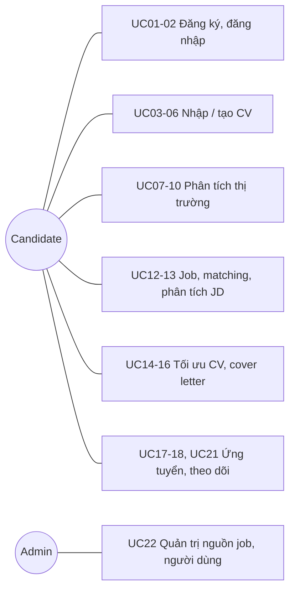

# AI CV Auto Apply Jobs (ACAJ)

ACAJ giúp người tìm việc đi hết một vòng khép kín: **hiểu CV của mình → hiểu thị trường → chọn đúng việc → tối ưu hồ sơ cho từng JD → ứng tuyển và theo dõi phản hồi**, với AI hỗ trợ ở mỗi bước và người dùng luôn là người quyết định cuối cùng.

**Vấn đề:** Khi đang thất nghiệp, hoặc không biết mình đang đứng ở đâu trong thị trường, nhiều người chọn cách rải thật nhiều CV. Họ gửi cùng một bản CV cho mọi nơi và không bên nào phản hồi. Điều khó nhất là **họ không biết phải sửa CV thế nào để khớp với đúng công việc mình ứng tuyển**: JD cần kỹ năng gì, từ khóa nào, nên nhấn mạnh dự án nào, CV đã qua vòng lọc ATS chưa. Họ cũng không rõ mình thiếu gì và mức lương kỳ vọng có thực tế không.

**ACAJ giúp bằng cách:**
- **Cho biết bạn đang ở đâu:** phân tích CV so với thị trường để biết nhu cầu tuyển dụng, độ cạnh tranh, mức lương thực tế, kỹ năng còn thiếu và lộ trình phát triển.
- **Tự động sửa CV để khớp từng công việc:** hệ thống tự phân tích JD, tự phát hiện CV đang thiếu gì và **tự sửa**, tạo CV và cover letter riêng cho từng job (kỹ năng, từ khóa, summary, dự án liên quan, chuẩn ATS) mà người dùng không phải chỉnh tay. Mỗi job có điểm khớp và khả năng trúng tuyển.
- **Tự động hóa toàn bộ quy trình, người dùng vẫn kiểm soát:** từ tìm job, sửa CV, ứng tuyển hàng loạt, nhắc nhà tuyển dụng khi chưa phản hồi đến báo ngay khi có thư mời phỏng vấn đều chạy tự động theo điều kiện người dùng đặt; mọi thay đổi được lưu lại để xem và hoàn tác.

Câu chuyện đầy đủ: [Scope](docs/01-scope.md).

## 1. Requirements — INVEST, Use Cases, and Acceptance Criteria

Requirements xác định ACAJ phải làm gì, ai dùng, giá trị mang lại và điều kiện thành công quan sát được. Các user story được kiểm tra theo INVEST và ánh xạ sang use case.

### 1.1 Product mind map


Mindmap có 6 nhánh, tương ứng 6 feature:

| Nhánh | Feature | Nội dung chính |
|---|---|---|
| Đăng nhập / Đăng ký | F01 | Tài khoản, hồ sơ cá nhân |
| Tạo / Nhập & Phân tích CV | F02 | PDF/DOCX, ảnh, template thủ công hoặc AI tạo |
| Phân tích so với thị trường | F03 | Nhu cầu tuyển dụng, lương, skill gaps, lộ trình theo năm |
| Tìm kiếm cơ hội và khớp việc làm | F04 | Thu thập JD, phân tích JD, matching score |
| Tối ưu CV theo Jobs | F05 | Khớp JD, chuẩn ATS, viết lại nội dung, cover letter |
| Tự động ứng tuyển | F06 | Nộp thủ công/hàng loạt, mail nhắc, mail trúng tuyển |

### 1.2 INVEST requirements

Backlog gồm 22 user story, bao phủ tài khoản, nhập/tạo CV, phân tích thị trường, tìm và khớp job, tối ưu CV, ứng tuyển, theo dõi và quản trị. Mỗi story được kiểm tra theo INVEST trước khi sẵn sàng phát triển.

| Criterion | Meaning in ACAJ |
|---|---|
| Independent | Mỗi story cho một kết quả rõ ràng, chỉ phụ thuộc story khác khi bắt buộc. |
| Negotiable | Giao diện và kỹ thuật có thể đổi miễn mục tiêu và quyền truy cập giữ nguyên. |
| Valuable | Mỗi story mang lại giá trị cho ứng viên hoặc vận hành. |
| Estimable | Vai trò, đầu vào, đầu ra, phụ thuộc và lỗi chính đã ghi rõ. |
| Small | Mỗi story một khả năng chính, tách được thành API, xử lý nền, lưu trữ, UI, test. |
| Testable | Mỗi story có tiêu chí nghiệm thu quan sát được. |

```
US01–US02   Tài khoản và phiên đăng nhập
US03–US06   Nhập và tạo CV
US07–US10   Phân tích thị trường, lương, skill gaps, lộ trình
US11–US13   Thu thập JD, danh sách job và matching, phân tích JD
US14–US16   Tối ưu CV, viết lại nội dung, cover letter
US17–US21   Ứng tuyển, mail nhắc, mail trúng tuyển, theo dõi hồ sơ
US22        Quản trị
```

Chi tiết: [INVEST Requirements](docs/05-invest-requirements.md).

### 1.3 Use cases



Ba tác nhân hệ thống không vẽ trong hình: bộ xử lý nền (UC11 thu thập JD, UC19 mail nhắc, UC20 xử lý mail trúng tuyển), dịch vụ LLM và nhà cung cấp email. Chi tiết: [Actors, roles, and use cases](docs/03-use-cases.md).

### 1.4 Roles and permissions

| Capability | Candidate | Admin |
|---|---|---|
| Đăng ký, đăng nhập, hồ sơ cá nhân | Yes | Yes |
| Upload, tạo, sửa CV của mình | Yes | No |
| Xem phân tích thị trường cho CV của mình | Yes | No |
| Xem job và matching score | Yes | Job only |
| Tối ưu CV, cover letter | Yes | No |
| Ứng tuyển thủ công / hàng loạt | Yes | No |
| Xác nhận gửi thư trả lời trúng tuyển | Yes | No |
| Quản lý nguồn job, người dùng, cấu hình | No | Yes |

Backend phải kiểm tra quyền và chủ sở hữu dữ liệu; ẩn nút ở frontend chỉ phục vụ UX. Admin không đọc được nội dung CV.

### 1.5 Acceptance criteria, business rules, and non-functional requirements

Mỗi use case có tiêu chí nghiệm thu quan sát được (AC-UC01 đến AC-UC22), viết để chuyển thành test API và UI. Business rules (BR-001 đến BR-016) cố định các quyết định mà code phải theo; NFR đặt mục tiêu đo được.

| Area | Key rules and targets |
|---|---|
| Nội dung CV | AI chỉ thêm kỹ năng khi người dùng có kỹ năng liên quan theo phả hệ kỹ năng (kèm nhãn "suy ra", xem lại và hoàn tác được); không bịa công ty, bằng cấp, chứng chỉ; CV gốc không bị ghi đè, mỗi job một phiên bản |
| Matching | Điểm 0–100 theo kỹ thuật/kỹ năng 50, kinh nghiệm 30, địa điểm 20; High ≥ 75, Medium ≥ 50; luôn kèm lý do |
| Ứng tuyển | Không nộp trùng; mặc định điểm ≥ 70, tối đa 20 hồ sơ/ngày, có danh sách công ty loại trừ; không vượt CAPTCHA |
| Mail | Nhắc sau 5 ngày, tối đa 1 lần; thư trả lời trúng tuyển chỉ gửi sau khi người dùng xác nhận |
| Security & privacy | Token 30 phút; 5 lần sai/15 phút → 429; admin không đọc CV; xóa tài khoản xóa dữ liệu trong 30 ngày |
| Performance | API đọc P95 ≤ 500 ms; danh sách job kèm matching ≤ 2 s; trích xuất CV ≤ 30 s; 50 người dùng đồng thời |

Chi tiết: [Acceptance Criteria](docs/08-acceptance-criteria.md), [Business Rules](docs/requirements/business-rules.md), [Non-Functional Requirements](docs/requirements/non-functional-requirements.md).

## Documentation

- **Requirements:** [Scope](docs/01-scope.md), [Features](docs/02-features.md), [INVEST backlog](docs/05-invest-requirements.md), [Acceptance criteria](docs/08-acceptance-criteria.md).
- **Requirements catalogs:** [Business rules](docs/requirements/business-rules.md), [Non-functional requirements](docs/requirements/non-functional-requirements.md).
- **Actors and use cases:** [Actors, roles, and use cases](docs/03-use-cases.md).

Các phần sau (Information Architecture, C4, Database/OpenAPI, cấu trúc thư mục, class/sequence) sẽ được bổ sung ở các phần tiếp theo.

## Project Progress

- [x] Define scope, goals, and user roles
- [x] Write the feature list and use cases
- [x] Write user stories following INVEST
- [x] Write acceptance criteria and business rules
- [x] Write non-functional requirements
- [ ] Design the information architecture and screen permissions
- [ ] Design the C4 System Context, Container, and Component views
- [ ] Design the database schema and API (OpenAPI 3.0)
- [ ] Design the frontend and backend folder structure
- [ ] Design class diagrams and sequence diagrams
- [ ] Build the UI prototype, backend, and connect them
