# AI CV Auto Apply Jobs (ACAJ)

> **Chỉ cần nạp CV một lần.** ACAJ tự đọc CV, tự phân tích thị trường, tự tìm job, tự tối ưu CV cho từng job, tự nộp hồ sơ và tự theo dõi phản hồi, theo đúng điều kiện bạn đặt. Bạn chỉ quay lại khi có thư mời phỏng vấn.

**Vấn đề:** Khi đang thất nghiệp, hoặc không biết mình đang đứng ở đâu trong thị trường, nhiều người rải cùng một bản CV cho mọi nơi và không bên nào phản hồi. Điều khó nhất là **họ không biết phải sửa CV thế nào để khớp với đúng công việc mình ứng tuyển**, và việc sửa tay cho từng job, nộp từng nơi, nhắc từng nhà tuyển dụng tốn quá nhiều thời gian.

**Ví dụ thực tế:** Bạn nạp CV Junior Backend lúc 8 giờ sáng. Đến 8 giờ 20, hệ thống đã đọc CV, tìm được 38 job phù hợp, tối ưu riêng 12 bản CV và nộp 10 hồ sơ; 2 job có CAPTCHA chờ bạn nộp tay. Năm ngày sau, các nhà tuyển dụng chưa trả lời được nhắc tự động. Khi Công ty ABC gửi thư mời phỏng vấn, bạn nhận thông báo kèm thư trả lời soạn sẵn và chỉ cần xác nhận.

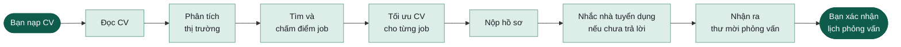

Bạn chỉ làm hai việc (ô xanh đậm); mọi bước ở giữa chạy tự động theo điều kiện bạn đặt, mặc định không cần chỉnh. Hệ thống chỉ dừng lại hỏi bạn ở 3 chỗ, xem [1.5](#15-acceptance-criteria-business-rules-and-non-functional-requirements). Giao diện thực tế ở [2.3](#23-current-ui-prototype).

## 1. Requirements — INVEST, Use Cases, and Acceptance Criteria

Requirements xác định ACAJ phải làm gì, ai dùng, giá trị mang lại và điều kiện thành công quan sát được. Các user story được kiểm tra theo INVEST và ánh xạ sang use case.

### 1.1 Product mind map


Mindmap có 6 nhánh, tương ứng F01–F06. F07 được bổ sung để đo và cải thiện chất lượng AI.

| Nhánh | Feature | Nội dung chính | AI dùng ở đâu |
|---|---|---|---|
| Đăng nhập / Đăng ký | F01 | Tài khoản, hồ sơ cá nhân | — |
| Tạo / Nhập & Phân tích CV | F02 | PDF/DOCX, ảnh, template thủ công hoặc AI tạo | OCR, LLM trích xuất CV thành fact |
| Phân tích so với thị trường | F03 | Nhu cầu tuyển dụng, lương, skill gaps, lộ trình theo năm | Con số do thống kê; LLM viết giải thích |
| Tìm kiếm cơ hội và khớp việc làm | F04 | Thu thập JD, phân tích JD, matching score | LLM phân tích JD có trích dẫn, embedding; điểm do luật |
| Tối ưu CV theo Jobs | F05 | Khớp JD, chuẩn ATS, viết lại nội dung, cover letter | LLM viết lại có grounding và nhãn nguồn gốc |
| Tự động ứng tuyển | F06 | Nộp thủ công/hàng loạt, mail nhắc, mail trúng tuyển | LLM phân loại email, soạn thư; quyết định nộp do luật |
| (bổ sung) | F07 | Phản hồi người dùng, eval, chỉ số chất lượng và chi phí AI | Eval, vòng học |

Nguyên tắc: **AI đọc hiểu và viết, luật tính điểm và quyết định.** LLM lỗi thì các phần do luật tính vẫn chạy. Chi tiết: [AI trong ACAJ](docs/01-scope.md#ai-trong-acaj).

### 1.2 Use cases

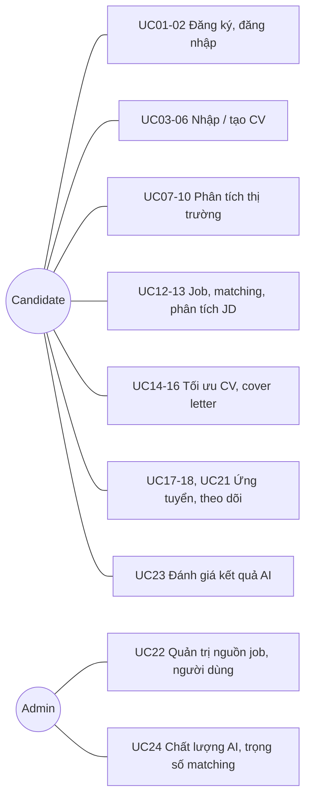

Các tác nhân hệ thống không vẽ trong hình: bộ xử lý nền (UC11 thu thập JD, UC19 mail nhắc, UC20 xử lý mail trúng tuyển), AI package (OCR, trích xuất, kiểm chứng, phân loại, eval; không tự ghi database, không tự quyết định nộp hay gửi), LLM provider (chỉ nhận văn bản đã che thông tin nhạy cảm) và nhà cung cấp email. Chi tiết: [Actors, roles, and use cases](docs/03-use-cases.md).

### 1.3 INVEST requirements

Backlog gồm 24 user story, bao phủ tài khoản, nhập/tạo CV, phân tích thị trường, tìm và khớp job, tối ưu CV, ứng tuyển, theo dõi, quản trị, và phản hồi/chất lượng AI. Mỗi story được kiểm tra theo INVEST trước khi sẵn sàng phát triển.

| Criterion | Meaning in ACAJ |
|---|---|
| Independent | Mỗi story cho một kết quả rõ ràng, chỉ phụ thuộc story khác khi bắt buộc. |
| Negotiable | Giao diện, model và prompt có thể đổi miễn mục tiêu, quyền truy cập và luật kiểm chứng giữ nguyên. |
| Valuable | Mỗi story mang lại giá trị cho ứng viên hoặc vận hành. |
| Estimable | Vai trò, đầu vào, đầu ra, phụ thuộc và lỗi chính (kể cả LLM lỗi, độ tin cậy thấp) đã ghi rõ. |
| Small | Mỗi story một khả năng chính, tách được thành API, xử lý nền, AI package, lưu trữ, UI, test. |
| Testable | Mỗi story có tiêu chí nghiệm thu quan sát được; phần AI còn có chỉ số eval. |

```
US01–US02   Tài khoản và phiên đăng nhập
US03–US06   Nhập và tạo CV
US07–US10   Phân tích thị trường, lương, skill gaps, lộ trình
US11–US13   Thu thập JD, danh sách job và matching, phân tích JD
US14–US16   Tối ưu CV, viết lại nội dung, cover letter
US17–US21   Ứng tuyển, mail nhắc, mail trúng tuyển, theo dõi hồ sơ
US22        Quản trị
US23–US24   Phản hồi kết quả AI, chỉ số chất lượng và trọng số matching
```

Chi tiết: [INVEST Requirements](docs/05-invest-requirements.md).

### 1.4 Roles and permissions

| Capability | Candidate | Admin |
|---|---|---|
| Đăng ký, đăng nhập, hồ sơ cá nhân | Yes | Yes |
| Upload, tạo, sửa CV của mình | Yes | No |
| Xem phân tích thị trường cho CV của mình | Yes | No |
| Xem job và matching score | Yes | Job only |
| Tối ưu CV, cover letter | Yes | No |
| Ứng tuyển thủ công / hàng loạt | Yes | No |
| Xác nhận gửi thư trả lời trúng tuyển | Yes | No |
| Đánh giá kết quả AI | Yes | No |
| Quản lý nguồn job, người dùng, cấu hình | No | Yes |
| Xem chỉ số chất lượng, chi phí AI; chỉnh trọng số matching | No | Yes |

Backend phải kiểm tra quyền và chủ sở hữu dữ liệu; ẩn nút ở frontend chỉ phục vụ UX. Admin không đọc được nội dung CV.

### 1.5 Acceptance criteria, business rules, and non-functional requirements

Mỗi use case có tiêu chí nghiệm thu quan sát được (AC-UC01 đến AC-UC24), cùng nhóm tiêu chí chung AC-AI cho mọi tác vụ AI, viết để chuyển thành test API, UI và eval. Business rules (BR-001 đến BR-024) cố định các quyết định mà code phải theo; NFR đặt mục tiêu đo được, gồm một nhóm riêng cho chất lượng và an toàn AI.

| Area | Key rules and targets |
|---|---|
| Ranh giới AI | LLM không tính điểm, không tạo con số thị trường, không tự quyết định nộp hay gửi; LLM lỗi thì tác vụ AI `FAILED`, thử lại 3 lần, phần do luật tính không bị ảnh hưởng |
| Grounding | Mọi câu AI viết vào CV/cover letter trích dẫn fact trong CV gốc hoặc kỹ năng suy ra theo phả hệ; nhận định về JD trỏ về đoạn JD; câu không có căn cứ bị loại; nhãn `ORIGINAL` / `REWRITTEN` / `INFERRED` |
| Nội dung CV | Không bịa công ty, vị trí, bằng cấp, chứng chỉ; CV gốc không bị ghi đè, mỗi job một phiên bản; sửa CV tự động, xem lại và hoàn tác được |
| Matching | Chỉ số chính là khả năng đậu phỏng vấn (Cao ≥ 75, Trung bình ≥ 50, hạ một mức khi thiếu yêu cầu bắt buộc hoặc cạnh tranh cao), tính từ điểm khớp 0–100: kỹ năng theo phả hệ 40, tương đồng ngữ nghĩa 20, kinh nghiệm 25, địa điểm 15; kỹ năng = 0 thì tối đa 39; luôn kèm giá trị từng yếu tố |
| An toàn AI | JD và email là văn bản không tin cậy, chỉ dẫn trong đó bị bỏ qua; đầu ra phải đúng schema; email độ tin cậy < 0.8 là `UNKNOWN`; che thông tin nhạy cảm trước khi gửi LLM |
| Chất lượng AI | Trích xuất CV ≥ 90% trường đúng; kỹ năng JD F1 ≥ 0.85; 100% câu có căn cứ; 0 trường hợp bịa; phân loại email precision ≥ 0.95; eval chạy trong CI |
| Tự động hóa | Người dùng chỉ nạp CV và xác nhận thư trả lời; đọc CV, phân tích, tìm job, tối ưu CV, nộp, nhắc đều tự chạy. Chế độ Tự động (mặc định) hoặc Duyệt trước. Chỉ dừng hỏi khi: câu CV chưa đủ căn cứ, trang bắt buộc nộp tay, có thư mời cần trả lời |
| Ứng tuyển | Không nộp trùng; mặc định điểm ≥ 70, tối đa 20 hồ sơ/ngày, có danh sách công ty loại trừ; không vượt CAPTCHA |
| Mail | Nhắc sau 5 ngày, tối đa 1 lần; thư trả lời trúng tuyển chỉ gửi sau khi người dùng xác nhận |
| Security & privacy | Token 30 phút; 5 lần sai/15 phút → 429; admin không đọc CV; xóa tài khoản xóa dữ liệu trong 30 ngày; không dùng CV để huấn luyện mô hình |
| Performance | API đọc P95 ≤ 500 ms; danh sách job kèm matching ≤ 2 s; trích xuất CV ≤ 30 s; 50 người dùng đồng thời |

Chi tiết: [Acceptance Criteria](docs/08-acceptance-criteria.md), [Business Rules](docs/requirements/business-rules.md), [Non-Functional Requirements](docs/requirements/non-functional-requirements.md).

## 2. Information Architecture, Screen Hierarchy, and UI/UX

Kiến trúc thông tin tổ chức workspace theo hành trình xin việc của người dùng. Quyền xem màn hình và điều hướng bám theo ma trận vai trò. Trạng thái loading, rỗng, validation, lỗi, đang lưu, thành công và các trạng thái của AI (đang xử lý, cần kiểm tra, không xử lý được) được định nghĩa thống nhất.

### 2.1 Information architecture

Kiến trúc thông tin không chỉ là danh sách trang. ACAJ định nghĩa nó bằng bốn hệ thống: tổ chức, gắn nhãn, điều hướng và phân cấp, theo mô hình IA kinh điển (Rosenfeld & Morville).

**Organization scheme.** Trang được nhóm theo *câu hỏi người dùng đang muốn trả lời*, theo thứ tự của hành trình xin việc: **Tổng quan** (hôm nay cần làm gì), **Hồ sơ** (CV của tôi có gì), **Thị trường** (tôi đang ở đâu), **Việc làm** (việc nào hợp và CV cần sửa thế nào), **Ứng tuyển** (hồ sơ đang ra sao), và **Quản trị** (hệ thống và AI có chạy tốt không, chỉ Admin). Trong mỗi nhóm, nội dung tổ chức theo đối tượng (CV, Job, Hồ sơ ứng tuyển).

**Site map.** Level 0 là sản phẩm, level 1 là nhóm điều hướng, level 2 là trang, level 3 là phần, tab hoặc modal trong trang.

```mermaid
flowchart TB
    ACAJ(["ACAJ"])
    ACAJ --> Public["Public"]
    ACAJ --> Shell["Authenticated workspace<br/>(sidebar + topbar)"]
    ACAJ --> Sys["System pages"]
    Public --> Login["Đăng nhập"]
    Public --> Register["Đăng ký"]
    Sys --> Forbidden["403 Forbidden"]
    Sys --> NotFound["404 Not found"]

    Shell --> Home["TỔNG QUAN"]
    Shell --> Profile["HỒ SƠ"]
    Shell --> Market["THỊ TRƯỜNG"]
    Shell --> Jobs["VIỆC LÀM"]
    Shell --> Apps["ỨNG TUYỂN"]
    Shell --> Admin["QUẢN TRỊ"]
    Shell --> Utility["UTILITY (topbar)"]

    Home --> Dash["Dashboard"]
    Dash --> D1["Việc cần làm<br/>(cần duyệt, cần nộp tay, thư chờ xác nhận)"]
    Dash --> D2["Job khớp nhất"]
    Dash --> D3["Tiến độ hồ sơ"]

    Profile --> Cv["CV của tôi"]
    Cv --> CV1["Danh sách CV"]
    Cv --> CV2["Upload CV<br/>AI trích xuất + duyệt kết quả"]
    Cv --> CV3["Tạo CV từ template<br/>thủ công / AI soạn"]
    Cv --> CV4["Chi tiết CV gốc<br/>sửa + xuất PDF"]

    Market --> Mk["Phân tích thị trường"]
    Mk --> M1["Nhu cầu tuyển dụng<br/>xu hướng năm, cạnh tranh, khu vực, hình thức"]
    Mk --> M2["Mức lương có thể đạt<br/>theo cấp độ, ngành, công ty"]
    Mk --> M3["Skill gaps<br/>kỹ năng hay gặp, còn thiếu, ưu tiên"]
    Mk --> M4["Lộ trình theo năm<br/>khóa học, chứng chỉ, ngạch nghề"]

    Jobs --> Jb["Việc làm"]
    Jb --> J1["Danh sách job<br/>điểm khớp + lý do"]
    Jb --> J2["Chi tiết job"]
    J2 --> J3["JD gốc"]
    J2 --> J4["Phân tích JD<br/>có trích dẫn"]
    J2 --> J5["Độ khớp<br/>từng yếu tố"]
    J2 --> J6["Tối ưu CV cho từng job<br/>màu tô nguồn gốc + căn cứ"]
    J6 --> J7["Cover letter"]
    J6 --> J8["Xem trước CV gửi đi"]

    Apps --> Ap["Hồ sơ ứng tuyển"]
    Ap --> AP1["Danh sách hồ sơ"]
    Ap --> AP2["Chi tiết hồ sơ<br/>chuỗi mail + nhãn AI"]
    AP2 --> AP3["Thư trả lời<br/>AI soạn, chờ xác nhận"]
    Apps --> Auto["Tự động ứng tuyển"]
    Auto --> AU1["Nạp CV và tiến trình 8 bước"]
    Auto --> AU2["Điều kiện nộp và chế độ"]
    Auto --> AU3["Nhật ký, cần nộp thủ công"]

    Admin --> Src["Nguồn job"]
    Admin --> Usr["Người dùng"]
    Admin --> Aiq["Chất lượng AI"]
    Aiq --> Q1["Chỉ số chất lượng"]
    Aiq --> Q2["Độ trễ và chi phí"]
    Aiq --> Q3["Trọng số matching"]

    Utility --> Noti["Thông báo"]
    Utility --> Acc["Tài khoản"]
    Acc --> P1["Thông tin cá nhân"]
    Acc --> P2["Bảo mật và xóa dữ liệu"]
    Acc --> P3["Kết nối hộp thư"]
    Utility --> Lang["Ngôn ngữ VI / EN"]
    Utility --> Logout["Đăng xuất"]

    classDef root fill:#222,color:#fff,stroke:#000
    classDef group fill:#1168bd,color:#fff,stroke:#0b4f9e
    classDef page fill:#dbeafe,color:#111,stroke:#3a7bd5
    classDef leaf fill:#fff,color:#111,stroke:#bbb
    class ACAJ root
    class Home,Profile,Market,Jobs,Apps,Admin,Utility group
    class Dash,Cv,Mk,Jb,Ap,Auto,Src,Usr,Aiq,Noti,Acc page
    class D1,D2,D3,CV1,CV2,CV3,CV4,M1,M2,M3,M4,J1,J2,J3,J4,J5,J6,J7,J8,AP1,AP2,AP3,AU1,AU2,AU3,Q1,Q2,Q3,P1,P2,P3,Lang,Logout,Login,Register,Forbidden,NotFound leaf
```

**Navigation model.**

| Layer | Where | Content |
|---|---|---|
| Global | Sidebar | Các nhóm và trang level 2; nhóm không có trang nào được phép thì ẩn |
| Utility | Topbar | Thông báo, trạng thái tự động hóa (bật/tắt, số hồ sơ còn lại trong ngày), tài khoản, ngôn ngữ, đăng xuất |
| Local | Tab trong trang | Chi tiết job (JD gốc · Phân tích JD · Độ khớp · Tối ưu CV), Chi tiết hồ sơ, Tự động ứng tuyển, Chất lượng AI, Tài khoản |
| Contextual | Liên kết trong nội dung | Skill gap → lộ trình; job → CV đã tối ưu; hồ sơ → bản CV đã nộp; câu trong CV tối ưu → fact gốc làm căn cứ; nhận định JD → đoạn JD được trích |

**Labeling.** Nhãn dùng từ của người tìm việc, mỗi khái niệm một tên: *CV gốc*, *CV đã tối ưu*, *Điểm khớp*, *Hồ sơ ứng tuyển*. Điểm khớp luôn hiện số 0–100 kèm Cao / Trung bình / Thấp. Nhãn nguồn gốc của câu do AI viết là *Giữ nguyên*, *Viết lại*, *Suy ra*; gợi ý ngoài dữ liệu hệ thống luôn ghi *Gợi ý của AI*.

**AI presentation.** Kết quả AI luôn đi kèm căn cứ và trạng thái. Bấm vào một câu trong CV đã sửa để thấy fact gốc; bấm vào nhận định phân tích JD để tô sáng đoạn JD được trích; điểm khớp luôn có bảng giá trị từng yếu tố; mỗi thay đổi có nút hoàn tác và mỗi kết quả có nút phản hồi. Thư do AI soạn gửi ra ngoài luôn có bước xác nhận riêng.

**Role scope.** Mỗi trang level 2 khai báo vai trò được xem (xem [page permissions](docs/04-information-architecture.md#page-permissions)). Trang không được phép không hiển thị trên sidebar, truy cập trực tiếp trả về 403; truy cập dữ liệu của người dùng khác trả về 404.

### 2.2 Screen hierarchy

Đăng nhập hoặc đăng ký dẫn vào shell đã xác thực. Shell điều hướng tới các trang tính năng. Từ chi tiết job đi tới "Tối ưu CV cho từng job", xem trước bản CV gửi đi, rồi nộp hồ sơ sang chi tiết hồ sơ. Dashboard dẫn thẳng tới việc cần xử lý. Điều hướng không được phép kết thúc ở trang Forbidden.

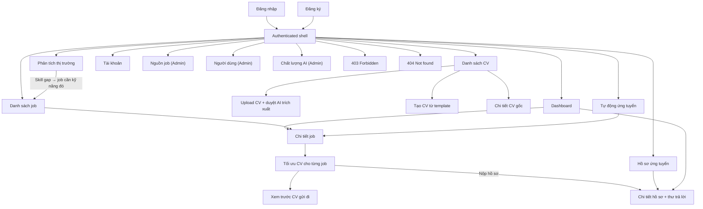

Screen ID, luồng tác vụ chính, hợp đồng trạng thái UI (kể cả trạng thái AI), quy tắc accessibility và ánh xạ requirement → màn hình nằm trong [Information Architecture](docs/04-information-architecture.md).

### 2.3 Current UI prototype

**Frontend đã port sang code** (`src/frontend/`): Next.js 16 + React 19 + TypeScript + Tailwind CSS v4, chạy bằng dữ liệu demo phía client (mất khi reload, chưa có backend). Đã có: landing, đăng nhập/đăng ký, và workspace gồm Tổng quan, Tự động ứng tuyển, CV, Phân tích thị trường, Việc làm (kèm tối ưu CV), Hồ sơ ứng tuyển, Tài khoản. Chưa có: các màn Admin, shadcn/ui, TanStack Query, API client. Quyết định: [ADR 0001](docs/decisions/0001-frontend-port-from-design-prototype.md).

```bash
cd src/frontend
cp .env.example .env.local
npm install
npm run dev        # http://localhost:3000
npm run typecheck
```

Prototype có thể bấm thử nằm trên canvas thiết kế: [ACAJ UI Prototype](https://claude.ai/artifact/Jk4AtZzuxHpgVd6RqKtTSo). Prototype gồm 12 màn chính, liên kết với nhau theo [screen inventory](docs/04-information-architecture.md#screen-inventory):

| Màn | Nội dung |
|---|---|
| `SCR-03` Tổng quan | Việc đang chờ bạn quyết định, job khớp nhất, hồ sơ đang ở đâu |
| `SCR-11` Upload CV | AI đọc CV, chỗ chưa chắc được tô màu để kiểm tra |
| `SCR-20` Phân tích CV so với thị trường | Nhu cầu tuyển dụng, mức lương có thể đạt, skill gaps, lộ trình theo năm, mỗi phần nối với CV của bạn |
| `SCR-42` Tự động ứng tuyển | Chỉ cần nạp CV, chạy thử tiến trình 8 bước |
| `SCR-30` Việc làm | Khả năng đậu phỏng vấn là chỉ số chính, kèm điểm khớp và giá trị từng yếu tố |
| `SCR-32` Tối ưu CV cho từng job | Câu được tô theo nguồn gốc, bấm để xem căn cứ |
| `SCR-33` Xem trước CV gửi đi | Bản PDF nhà tuyển dụng nhận, kiểm tra ATS |
| `SCR-41` Chi tiết hồ sơ | Thư mời phỏng vấn, thư trả lời AI soạn, bước xác nhận trước khi gửi |
| `SCR-60` Nguồn job (Admin) | Bật/tắt nguồn, tần suất, kỹ năng chưa có trong phả hệ |
| `SCR-61` Người dùng (Admin) | Tài khoản, mức dùng token, khóa/mở; không thấy nội dung CV |
| `SCR-62` Chất lượng AI (Admin) | Chỉ số thật, hiệu chỉnh khả năng đậu phỏng vấn, trọng số, eval, chi phí |

**Trang đầu (landing):** trang một màn hình, thông điệp "Nạp CV một lần", dẫn tới đăng ký.

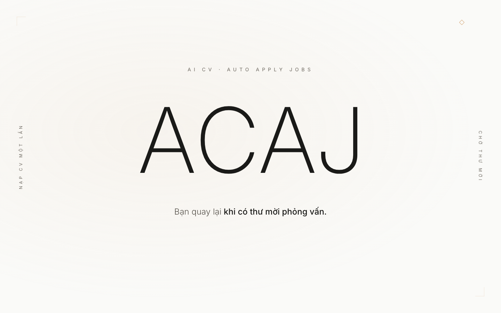

**CV gốc (`SCR-10`/`SCR-11`):** CV gốc không bị ghi đè; bên phải là những gì AI đọc được kèm độ tin cậy, chỗ chưa chắc được tô màu để kiểm tra.

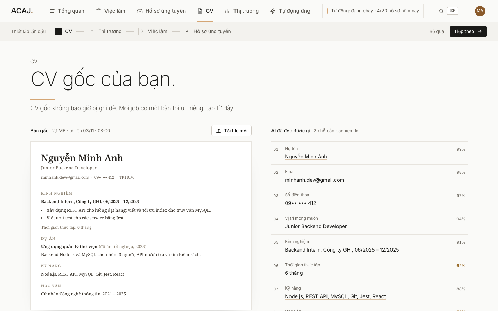

**Tự động ứng tuyển (`SCR-42`):** nạp CV một lần, quy trình 8 bước tự chạy; hệ thống chỉ hỏi bạn ở 3 chỗ.

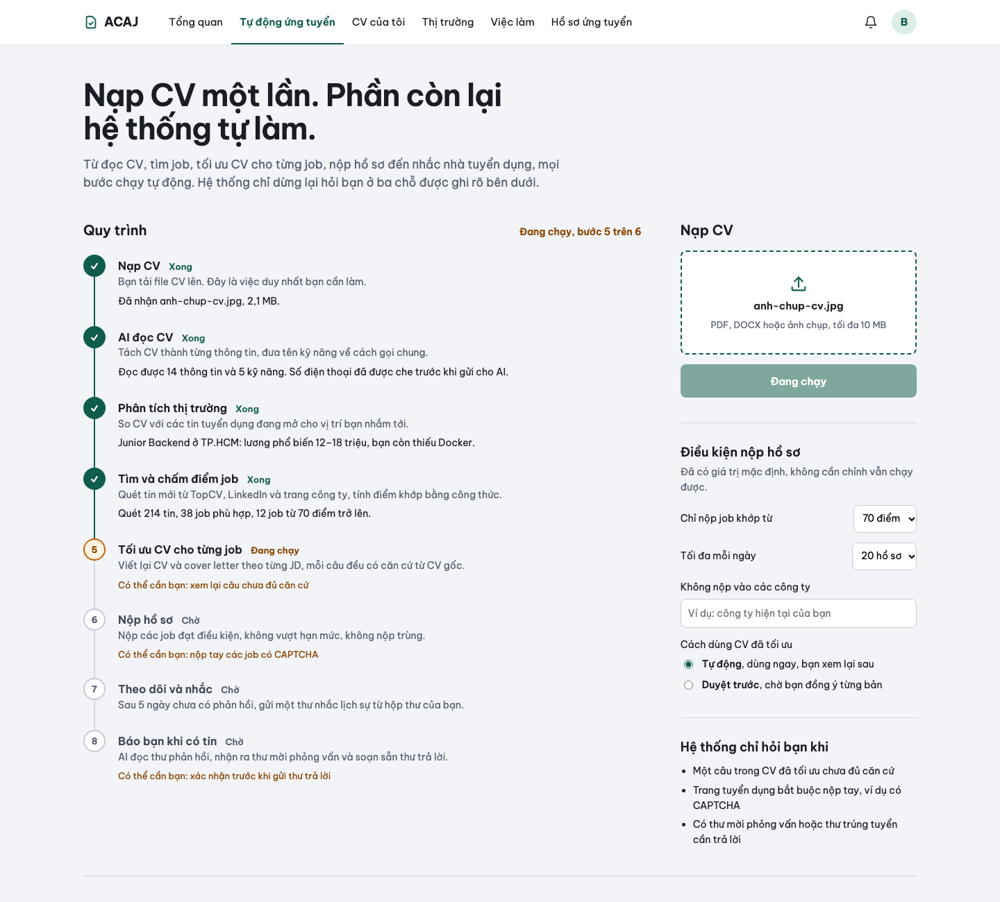

**Phân tích CV so với thị trường (`SCR-20`):** nhu cầu tuyển dụng, mức lương có thể đạt, skill gaps và lộ trình theo năm, theo các nhánh của mindmap.

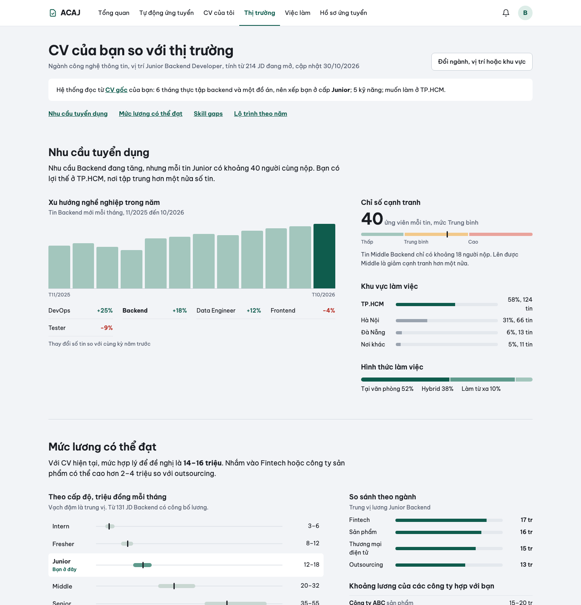

**Việc làm (`SCR-30`):** khả năng đậu phỏng vấn là chỉ số chính, kèm điểm khớp và giá trị từng yếu tố.

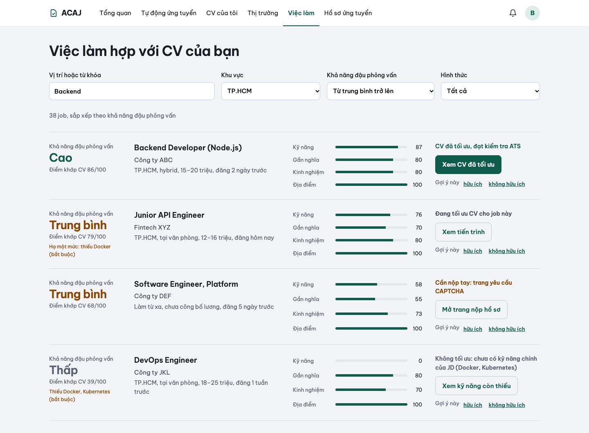

**Tối ưu CV cho từng job (`SCR-32`):** câu được tô theo nguồn gốc (giữ nguyên, viết lại, suy ra, cần xem lại); bấm vào câu để xem căn cứ từ CV gốc và JD.

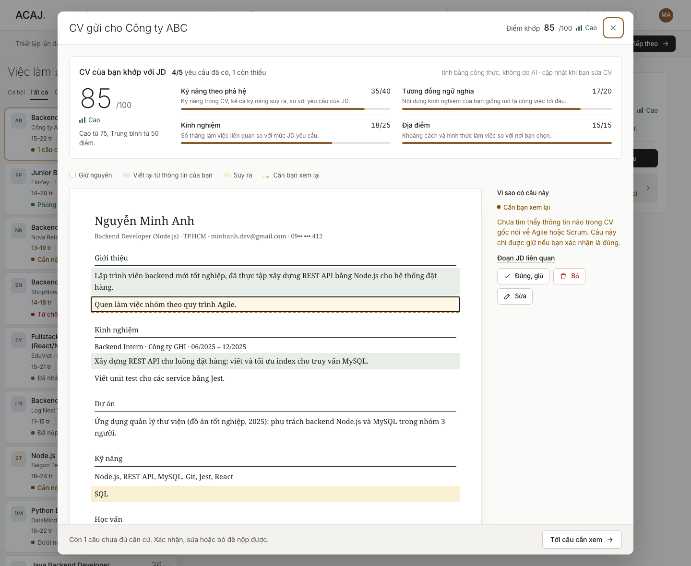

**Chi tiết hồ sơ (`SCR-41`):** AI nhận ra thư mời phỏng vấn và soạn sẵn thư trả lời; thư chỉ gửi khi bạn xác nhận.

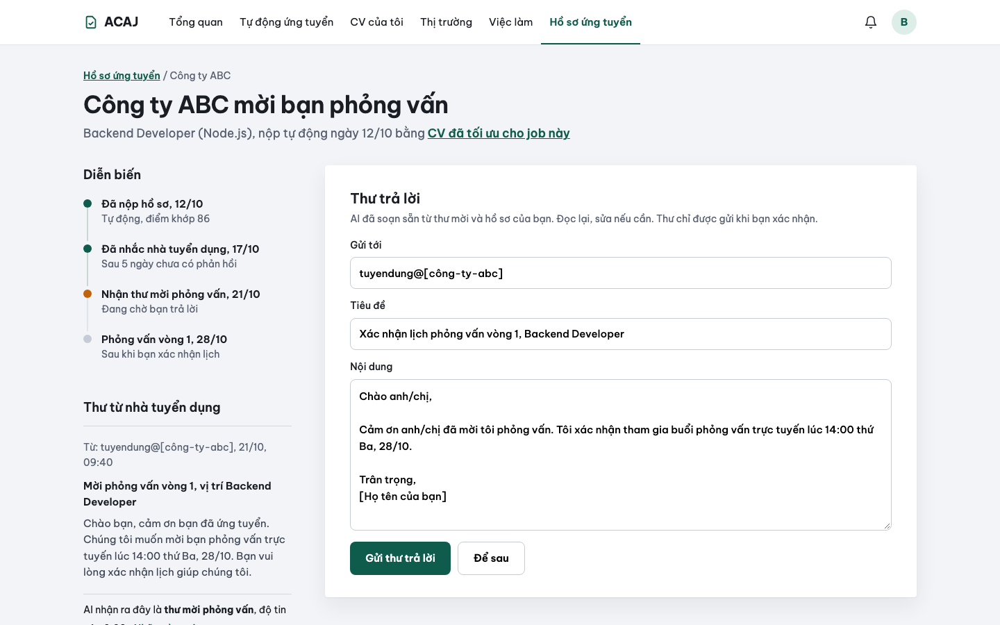

Ngôn ngữ thiết kế: chữ Be Vietnam Pro cho giao diện, Noto Serif cho tờ CV; màu nhấn xanh thông `#0F5C4D`; màu hổ phách chỉ dành cho nội dung AI suy ra hoặc cần xem lại. Nội dung đặt phẳng trên nền, chỉ tờ CV có khung giấy. Prototype đang ở chế độ riêng tư, cần chia sẻ từ menu Share để người khác mở được.

## 3. Database Diagrams (DBML / ER)

Mô hình dữ liệu PostgreSQL (kèm pgvector) gồm 41 bảng, viết bằng DBML: [acaj.dbml](docs/database/acaj.dbml). Các ràng buộc CHECK mà DBML không diễn đạt được nằm ở [checks.sql](docs/database/checks.sql). Schema đã được sinh SQL từ DBML, nạp vào PostgreSQL 16 + pgvector và chạy thử với ví dụ job Backend tại Công ty ABC.

### 3.1 Table groups

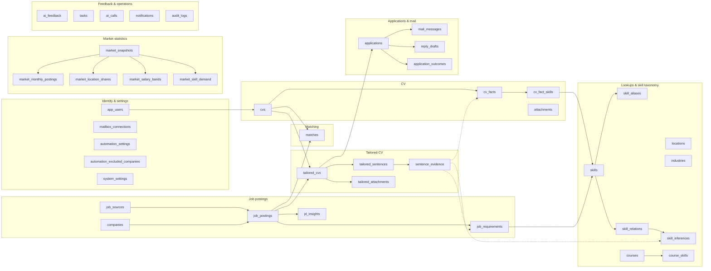

### 3.2 Entity-relationship diagram

```mermaid
erDiagram
    app_users ||--o| mailbox_connections : connects
    app_users ||--|| automation_settings : configures
    app_users ||--o{ automation_excluded_companies : excludes
    companies ||--o{ automation_excluded_companies : excluded
    app_users ||--o{ cvs : owns
    app_users ||--o{ attachments : uploads
    app_users ||--o{ applications : submits
    app_users ||--o{ ai_feedback : gives
    app_users ||--o{ notifications : receives
    app_users ||--o{ tasks : requests
    app_users ||--o{ audit_logs : performs

    skills ||--o{ skill_aliases : known_as
    skills ||--o{ skill_relations : from
    skills ||--o{ skill_inferences : infers
    courses ||--o{ course_skills : teaches
    skills ||--o{ course_skills : taught_by

    cvs ||--o{ cv_facts : has
    cv_facts ||--o{ cv_fact_skills : shows
    skills ||--o{ cv_fact_skills : shown_in
    locations ||--o{ cvs : targets

    job_sources ||--o{ job_postings : publishes
    companies ||--o{ job_postings : posts
    industries ||--o{ companies : groups
    locations ||--o{ job_postings : located_in
    job_postings ||--o{ job_requirements : requires
    skills ||--o{ job_requirements : asked_for
    job_postings ||--o{ jd_insights : explains

    locations ||--o{ market_snapshots : for
    market_snapshots ||--o{ market_monthly_postings : trend
    market_snapshots ||--o{ market_location_shares : spread
    market_snapshots ||--o{ market_salary_bands : salary
    market_snapshots ||--o{ market_skill_demand : demand
    skills ||--o{ market_skill_demand : demanded

    cvs ||--o{ matches : scored
    job_postings ||--o{ matches : scored

    cvs ||--o{ tailored_cvs : tailored_from
    job_postings ||--o{ tailored_cvs : tailored_for
    tailored_cvs ||--o{ tailored_sentences : contains
    tailored_sentences ||--o{ sentence_evidence : cites
    cv_facts |o--o{ sentence_evidence : cited_fact
    skill_inferences |o--o{ sentence_evidence : cited_inference
    job_requirements |o--o{ sentence_evidence : cited_requirement
    tailored_cvs ||--o{ tailored_attachments : attaches
    attachments ||--o{ tailored_attachments : attached

    job_postings ||--o{ applications : applied_to
    tailored_cvs |o--o{ applications : used
    applications ||--o{ mail_messages : thread
    applications ||--o{ reply_drafts : drafts
    mail_messages ||--o| reply_drafts : answers
    applications ||--o| application_outcomes : results_in
    tasks ||--o{ ai_calls : makes

    app_users {
        uuid id PK
        citext email UK
        user_role role
        boolean is_active
        timestamptz delete_requested_at
    }
    automation_settings {
        uuid user_id PK
        boolean enabled
        automation_mode mode
        smallint min_match_score
        smallint daily_limit
        smallint follow_up_after_days
    }
    skill_inferences {
        uuid from_skill_id PK
        uuid to_skill_id PK
        smallint depth
        uuid via_skill_id FK
    }
    cvs {
        uuid id PK
        uuid user_id FK
        cv_source source
        ai_status status
        boolean is_primary
        vector embedding
    }
    cv_facts {
        uuid id PK
        uuid cv_id FK
        fact_kind kind
        text body
        numeric confidence
        boolean needs_review
    }
    job_postings {
        uuid id PK
        uuid source_id FK
        varchar external_id
        uuid company_id FK
        posting_status status
        apply_channel apply_channel
        text description
        vector embedding
    }
    job_requirements {
        uuid id PK
        uuid posting_id FK
        requirement_kind kind
        uuid skill_id FK
        integer quote_start
        integer quote_end
    }
    matches {
        uuid id PK
        uuid cv_id FK
        uuid posting_id FK
        smallint score
        interview_chance chance
        numeric factor_skill
        numeric factor_semantic
    }
    tailored_cvs {
        uuid id PK
        uuid cv_id FK
        uuid posting_id FK
        smallint version
        ai_status status
        boolean ats_passed
        varchar prompt_version
    }
    tailored_sentences {
        uuid id PK
        uuid tailored_cv_id FK
        text text
        provenance provenance
        boolean needs_review
        sentence_state state
    }
    sentence_evidence {
        uuid id PK
        uuid sentence_id FK
        evidence_type type
        uuid fact_id FK
        uuid requirement_id FK
    }
    applications {
        uuid id PK
        uuid user_id FK
        uuid posting_id FK
        uuid tailored_cv_id FK
        application_mode mode
        application_status status
        interview_chance chance_at_apply
    }
    mail_messages {
        uuid id PK
        uuid application_id FK
        message_direction direction
        varchar provider_message_id UK
        reply_class class
        numeric class_confidence
    }
    reply_drafts {
        uuid id PK
        uuid inbound_message_id FK
        draft_status status
        uuid confirmed_by FK
        timestamptz confirmed_at
    }
    tasks {
        uuid id PK
        task_type type
        task_status status
        timestamptz run_after
        smallint attempts
    }
```

### 3.3 Key rules

Database tự giữ các luật quan trọng nhất:

- Không nộp hai lần một job (BR-018) và không lưu trùng tin tuyển dụng (BR-003).
- Điểm khớp 0–100, mỗi yếu tố 0–1 (BR-007).
- Mỗi căn cứ của một câu trỏ đúng một fact, một dòng suy ra trong phả hệ kỹ năng, hoặc một yêu cầu JD (BR-008, BR-009).
- Thư trả lời ở trạng thái `SENT` bắt buộc phải có người xác nhận và thời điểm xác nhận (BR-022).

Khi kiểm thử, cả 10 thao tác sai đều bị từ chối.

Bảng, enum, luật do ứng dụng giữ, và ánh xạ sang API: [Data model](docs/06-data-model.md).

## 4. OpenAPI 3.0 Contract

Hợp đồng REST giữa Web Frontend và Backend API được viết bằng OpenAPI 3.0.3: 53 thao tác, kiểm tra bằng `openapi-spec-validator`. Hợp đồng suy ra từ use case, danh sách màn hình và mô hình dữ liệu.

| Group | Operations |
|---|---|
| Auth, Account, Mailbox | Đăng ký, đăng nhập, tài khoản, đổi mật khẩu, xóa tài khoản, kết nối Gmail/Outlook qua OAuth |
| CVs, Attachments | Upload CV hoặc ảnh (AI đọc ở nền), tạo từ template thủ công hoặc AI, sửa fact, PDF, chứng chỉ |
| Market | Phân tích CV so với thị trường: nhu cầu, lương, skill gaps, lộ trình |
| Jobs, Tailored CVs | Job theo khả năng đậu phỏng vấn, phân tích JD có trích dẫn, CV đã tối ưu với nguồn gốc và căn cứ từng câu, sửa, hoàn tác, duyệt, xem trước |
| Applications | Nộp tay, theo dõi hồ sơ, chuỗi thư, sửa nhãn AI, thư trả lời và **xác nhận gửi** |
| Automation | Điều kiện tự động, trạng thái quy trình 8 bước, nhật ký |
| Dashboard, Feedback, Notifications, Lookups | Tổng quan, phản hồi kết quả AI, thông báo, danh mục |
| Admin | Nguồn job, người dùng, chất lượng AI, trọng số matching |

Quy ước chính:

- Base path là `/api/v1`, xác thực bằng JWT, lỗi trả về dạng `problem+json`.
- Mỗi thao tác khai báo vai trò được gọi trong `x-roles`.
- Việc AI chạy nền: thao tác trả `202`, còn tài nguyên mang trạng thái `PENDING` / `READY` / `NEEDS_REVIEW` / `FAILED`.
- Thư trả lời nhà tuyển dụng chỉ được gửi qua `confirmReplyDraft`.

- Contract: [docs/api/openapi.yaml](docs/api/openapi.yaml)
- Quy ước, vai trò từng thao tác, ánh xạ màn hình → API: [API documentation](docs/api/README.md)

## 5. C4 Architecture

README này trình bày C1–C3. Trách nhiệm từng phần, luật kiến trúc và danh mục thành phần nằm trong [thư mục kiến trúc](docs/architecture/c4/README.md).

### C1 — System Context

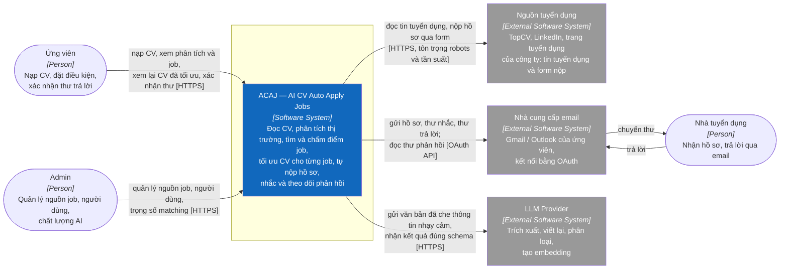

### C2 — Container

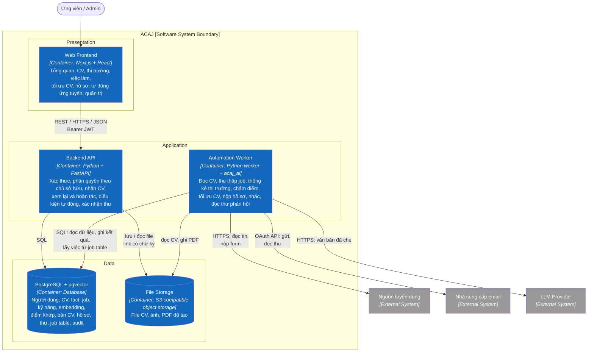

Backend API và Automation Worker giao tiếp qua job table trong PostgreSQL, không dùng message broker. Chỉ Automation Worker gọi ra ngoài (LLM, nguồn tuyển dụng, email). Điểm khớp và quyết định nộp hồ sơ do luật tính và được lưu trước mọi lời gọi LLM; thư trả lời chỉ được gửi khi người dùng xác nhận.

### C3 — Component

#### C3.1 Backend API

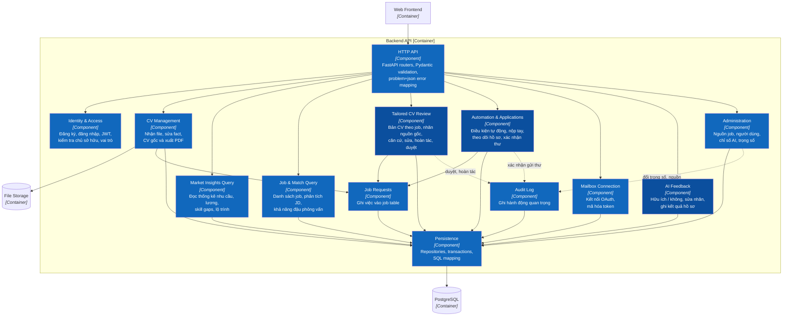

#### C3.2 Automation Worker

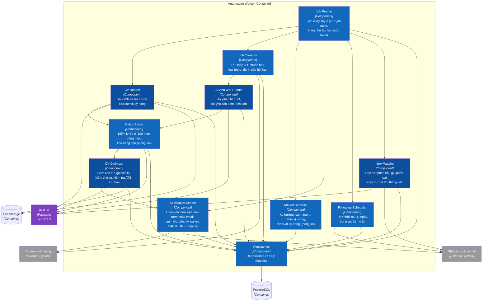

#### C3.3 AI package `acaj_ai`

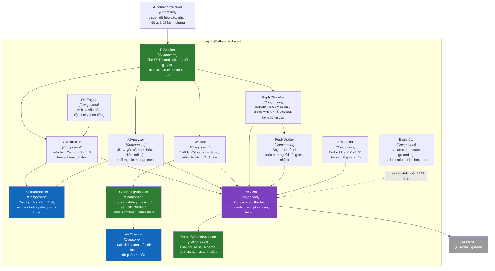

### AI pipeline and data for AI

Phần AI đi từ đầu vào tới đầu ra như sau. Thống kê và chấm điểm là luật. LLM chỉ viết lại trên căn cứ có ID: toàn bộ fact của CV, yêu cầu của JD và kỹ năng suy ra từ bảng phả hệ. Mọi câu nó viết phải trích được căn cứ đó.

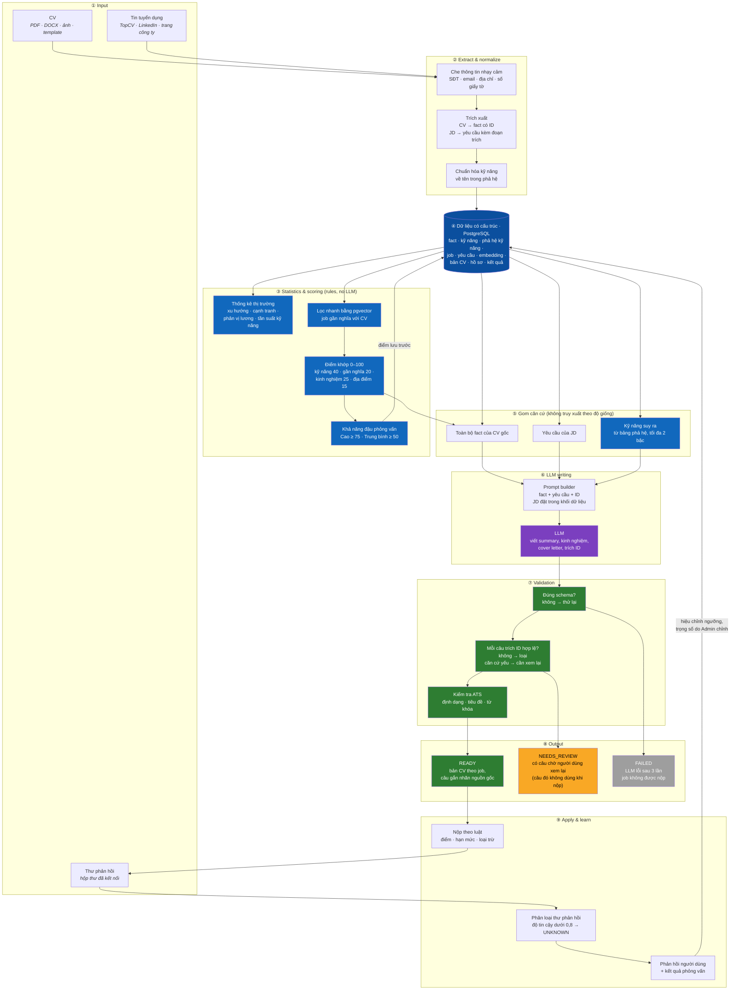

Dữ liệu cho AI nằm trong PostgreSQL dưới dạng bảng quan hệ, cộng bảng phả hệ kỹ năng và pgvector cho độ gần nghĩa. ACAJ không dùng knowledge graph hay RAG: mỗi lần viết lại chỉ cần một CV và một JD, đủ nhỏ để đưa nguyên vào prompt, và phần "đồ thị" duy nhất (phả hệ kỹ năng) chỉ là một bảng.

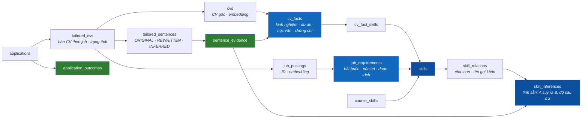

Cách trả lời từng câu hỏi của AI, ví dụ job Backend tại Công ty ABC, và so sánh các phương án (bảng quan hệ, RAG, graph database, chỉ dùng LLM): [AI Pipeline and Data for AI](docs/architecture/ai-pipeline.md).

Tài liệu đầy đủ: [C4 Architecture](docs/architecture/c4/README.md).

## 6. Frontend and Backend Folder Structures

Frontend dùng Next.js (App Router) + React + TypeScript. Backend dùng Python + FastAPI, chia theo module; Backend API và Automation Worker chung một codebase. Code AI nằm trong package riêng `acaj_ai` (`src/ai/`), có eval chạy được từ terminal.

### 6.1 Repository layout

```text
auto_apply_jobs/
├── src/
│   ├── frontend/                 # Next.js (Web Frontend)
│   ├── backend/                  # FastAPI API + Automation Worker, one codebase
│   └── ai/                       # acaj_ai: masking, OCR, extraction, tailoring, grounding, classification, evals
├── docs/
│   ├── api/                      # openapi.yaml + API documentation
│   ├── architecture/             # C4 (c4/) and AI pipeline
│   ├── database/                 # acaj.dbml + checks.sql
│   ├── requirements/             # Business rules, non-functional requirements
│   ├── images/                   # UI screenshots used in the README
│   ├── 01-scope.md … 10-cost-estimate.md
│   └── mindmap.png
├── docker-compose.yml            # postgres (pgvector), minio (object storage), api, worker, frontend
├── .gitignore                    # Ignores .env files, keeps .env.example
└── README.md
```

### 6.2 Target Next.js structure

```text
src/frontend/
├── app/                          # App Router: one route per screen in the IA
│   ├── (public)/
│   │   ├── login/                # SCR-01
│   │   └── register/             # SCR-02
│   ├── (workspace)/              # Shell (top navigation + notifications), requires login
│   │   ├── layout.tsx
│   │   ├── dashboard/            # SCR-03
│   │   ├── auto-apply/           # SCR-42: upload CV, 8-step pipeline, conditions, activity
│   │   ├── cv/                   # SCR-10
│   │   │   ├── upload/           # SCR-11: AI extraction review
│   │   │   ├── new/              # SCR-12: template, manual or AI
│   │   │   └── [cvId]/           # SCR-13
│   │   ├── insights/             # SCR-20: demand, salary, skill gaps, roadmap
│   │   ├── jobs/                 # SCR-30
│   │   │   └── [jobId]/          # SCR-31
│   │   │       ├── cv/           # SCR-32: tailored CV, provenance, evidence
│   │   │       └── preview/      # SCR-33: PDF sent to the recruiter, ATS checks
│   │   ├── applications/         # SCR-40
│   │   │   └── [applicationId]/  # SCR-41: thread, AI label, reply draft, confirmation
│   │   ├── account/              # SCR-50: profile, security, mailbox
│   │   └── admin/                # Admin only
│   │       ├── sources/          # SCR-60
│   │       ├── users/            # SCR-61
│   │       └── ai/               # SCR-62: quality, cost, matching weights
│   ├── forbidden/                # SCR-90
│   ├── not-found.tsx             # SCR-91
│   └── providers.tsx             # TanStack Query, theme, i18n (vi, en)
├── features/                     # One folder per feature: components/, hooks/, api.ts
│   ├── auth/  account/  dashboard/  automation/  cv/  insights/
│   ├── jobs/  tailoring/  applications/  feedback/  notifications/  admin/
├── components/
│   ├── ui/                       # shadcn/ui primitives
│   ├── ai/                       # Shared AI states: AiStatusBadge, ProvenanceMark, EvidencePopover, FeedbackButtons
│   └── cv-sheet/                 # CV paper rendering (Noto Serif), shared by SCR-11, SCR-32, SCR-33
├── lib/
│   ├── api-client.ts             # fetch wrapper: JWT, problem+json, 401 → login, 403 → forbidden
│   ├── api-types.ts              # Generated from docs/api/openapi.yaml (openapi-typescript)
│   ├── poll.ts                   # Polls an AI resource until READY / NEEDS_REVIEW / FAILED
│   └── format.ts                 # Dates, salary, time zone
├── messages/                     # vi.json, en.json
├── proxy.ts                      # Login and role redirects
├── tests/                        # Vitest + Testing Library
├── .env.example
└── package.json                  # Tailwind CSS, shadcn/ui, react-hook-form + zod, TanStack Query/Table
```

`app/ route → feature component → feature hook → feature api.ts → api-client → REST API`

### 6.3 Target FastAPI modular structure

Ba lớp: `host/` (khởi chạy, ráp module), `shared/` (hạ tầng dùng chung), `modules/` (nghiệp vụ, mỗi module tự chứa router, service, repository, models, schemas).

```text
src/backend/
├── host/                              # Composition root: ráp module, không chứa nghiệp vụ
│   ├── main.py                        # FastAPI app (Backend API)
│   ├── worker.py                      # Automation Worker entry: scheduler + task loop
│   ├── api_router.py                  # Mounts every module router under /api/v1
│   ├── container.py                   # DI: Protocol → implementation (repository, LLMClient, MailClient, collectors)
│   ├── task_registry.py               # Registers task type → handler of each module
│   └── schedule.py                    # Periodic: COLLECT_JOBS, COMPUTE_MARKET, POLL_INBOX, SEND_FOLLOW_UP
├── shared/                            # Dùng chung, không import module nào
│   ├── config.py                      # pydantic-settings
│   ├── database.py                    # SQLAlchemy engine, session, Base
│   ├── security.py                    # Password hashing (Argon2), JWT
│   ├── crypto.py                      # Encrypts mailbox tokens (NFR-SEC-006)
│   ├── storage.py                     # Object storage client, signed links
│   ├── deps.py                        # current_user, require_role, ownership helpers (BR-001)
│   ├── errors.py                      # Base exceptions + problem+json mapping
│   ├── pagination.py                  # Shared page/cursor params
│   └── tasks/                         # Queue infrastructure (not a business module)
│       ├── models.py                  # tasks, ai_calls
│       ├── repository.py              # Claims with FOR UPDATE SKIP LOCKED
│       ├── runner.py                  # Task loop, retries, quotas
│       ├── queries.py                 # Read-only ai_calls statistics for admin
│       └── enqueue.py                 # enqueue(task_type, payload): any module may call
├── modules/
│   ├── auth/                          # Register, login, JWT (uses app_users of account)
│   │   └── router.py  service.py  schemas.py
│   ├── account/                       # app_users, mailbox_connections
│   │   ├── router.py  service.py  repository.py  models.py  schemas.py
│   │   ├── tasks.py                   # PURGE_USER
│   │   └── integrations/mail_oauth.py # Gmail/Outlook OAuth: get and refresh tokens
│   ├── cv/                            # cvs, cv_facts, cv_fact_skills, attachments
│   │   ├── router.py  service.py  repository.py  models.py  schemas.py
│   │   ├── tasks.py                   # PARSE_CV
│   │   └── export.py                  # PDF export
│   ├── taxonomy/                      # skills, aliases, relations, inferences, courses, locations, industries
│   │   ├── router.py  service.py  repository.py  models.py  schemas.py
│   │   └── tasks.py                   # Recompute skill_inferences
│   ├── jobs/                          # job_sources, companies, job_postings, job_requirements, jd_insights
│   │   ├── router.py  service.py  repository.py  models.py  schemas.py
│   │   ├── tasks.py                   # COLLECT_JOBS, ANALYZE_JD
│   │   └── integrations/sources/      # base.py (JobSourceCollector), topcv.py, linkedin.py, company_site.py
│   ├── market/                        # market_snapshots + 4 child tables
│   │   ├── router.py  service.py  repository.py  models.py  schemas.py
│   │   └── tasks.py                   # COMPUTE_MARKET
│   ├── matching/                      # matches, system_settings (weights)
│   │   ├── router.py  service.py  repository.py  models.py  schemas.py
│   │   ├── scoring.py                 # Rule-based score, no LLM
│   │   └── tasks.py                   # SCORE_MATCHES
│   ├── tailoring/                     # tailored_cvs, tailored_sentences, sentence_evidence, tailored_attachments
│   │   ├── router.py  service.py  repository.py  models.py  schemas.py
│   │   └── tasks.py                   # OPTIMIZE_CV (calls acaj_ai)
│   ├── applications/                  # applications, mail_messages, reply_drafts, application_outcomes
│   │   ├── router.py  service.py  repository.py  models.py  schemas.py
│   │   ├── tasks.py                   # SUBMIT_APPLICATION, SEND_FOLLOW_UP, POLL_INBOX, SEND_REPLY
│   │   └── integrations/
│   │       ├── submit/                # form.py (Playwright), email.py
│   │       └── mail/                  # base.py (MailClient), gmail.py, outlook.py
│   ├── automation/                    # automation_settings, automation_excluded_companies
│   │   ├── router.py  service.py  repository.py  models.py  schemas.py
│   │   └── tasks.py                   # Orchestrates the automatic steps
│   ├── feedback/                      # ai_feedback
│   │   └── router.py  service.py  repository.py  models.py  schemas.py
│   ├── notifications/                 # notifications
│   │   └── router.py  service.py  repository.py  models.py  schemas.py
│   ├── audit/                         # audit_logs; no router, written via audit.service.record()
│   │   └── service.py  repository.py  models.py  schemas.py
│   ├── dashboard/                     # No tables; aggregates through other modules' services
│   │   └── router.py  service.py  schemas.py
│   └── admin/                         # No tables; reads through other modules' services
│       └── router.py  service.py  schemas.py
├── tests/
│   ├── fakes/                         # In-memory repositories, stub LLM, fake mail and sources
│   ├── architecture/test_boundaries.py# Runs import-linter; fails on dependency violations
│   ├── modules/<module>/              # Service tests with fakes
│   └── api/                           # Router smoke tests against openapi.yaml
├── alembic/                           # Migrations; the first one comes from docs/database (DBML → SQL + checks.sql)
├── .importlinter                      # Contracts: host → modules → shared; modules import only other modules' service
├── .env.example
├── requirements.txt
├── requirements-dev.txt               # + pytest, ruff, mypy, import-linter
└── Dockerfile                         # One image, run as `api` or `worker`
```

```text
host ──► modules ──► shared
              └────► acaj_ai (only via a module's tasks.py, inside the worker)
```

```text
api_router   → module/router → module/service → module/repository (interface) → PostgreSQL
worker       → shared/tasks/runner → module/tasks → module/service → acaj_ai / module/integrations / repository
acaj_ai      → LLMClient (interface) → provider client → LLM provider
```

Module gọi nhau chỉ qua service; `shared` không import module. Điểm khớp được tính trước khi `acaj_ai` chạy, và chỉ `applications.service` gửi thư trả lời đã được xác nhận.

### 6.4 AI package `acaj_ai`

```text
src/ai/
├── acaj_ai/          # masking, ocr, extraction/, skills, embedding, tailoring/, replies/, llm/, settings, cli
├── evals/            # datasets (JSONL with gold labels), thresholds.toml, reports/
├── tests/
└── pyproject.toml    # command: acaj-ai eval | parse | tailor | classify
```

Backend truyền dữ liệu vào và lưu kết quả đã kiểm chứng; `acaj_ai` không truy cập database. Bảng module, luật phụ thuộc và biến môi trường: [Target Folder Structure](docs/07-folder-structure.md). Ranh giới, prompt, che dữ liệu và eval của `acaj_ai`: [AI package](docs/architecture/ai-package.md).

## 7. Detailed Class and Sequence Design

Thiết kế chi tiết suy ra từ các thành phần C4 (mục 5), database và hợp đồng OpenAPI (mục 3, 4), và cấu trúc module (mục 6). Tên lớp là lớp Python trong các module FastAPI và package `acaj_ai`; đây là thiết kế mục tiêu.

### 7.1 C4 Level 4 — Code collaboration

Hai tính năng cốt lõi:

- **Matching:** chỉ dùng luật, không gọi LLM.
- **Tối ưu CV cho từng job:** dùng LLM, có kiểm chứng căn cứ.

Cả hai chạy trong Automation Worker; người dùng đọc kết quả qua API.

#### L4.1 Matching

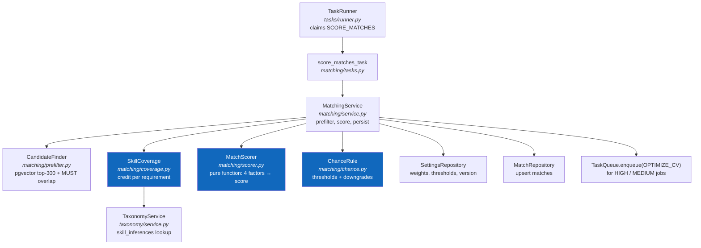

#### L4.2 CV tailoring

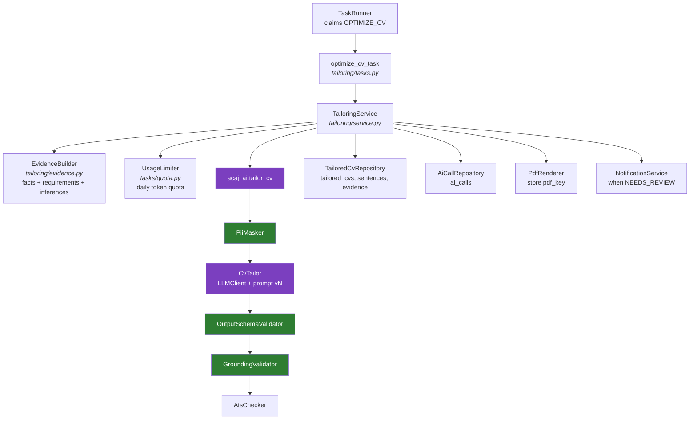

Nguồn: [C4 Level 4 — Code](docs/architecture/c4/04-code.md)

### 7.2 Core class diagrams

#### 1. Matching

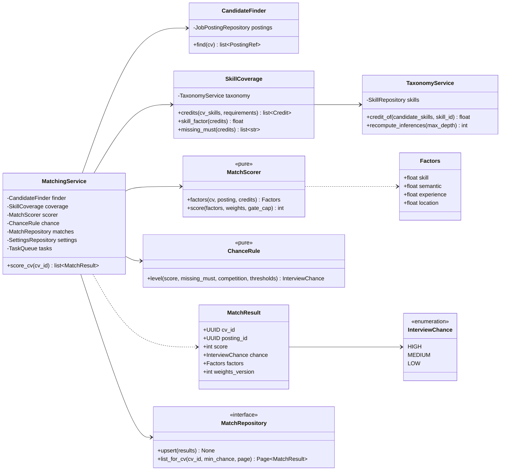

#### 2. CV tailoring

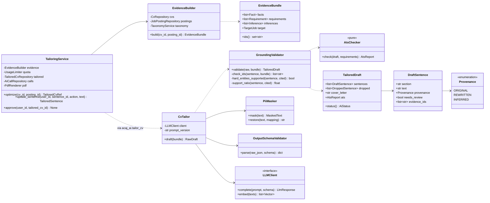

#### 3. Automation and replies

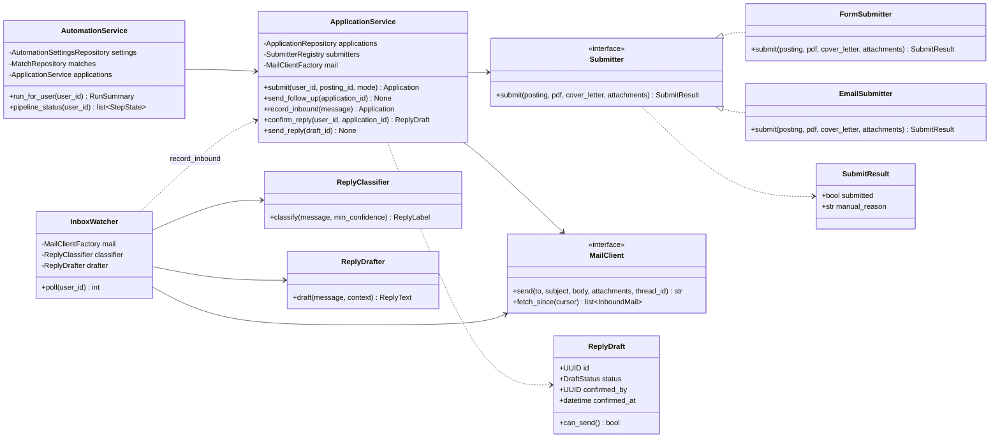

Ranh giới kiểu dữ liệu giữa các tầng: [Class diagrams](docs/architecture/uml/01-class-diagrams.md).

### 7.3 Sequence diagrams

Bảy luồng chạy, mỗi luồng nối use case và thao tác OpenAPI với router, service, `acaj_ai`, repository, database và các nhánh lỗi:

| # | Flow | Trigger |
|---|---|---|
| 1 | Nạp CV và AI đọc CV | `POST /cvs` |
| 2 | Chấm điểm job | Việc `SCORE_MATCHES` |
| 3 | Tối ưu CV cho một job (che dữ liệu, LLM, kiểm chứng, ATS) | Việc `OPTIMIZE_CV` |
| 4 | Tự động nộp hồ sơ (hạn mức, nộp trùng, CAPTCHA → nộp tay) | Việc `SUBMIT_APPLICATION` |
| 5 | Đọc thư phản hồi và phân loại | Việc `POLL_INBOX` |
| 6 | Xác nhận và gửi thư trả lời | `POST /applications/{id}/reply-draft/confirmation` |
| 7 | Hoàn tác một câu đã tối ưu | `PATCH /tailored-cvs/{id}/sentences/{sid}` |

[Sequence diagrams](docs/architecture/uml/02-sequence-diagrams.md) · [Detailed UML overview](docs/architecture/uml/README.md)

### 7.4 Algorithms — skill taxonomy, matching, interview chance

Các thuật toán đều là luật và thống kê, giải thích được; LLM chỉ chạy sau khi chúng xong.

| Algorithm | Rule |
|---|---|
| Phả hệ kỹ năng | Có kỹ năng con thì suy ra kỹ năng cha, tối đa 2 bậc; mức tính 1,0 (có) · 0,9 (bậc 1) · 0,7 (bậc 2); tính sẵn vào `skill_inferences` |
| Điểm khớp | Lọc 300 job gần nghĩa bằng pgvector; 4 yếu tố trong [0, 1]; điểm = trung bình có trọng số 40/20/25/15; yếu tố kỹ năng bằng 0 thì tối đa 39 |
| Khả năng đậu phỏng vấn | Cao ≥ 75, Trung bình ≥ 50; hạ một mức nếu thiếu yêu cầu bắt buộc, hạ thêm nếu cạnh tranh cao; hiệu chỉnh hằng tháng theo tỉ lệ được mời phỏng vấn thật |
| Kiểm chứng câu | ID căn cứ phải có trong bundle; câu có thực thể không có căn cứ bị bỏ; độ hỗ trợ dưới 0,3 thì cần xem lại |
| Tự động nộp | Điểm ≥ ngưỡng, chance khác Thấp, CV sẵn sàng và đạt ATS, xếp theo chance rồi điểm, dừng ở hạn mức ngày |

Ví dụ với dữ liệu của prototype, đã chạy bằng script tham chiếu:

- Job Backend của Công ty ABC: các yếu tố 0,87 · 0,80 · 0,80 · 1 → **86 điểm, Cao**.
- Junior API Engineer: **79 điểm** nhưng thiếu Docker bắt buộc → **Trung bình**.
- DevOps: điểm thô 46, bị chặn ở **39 điểm** → **Thấp**.

Công thức, SQL, trường hợp biên và cách chỉnh: [Algorithms](docs/09-algorithms.md).

## Documentation

- **Research and requirements:** [Scope](docs/01-scope.md), [Features](docs/02-features.md), [Acceptance criteria](docs/08-acceptance-criteria.md).
- **Requirements catalogs:** [Business rules](docs/requirements/business-rules.md), [Non-functional requirements](docs/requirements/non-functional-requirements.md).
- **Use cases and user stories:** [Actors, roles, and use cases](docs/03-use-cases.md), [INVEST backlog](docs/05-invest-requirements.md).
- **Information architecture:** [Information architecture](docs/04-information-architecture.md).
- **UI/UX:** [UI prototype](https://claude.ai/artifact/Jk4AtZzuxHpgVd6RqKtTSo), ảnh màn hình trong `docs/images/`, [ADR 0001 — port UI sang Next.js](docs/decisions/0001-frontend-port-from-design-prototype.md).
- **Database:** [Data model](docs/06-data-model.md), [acaj.dbml](docs/database/acaj.dbml), [checks.sql](docs/database/checks.sql).
- **API contract:** [OpenAPI 3.0](docs/api/openapi.yaml), [API documentation](docs/api/README.md).
- **Architecture:** [C4 model](docs/architecture/c4/README.md), [AI pipeline and data for AI](docs/architecture/ai-pipeline.md), [AI package](docs/architecture/ai-package.md).
- **Detailed design:** [Algorithms](docs/09-algorithms.md), [C4 Level 4](docs/architecture/c4/04-code.md), [Class diagrams](docs/architecture/uml/01-class-diagrams.md), [Sequence diagrams](docs/architecture/uml/02-sequence-diagrams.md).

- **Folder structure:** [Next.js, FastAPI modules, acaj_ai](docs/07-folder-structure.md).

- **Deployment cost:** [Cost estimate — AWS EC2 và OpenAI (MVP)](docs/10-cost-estimate.md).

## Project Progress

- [x] Define scope, goals, and user roles
- [x] Write the feature list and use cases
- [x] Write user stories following INVEST
- [x] Write acceptance criteria and business rules
- [x] Write non-functional requirements
- [x] Define AI boundaries, grounding rules, and AI quality targets
- [x] Design the information architecture and screen permissions
- [x] Design the screen hierarchy, task flows, and UI states (including AI states)
- [x] Build the UI prototype for the Candidate role
- [x] Build the UI prototype for the Admin role
- [x] Design the database schema in DBML and the ER diagram in Mermaid
- [x] Write the API documentation in OpenAPI 3.0
- [x] Design the C4 System Context, Container, and Component views
- [x] Design the AI pipeline and the data it uses (no knowledge graph, see decision)
- [x] Design the matching algorithm and skill taxonomy
- [x] Design the AI package in detail (prompts, validators, evals)
- [x] Design the frontend and backend folder structure
- [x] Design class diagrams and sequence diagrams
- [x] Port the Candidate UI to Next.js + Tailwind CSS v4 (demo data, no backend yet)
- [ ] Build the Admin screens in the frontend
- [ ] Build the backend and connect the frontend to the API
