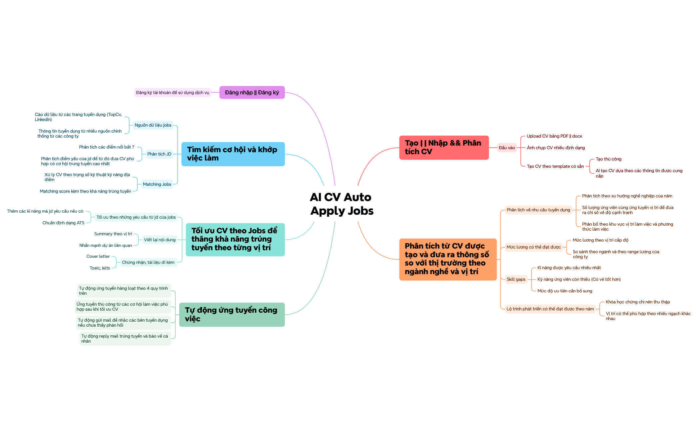
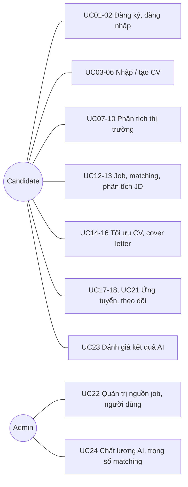

# AI CV Auto Apply Jobs (ACAJ)

ACAJ giúp người tìm việc đi hết một vòng khép kín: **hiểu CV của mình → hiểu thị trường → chọn đúng việc → tối ưu hồ sơ cho từng JD → ứng tuyển và theo dõi phản hồi**, với AI hỗ trợ ở mỗi bước và người dùng luôn là người quyết định cuối cùng.

**Vấn đề:** Khi đang thất nghiệp, hoặc không biết mình đang đứng ở đâu trong thị trường, nhiều người chọn cách rải thật nhiều CV. Họ gửi cùng một bản CV cho mọi nơi và không bên nào phản hồi. Điều khó nhất là **họ không biết phải sửa CV thế nào để khớp với đúng công việc mình ứng tuyển**: JD cần kỹ năng gì, từ khóa nào, nên nhấn mạnh dự án nào, CV đã qua vòng lọc ATS chưa. Họ cũng không rõ mình thiếu gì và mức lương kỳ vọng có thực tế không.

**ACAJ giúp bằng cách:**
- **Cho biết bạn đang ở đâu:** phân tích CV so với thị trường để biết nhu cầu tuyển dụng, độ cạnh tranh, mức lương thực tế, kỹ năng còn thiếu và lộ trình phát triển.
- **Tự động sửa CV để khớp từng công việc:** hệ thống tự phân tích JD, tự phát hiện CV đang thiếu gì và **tự sửa**, tạo CV và cover letter riêng cho từng job (kỹ năng, từ khóa, summary, dự án liên quan, chuẩn ATS) mà người dùng không phải chỉnh tay. Mỗi job có điểm khớp và khả năng trúng tuyển.
- **Tự động hóa toàn bộ quy trình, người dùng vẫn kiểm soát:** từ tìm job, sửa CV, ứng tuyển hàng loạt, nhắc nhà tuyển dụng khi chưa phản hồi đến báo ngay khi có thư mời phỏng vấn đều chạy tự động theo điều kiện người dùng đặt; mọi thay đổi được lưu lại để xem và hoàn tác.

Câu chuyện đầy đủ: [Scope](docs/01-scope.md).

## 1. Requirements — INVEST, Use Cases, and Acceptance Criteria

Requirements xác định ACAJ phải làm gì, ai dùng, giá trị mang lại và điều kiện thành công quan sát được. Các user story được kiểm tra theo INVEST và ánh xạ sang use case.

### 1.1 Product mind map



Mindmap có 6 nhánh, tương ứng F01–F06. F07 được bổ sung để đo và cải thiện chất lượng AI.

| Nhánh | Feature | Nội dung chính | AI dùng ở đâu |
|---|---|---|---|
| Đăng nhập / Đăng ký | F01 | Tài khoản, hồ sơ cá nhân | — |
| Tạo / Nhập & Phân tích CV | F02 | PDF/DOCX, ảnh, template thủ công hoặc AI tạo | OCR, LLM trích xuất CV thành fact |
| Phân tích so với thị trường | F03 | Nhu cầu tuyển dụng, lương, skill gaps, lộ trình theo năm | Con số do thống kê; LLM viết giải thích |
| Tìm kiếm cơ hội và khớp việc làm | F04 | Thu thập JD, phân tích JD, matching score | LLM phân tích JD có trích dẫn, embedding; điểm do luật |
| Tối ưu CV theo Jobs | F05 | Khớp JD, chuẩn ATS, viết lại nội dung, cover letter | LLM viết lại có grounding và nhãn nguồn gốc |
| Tự động ứng tuyển | F06 | Nộp thủ công/hàng loạt, mail nhắc, mail trúng tuyển | LLM phân loại email, soạn thư; quyết định nộp do luật |
| (bổ sung) | F07 | Phản hồi người dùng, eval, chỉ số chất lượng và chi phí AI | Eval, vòng học |

Nguyên tắc: **AI đọc hiểu và viết, luật tính điểm và quyết định.** LLM lỗi thì các phần do luật tính vẫn chạy. Chi tiết: [AI trong ACAJ](docs/01-scope.md#ai-trong-acaj).

### 1.2 INVEST requirements

Backlog gồm 24 user story, bao phủ tài khoản, nhập/tạo CV, phân tích thị trường, tìm và khớp job, tối ưu CV, ứng tuyển, theo dõi, quản trị, và phản hồi/chất lượng AI. Mỗi story được kiểm tra theo INVEST trước khi sẵn sàng phát triển.

| Criterion | Meaning in ACAJ |
|---|---|
| Independent | Mỗi story cho một kết quả rõ ràng, chỉ phụ thuộc story khác khi bắt buộc. |
| Negotiable | Giao diện, model và prompt có thể đổi miễn mục tiêu, quyền truy cập và luật kiểm chứng giữ nguyên. |
| Valuable | Mỗi story mang lại giá trị cho ứng viên hoặc vận hành. |
| Estimable | Vai trò, đầu vào, đầu ra, phụ thuộc và lỗi chính (kể cả LLM lỗi, độ tin cậy thấp) đã ghi rõ. |
| Small | Mỗi story một khả năng chính, tách được thành API, xử lý nền, AI package, lưu trữ, UI, test. |
| Testable | Mỗi story có tiêu chí nghiệm thu quan sát được; phần AI còn có chỉ số eval. |

```
US01–US02   Tài khoản và phiên đăng nhập
US03–US06   Nhập và tạo CV
US07–US10   Phân tích thị trường, lương, skill gaps, lộ trình
US11–US13   Thu thập JD, danh sách job và matching, phân tích JD
US14–US16   Tối ưu CV, viết lại nội dung, cover letter
US17–US21   Ứng tuyển, mail nhắc, mail trúng tuyển, theo dõi hồ sơ
US22        Quản trị
US23–US24   Phản hồi kết quả AI, chỉ số chất lượng và trọng số matching
```

Chi tiết: [INVEST Requirements](docs/05-invest-requirements.md).

### 1.3 Use cases



Các tác nhân hệ thống không vẽ trong hình: bộ xử lý nền (UC11 thu thập JD, UC19 mail nhắc, UC20 xử lý mail trúng tuyển), AI package (OCR, trích xuất, kiểm chứng, phân loại, eval; không tự ghi database, không tự quyết định nộp hay gửi), LLM provider (chỉ nhận văn bản đã che thông tin nhạy cảm) và nhà cung cấp email. Chi tiết: [Actors, roles, and use cases](docs/03-use-cases.md).

### 1.4 Roles and permissions

| Capability | Candidate | Admin |
|---|---|---|
| Đăng ký, đăng nhập, hồ sơ cá nhân | Yes | Yes |
| Upload, tạo, sửa CV của mình | Yes | No |
| Xem phân tích thị trường cho CV của mình | Yes | No |
| Xem job và matching score | Yes | Job only |
| Tối ưu CV, cover letter | Yes | No |
| Ứng tuyển thủ công / hàng loạt | Yes | No |
| Xác nhận gửi thư trả lời trúng tuyển | Yes | No |
| Đánh giá kết quả AI | Yes | No |
| Quản lý nguồn job, người dùng, cấu hình | No | Yes |
| Xem chỉ số chất lượng, chi phí AI; chỉnh trọng số matching | No | Yes |

Backend phải kiểm tra quyền và chủ sở hữu dữ liệu; ẩn nút ở frontend chỉ phục vụ UX. Admin không đọc được nội dung CV.

### 1.5 Acceptance criteria, business rules, and non-functional requirements

Mỗi use case có tiêu chí nghiệm thu quan sát được (AC-UC01 đến AC-UC24), cùng nhóm tiêu chí chung AC-AI cho mọi tác vụ AI, viết để chuyển thành test API, UI và eval. Business rules (BR-001 đến BR-024) cố định các quyết định mà code phải theo; NFR đặt mục tiêu đo được, gồm một nhóm riêng cho chất lượng và an toàn AI.

| Area | Key rules and targets |
|---|---|
| Ranh giới AI | LLM không tính điểm, không tạo con số thị trường, không tự quyết định nộp hay gửi; LLM lỗi thì tác vụ AI `FAILED`, thử lại 3 lần, phần do luật tính không bị ảnh hưởng |
| Grounding | Mọi câu AI viết vào CV/cover letter trích dẫn fact trong CV gốc hoặc kỹ năng suy ra theo phả hệ; nhận định về JD trỏ về đoạn JD; câu không có căn cứ bị loại; nhãn `ORIGINAL` / `REWRITTEN` / `INFERRED` |
| Nội dung CV | Không bịa công ty, vị trí, bằng cấp, chứng chỉ; CV gốc không bị ghi đè, mỗi job một phiên bản; sửa CV tự động, xem lại và hoàn tác được |
| Matching | Điểm 0–100 từ kỹ năng theo phả hệ 40, tương đồng ngữ nghĩa 20, kinh nghiệm 25, địa điểm 15; kỹ năng = 0 thì tối đa 39; High ≥ 75, Medium ≥ 50; luôn kèm giá trị từng yếu tố |
| An toàn AI | JD và email là văn bản không tin cậy, chỉ dẫn trong đó bị bỏ qua; đầu ra phải đúng schema; email độ tin cậy < 0.8 là `UNKNOWN`; che thông tin nhạy cảm trước khi gửi LLM |
| Chất lượng AI | Trích xuất CV ≥ 90% trường đúng; kỹ năng JD F1 ≥ 0.85; 100% câu có căn cứ; 0 trường hợp bịa; phân loại email precision ≥ 0.95; eval chạy trong CI |
| Ứng tuyển | Không nộp trùng; mặc định điểm ≥ 70, tối đa 20 hồ sơ/ngày, có danh sách công ty loại trừ; không vượt CAPTCHA |
| Mail | Nhắc sau 5 ngày, tối đa 1 lần; thư trả lời trúng tuyển chỉ gửi sau khi người dùng xác nhận |
| Security & privacy | Token 30 phút; 5 lần sai/15 phút → 429; admin không đọc CV; xóa tài khoản xóa dữ liệu trong 30 ngày; không dùng CV để huấn luyện mô hình |
| Performance | API đọc P95 ≤ 500 ms; danh sách job kèm matching ≤ 2 s; trích xuất CV ≤ 30 s; 50 người dùng đồng thời |

Chi tiết: [Acceptance Criteria](docs/08-acceptance-criteria.md), [Business Rules](docs/requirements/business-rules.md), [Non-Functional Requirements](docs/requirements/non-functional-requirements.md).

## Documentation

- **Requirements:** [Scope](docs/01-scope.md), [Features](docs/02-features.md), [INVEST backlog](docs/05-invest-requirements.md), [Acceptance criteria](docs/08-acceptance-criteria.md).
- **Requirements catalogs:** [Business rules](docs/requirements/business-rules.md), [Non-functional requirements](docs/requirements/non-functional-requirements.md).
- **Actors and use cases:** [Actors, roles, and use cases](docs/03-use-cases.md).

Các phần sau (Information Architecture, C4, Database/OpenAPI, cấu trúc thư mục, class/sequence) sẽ được bổ sung ở các phần tiếp theo.

## Project Progress

- [x] Define scope, goals, and user roles
- [x] Write the feature list and use cases
- [x] Write user stories following INVEST
- [x] Write acceptance criteria and business rules
- [x] Write non-functional requirements
- [x] Define AI boundaries, grounding rules, and AI quality targets
- [ ] Design the information architecture and screen permissions
- [ ] Design the matching algorithm and skill taxonomy
- [ ] Design the AI pipeline and AI package (prompts, validators, evals)
- [ ] Design the C4 System Context, Container, and Component views
- [ ] Design the database schema and API (OpenAPI 3.0)
- [ ] Design the frontend and backend folder structure
- [ ] Design class diagrams and sequence diagrams
- [ ] Build the UI prototype, backend, and connect them
