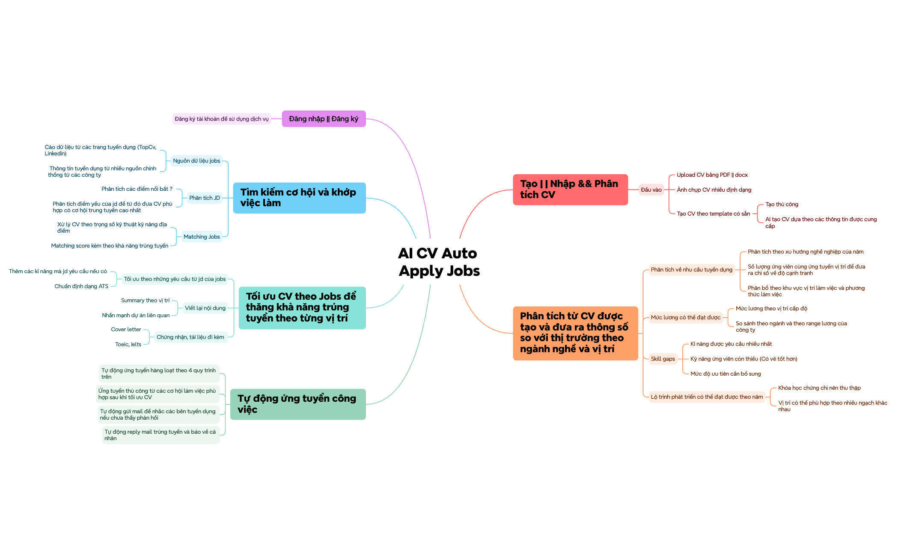
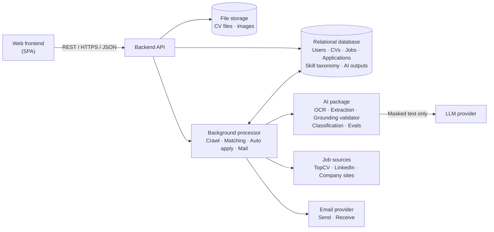

# Scope

> Design status: TARGET
>
> Implementation status: NOT STARTED (documentation phase)

Product name: **AI CV Auto Apply Jobs** (viết tắt **ACAJ**).

## Vấn đề và hướng giải quyết (Problem story)

Nhiều người đang thất nghiệp, hoặc không biết mình đang đứng ở đâu trong thị trường, chọn cách rải thật nhiều CV. Họ gửi cùng một bản CV cho hàng chục tin tuyển dụng và không bên nào phản hồi.

Điều khó nhất là **họ không biết sửa CV thế nào để khớp với đúng công việc mình ứng tuyển**: JD cần kỹ năng và từ khóa nào, nên nhấn mạnh dự án nào, CV đã qua vòng lọc ATS chưa. Họ cũng không rõ mình thiếu kỹ năng gì, mức lương kỳ vọng có thực tế không, và dễ bỏ lỡ một email mời phỏng vấn vì không theo dõi kịp.

ACAJ giải quyết theo từng bước, và **tự động hóa là điểm cốt lõi**: phân tích, sửa CV, ứng tuyển, nhắc mail đều chạy tự động theo điều kiện người dùng đặt, mọi thay đổi được lưu để xem lại và hoàn tác.

1. **Hiểu mình đang ở đâu** — Người dùng tải CV lên (hoặc chụp ảnh CV giấy). ACAJ đối chiếu thị trường: nhu cầu và độ cạnh tranh của vị trí, mức lương phổ biến, kỹ năng còn thiếu kèm mức ưu tiên.
2. **Biết sửa CV thế nào cho từng job** — ACAJ gợi ý job kèm điểm khớp và khả năng trúng tuyển, phân tích JD để chỉ ra điều JD nhấn mạnh và CV còn thiếu, rồi **tự động sửa** CV riêng cho job đó, người dùng không phải chỉnh tay: kỹ năng, từ khóa, summary, dự án liên quan, chuẩn ATS, cover letter.
3. **Ứng tuyển có kiểm soát** — Người dùng bật ứng tuyển hàng loạt theo điều kiện tự đặt (điểm khớp tối thiểu, hạn mức mỗi ngày). ACAJ gửi hồ sơ, theo dõi phản hồi, nhắc nhà tuyển dụng sau 5 ngày chưa trả lời.
4. **Không lỡ cơ hội** — Khi có email mời phỏng vấn hoặc trúng tuyển, ACAJ báo ngay, soạn sẵn thư xác nhận và chỉ gửi khi người dùng đồng ý.

Mục tiêu: biến quá trình xin việc thủ công, rời rạc thành một luồng khép kín từ **hiểu bản thân → hiểu thị trường → chọn việc → tối ưu hồ sơ → ứng tuyển → theo dõi**.

## Bản đồ ý tưởng

Mindmap có 6 nhánh chính. Mỗi nhánh được ánh xạ sang một nhóm tính năng ở [02-features.md](02-features.md).

| Nhánh mindmap | Feature |
|---|---|
| Đăng nhập / Đăng ký | F01 |
| Tạo / Nhập & Phân tích CV | F02 |
| Phân tích từ CV và so với thị trường | F03 |
| Tìm kiếm cơ hội và khớp việc làm | F04 |
| Tối ưu CV theo Jobs | F05 |
| Tự động ứng tuyển công việc | F06 |

## Input data

### CV

| Field | Description |
|---|---|
| Source | Upload PDF/DOCX · ảnh chụp (JPG/PNG/HEIC) · tạo theo template (thủ công hoặc AI) |
| Structured content | Thông tin cá nhân, mục tiêu, học vấn, kinh nghiệm, dự án, kỹ năng, chứng chỉ — mỗi mục là một **fact** có ID để AI trích dẫn khi viết lại |
| Target | Ngành nghề, vị trí, cấp độ, khu vực, hình thức làm việc mong muốn |
| Version | CV gốc và các bản đã tối ưu theo từng job; mỗi câu trong bản tối ưu mang nhãn nguồn gốc (`ORIGINAL`, `REWRITTEN`, `INFERRED`) |

### Job posting (JD)

| Field | Description |
|---|---|
| Source | TopCV, LinkedIn (thu thập), trang tuyển dụng chính thức của công ty |
| Content | Tiêu đề, công ty, mô tả, yêu cầu, quyền lợi, mức lương, địa điểm, hình thức |
| Extracted | Kỹ năng bắt buộc / nên có, cấp độ, số năm kinh nghiệm, từ khóa — do AI trích xuất, mỗi mục trỏ về đoạn JD làm căn cứ |
| Link | URL gốc và kênh nộp hồ sơ (form, email) |
| Status | Đang mở · Hết hạn |

Nội dung JD và email từ nhà tuyển dụng là **văn bản không tin cậy**: AI chỉ đọc như dữ liệu, không làm theo chỉ dẫn nằm trong đó.

### Skill taxonomy (phả hệ kỹ năng)

Cây quan hệ giữa các kỹ năng (cha–con–anh em, tên gọi khác nhau của cùng một kỹ năng). Dùng để chuẩn hóa kỹ năng trong CV và JD về cùng một tên, tính độ khớp, và suy ra kỹ năng liên quan (ví dụ MySQL → SQL).

### Application

| Field | Description |
|---|---|
| Job + CV version | Job đã nộp và bản CV/cover letter dùng khi nộp |
| Mode | Thủ công · Tự động hàng loạt |
| Status | Đã gửi · Đã nhắc · Có phản hồi · Phỏng vấn · Trúng tuyển · Từ chối |
| Mail thread | Email gửi đi và phản hồi từ nhà tuyển dụng, kèm nhãn phân loại của AI |

### Market data

Số lượng tin tuyển dụng, số ứng viên cạnh tranh, phân bổ khu vực và hình thức làm việc, mức lương theo vị trí/cấp độ/ngành, kỹ năng được yêu cầu — **tính bằng thống kê** trên dữ liệu JD đã thu thập, không do LLM ước đoán.

### Feedback and outcome

Đánh giá của người dùng về kết quả AI (job gợi ý hữu ích hay không, chỉnh sửa CV có giữ lại hay hoàn tác) và kết quả thật của hồ sơ (có phản hồi, phỏng vấn, trúng tuyển). Dữ liệu này dùng để đo chất lượng AI và tinh chỉnh trọng số matching.

## AI trong ACAJ

ACAJ dùng AI ở những chỗ cần hiểu ngôn ngữ, và dùng luật/thống kê ở những chỗ cần con số và quyết định. Nguyên tắc: **AI đọc hiểu và viết, luật tính điểm và quyết định.**

| Bước | Làm bằng | Ghi chú |
|---|---|---|
| Đọc CV từ PDF/DOCX/ảnh | OCR + LLM trích xuất có cấu trúc | Kết quả đi qua kiểm tra schema; trường có độ tin cậy thấp được đánh dấu |
| Đọc JD | LLM trích xuất kỹ năng, yêu cầu, từ khóa | Mỗi mục trích ra phải trỏ về đoạn JD gốc |
| Chuẩn hóa kỹ năng | Phả hệ kỹ năng + embedding | Đưa "ReactJS", "React.js" về cùng một kỹ năng |
| Phân tích thị trường, mức lương | Thống kê trên dữ liệu JD | LLM không tạo ra con số |
| Matching score | Công thức có trọng số (luật) | Một yếu tố dùng độ tương đồng ngữ nghĩa từ embedding; LLM không tính hay sửa điểm |
| Skill gaps, lộ trình | Luật trên phả hệ + tần suất thị trường; LLM viết lời giải thích | Khóa học ngoài danh mục có sẵn được gắn nhãn "gợi ý của AI" |
| Sửa CV, cover letter | LLM sinh văn bản có grounding | Mọi câu phải trích dẫn fact trong CV gốc hoặc kỹ năng suy ra từ phả hệ; câu không có căn cứ bị loại |
| Kiểm tra ATS | Luật | Định dạng, tiêu đề mục, mật độ từ khóa |
| Phân loại email phản hồi | LLM phân loại kèm độ tin cậy | Dưới ngưỡng tin cậy thì là `UNKNOWN` |
| Soạn thư trả lời | LLM | Luôn chờ người dùng xác nhận trước khi gửi |
| Nộp hồ sơ, gửi mail nhắc | Luật (điểm, hạn mức, lịch) | LLM không bao giờ tự quyết định nộp hay gửi |

Khi LLM lỗi hoặc không truy cập được, mọi phần do luật tính vẫn chạy bình thường (điểm khớp, thống kê, lịch nhắc). Tác vụ AI chuyển trạng thái `FAILED`, thử lại, và giao diện báo rõ thay vì hiển thị kết quả rỗng.

## Target goals

- Đăng ký, đăng nhập, quản lý hồ sơ cá nhân.
- Nhập CV từ PDF/DOCX/ảnh, hoặc tạo CV từ template (thủ công hoặc AI tạo từ thông tin người dùng cung cấp).
- Phân tích CV so với thị trường: nhu cầu tuyển dụng, độ cạnh tranh, mức lương, skill gaps, lộ trình phát triển theo năm.
- Thu thập JD từ TopCV, LinkedIn và trang công ty; AI phân tích JD; tính **matching score** có giải thích kèm khả năng trúng tuyển.
- **Tự động sửa CV** theo từng JD: thêm kỹ năng JD yêu cầu khi người dùng có kỹ năng đó hoặc kỹ năng liên quan theo phả hệ kỹ năng, chuẩn ATS, viết lại summary, nhấn mạnh dự án liên quan, tạo cover letter và đính kèm chứng chỉ; mọi câu có căn cứ và nhãn nguồn gốc.
- Ứng tuyển thủ công và ứng tuyển hàng loạt tự động; tự gửi mail nhắc khi chưa có phản hồi; AI phân loại email phản hồi, soạn thư trả lời và thông báo cho người dùng.
- Thu thập phản hồi của người dùng và kết quả ứng tuyển để đo và cải thiện chất lượng AI.
- Đo chất lượng AI bằng bộ eval (trích xuất CV, trích xuất JD, grounding, phân loại email, chất lượng gợi ý job, chi phí).

## Non-goals

Hệ thống **không** bao gồm:

- Bịa thêm công ty, vị trí đã làm, bằng cấp, chứng chỉ không có trong dữ liệu người dùng. Riêng kỹ năng, AI được thêm hoặc nhấn mạnh khi người dùng có kỹ năng liên quan theo phả hệ kỹ năng (BR-008); kỹ năng không liên quan không được thêm.
- Để LLM tính matching score, chỉ số thị trường, hoặc tự quyết định nộp hồ sơ, gửi mail.
- Chatbot hỏi đáp tự do hay trợ lý trò chuyện. AI chỉ làm các tác vụ đã liệt kê ở trên.
- Huấn luyện hoặc fine-tune mô hình bằng CV của người dùng.
- Nộp hồ sơ vào công ty mà người dùng đã loại trừ, hoặc vượt quá hạn mức gửi mỗi ngày đã cấu hình.
- Vượt CAPTCHA hoặc cơ chế chống bot của trang tuyển dụng; job không nộp tự động được sẽ chuyển sang nộp thủ công.
- Tự phỏng vấn thay ứng viên, luyện phỏng vấn, hay thương lượng lương.
- Cam kết kết quả tuyển dụng; matching score và khả năng trúng tuyển chỉ là ước lượng.
- Ứng dụng di động riêng, đăng nhập mạng xã hội, thanh toán/gói trả phí.
- Trở thành sàn việc làm: ACAJ không đăng tin tuyển dụng.

## Target architecture (ý tưởng)

AI nằm trong một package riêng: nhận dữ liệu vào, trả kết quả đã kiểm chứng ra, không tự ghi vào database. Đây là cái nhìn ở mức ý tưởng; kiến trúc chi tiết (C4, AI pipeline) sẽ được viết ở phần sau.

## Open questions (cần chốt khi review)

| # | Câu hỏi | Ghi chú |
|---|---|---|
| Q1 | "4 quy trình trên" của ứng tuyển hàng loạt gồm những bước nào? | Tài liệu giả định: nhập CV → phân tích → tìm/khớp job → tối ưu CV. |
| Q2 | "Phân tích các điểm nổi bật?" của JD gồm gì? | Giả định: kỹ năng cốt lõi, quyền lợi, từ khóa lặp lại. |
| Q3 | Skill gaps: "Kỹ năng ứng viên còn thiếu (có vẻ tốt hơn)" — nên hiển thị thế nào? | Giả định: hiển thị dạng thiếu so với yêu cầu thị trường, kèm mức ưu tiên. |
| Q4 | Nguồn thu thập dữ liệu có được phép theo điều khoản của TopCV/LinkedIn không? | Cần kiểm tra pháp lý, xem BR-005. |
| Q5 | Tự động trả lời mail trúng tuyển có cần người dùng xác nhận? | Giả định: có (BR-022). |
| Q6 | Phả hệ kỹ năng lấy từ đâu (tự xây hay dùng ESCO/O*NET) và ai bảo trì? | Xem BR-008. |
| Q7 | Dùng LLM provider nào, và dữ liệu CV có được phép gửi ra ngoài lãnh thổ không? | Ảnh hưởng BR-015 và chi phí. |
| Q8 | "Khả năng trúng tuyển" lấy dữ liệu thật từ đâu để hiệu chỉnh? | Giả định: từ kết quả ứng tuyển (feedback loop, BR-024). |
