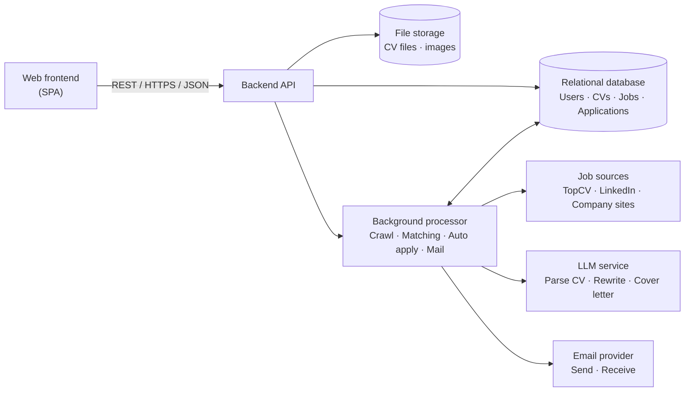

# Scope

> Design status: TARGET
>
> Implementation status: NOT STARTED (documentation phase)

Product name: **AI CV Auto Apply Jobs** (viết tắt **ACAJ**).

## Vấn đề và hướng giải quyết (Problem story)

Nhiều người đang thất nghiệp, hoặc không biết mình đang đứng ở đâu trong thị trường, chọn cách rải thật nhiều CV. Họ gửi cùng một bản CV cho hàng chục tin tuyển dụng và không bên nào phản hồi.

Điều khó nhất là **họ không biết sửa CV thế nào để khớp với đúng công việc mình ứng tuyển**: JD cần kỹ năng và từ khóa nào, nên nhấn mạnh dự án nào, CV đã qua vòng lọc ATS chưa. Họ cũng không rõ mình thiếu kỹ năng gì, mức lương kỳ vọng có thực tế không, và dễ bỏ lỡ một email mời phỏng vấn vì không theo dõi kịp.

ACAJ giải quyết theo từng bước, và **tự động hóa là điểm cốt lõi**: phân tích, sửa CV, ứng tuyển, nhắc mail đều chạy tự động theo điều kiện người dùng đặt, mọi thay đổi được lưu để xem lại và hoàn tác.

1. **Hiểu mình đang ở đâu** — Người dùng tải CV lên (hoặc chụp ảnh CV giấy). ACAJ đối chiếu thị trường: nhu cầu và độ cạnh tranh của vị trí, mức lương phổ biến, kỹ năng còn thiếu kèm mức ưu tiên.
2. **Biết sửa CV thế nào cho từng job** — ACAJ gợi ý job kèm điểm khớp và khả năng trúng tuyển, phân tích JD để chỉ ra điều JD nhấn mạnh và CV còn thiếu, rồi **tự động sửa** CV riêng cho job đó, người dùng không phải chỉnh tay: kỹ năng, từ khóa, summary, dự án liên quan, chuẩn ATS, cover letter.
3. **Ứng tuyển có kiểm soát** — Người dùng bật ứng tuyển hàng loạt theo điều kiện tự đặt (điểm khớp tối thiểu, hạn mức mỗi ngày). ACAJ gửi hồ sơ, theo dõi phản hồi, nhắc nhà tuyển dụng sau 5 ngày chưa trả lời.
4. **Không lỡ cơ hội** — Khi có email mời phỏng vấn hoặc trúng tuyển, ACAJ báo ngay, soạn sẵn thư xác nhận và chỉ gửi khi người dùng đồng ý.

Mục tiêu: biến quá trình xin việc thủ công, rời rạc thành một luồng khép kín từ **hiểu bản thân → hiểu thị trường → chọn việc → tối ưu hồ sơ → ứng tuyển → theo dõi**.

## Bản đồ ý tưởng

Mindmap có 6 nhánh chính. Mỗi nhánh được ánh xạ sang một nhóm tính năng ở [02-features.md](02-features.md).

| Nhánh mindmap | Feature |
|---|---|
| Đăng nhập / Đăng ký | F01 |
| Tạo / Nhập & Phân tích CV | F02 |
| Phân tích từ CV và so với thị trường | F03 |
| Tìm kiếm cơ hội và khớp việc làm | F04 |
| Tối ưu CV theo Jobs | F05 |
| Tự động ứng tuyển công việc | F06 |

## Input data

### CV

| Field | Description |
|---|---|
| Source | Upload PDF/DOCX · ảnh chụp (JPG/PNG/HEIC) · tạo theo template (thủ công hoặc AI) |
| Structured content | Thông tin cá nhân, mục tiêu, học vấn, kinh nghiệm, dự án, kỹ năng, chứng chỉ |
| Target | Ngành nghề, vị trí, cấp độ, khu vực, hình thức làm việc mong muốn |
| Version | CV gốc và các bản đã tối ưu theo từng job |

### Job posting (JD)

| Field | Description |
|---|---|
| Source | TopCV, LinkedIn (thu thập), trang tuyển dụng chính thức của công ty |
| Content | Tiêu đề, công ty, mô tả, yêu cầu, quyền lợi, mức lương, địa điểm, hình thức |
| Link | URL gốc và kênh nộp hồ sơ (form, email) |
| Status | Đang mở · Hết hạn |

### Application

| Field | Description |
|---|---|
| Job + CV version | Job đã nộp và bản CV/cover letter dùng khi nộp |
| Mode | Thủ công · Tự động hàng loạt |
| Status | Đã gửi · Đã nhắc · Có phản hồi · Phỏng vấn · Trúng tuyển · Từ chối |
| Mail thread | Email gửi đi và phản hồi từ nhà tuyển dụng |

### Market data

Số lượng tin tuyển dụng, số ứng viên cạnh tranh, phân bổ khu vực và hình thức làm việc, mức lương theo vị trí/cấp độ/ngành, kỹ năng được yêu cầu — tổng hợp từ dữ liệu JD đã thu thập.

## Target goals

- Đăng ký, đăng nhập, quản lý hồ sơ cá nhân.
- Nhập CV từ PDF/DOCX/ảnh, hoặc tạo CV từ template (thủ công hoặc AI tạo từ thông tin người dùng cung cấp).
- Phân tích CV so với thị trường: nhu cầu tuyển dụng, độ cạnh tranh, mức lương, skill gaps, lộ trình phát triển theo năm.
- Thu thập JD từ TopCV, LinkedIn và trang công ty; phân tích JD; tính **matching score** kèm khả năng trúng tuyển.
- Tối ưu CV theo từng JD: thêm kỹ năng JD yêu cầu khi người dùng có kỹ năng đó hoặc kỹ năng liên quan theo phả hệ kỹ năng, chuẩn ATS, viết lại summary, nhấn mạnh dự án liên quan, tạo cover letter và đính kèm chứng chỉ.
- Ứng tuyển thủ công và ứng tuyển hàng loạt tự động; tự gửi mail nhắc khi chưa có phản hồi; soạn và gửi mail trả lời khi trúng tuyển, đồng thời thông báo cho người dùng.

## Non-goals

Hệ thống **không** bao gồm:

- Bịa thêm công ty, vị trí đã làm, bằng cấp, chứng chỉ không có trong dữ liệu người dùng. Riêng kỹ năng, AI được thêm hoặc nhấn mạnh khi người dùng có kỹ năng liên quan theo phả hệ kỹ năng (BR-001); kỹ năng không liên quan không được thêm.
- Nộp hồ sơ vào công ty mà người dùng đã loại trừ, hoặc vượt quá hạn mức gửi mỗi ngày đã cấu hình.
- Vượt CAPTCHA hoặc cơ chế chống bot của trang tuyển dụng; job không nộp tự động được sẽ chuyển sang nộp thủ công.
- Tự phỏng vấn thay ứng viên, luyện phỏng vấn, hay thương lượng lương.
- Cam kết kết quả tuyển dụng; matching score chỉ là ước lượng.
- Ứng dụng di động riêng, đăng nhập mạng xã hội, thanh toán/gói trả phí (để phiên bản sau).
- Trở thành sàn việc làm: ACAJ không đăng tin tuyển dụng.

## Target architecture (ý tưởng)

Đây là cái nhìn ở mức ý tưởng. Kiến trúc chi tiết (C4) sẽ được viết ở phần sau.

## Open questions (cần chốt khi review)

| # | Câu hỏi | Ghi chú từ mindmap |
|---|---|---|
| Q1 | "4 quy trình trên" của ứng tuyển hàng loạt gồm những bước nào? | Tài liệu giả định: nhập CV → phân tích → tìm/khớp job → tối ưu CV. |
| Q2 | "Phân tích các điểm nổi bật?" của JD gồm gì? | Giả định: kỹ năng cốt lõi, quyền lợi, từ khóa lặp lại. |
| Q3 | Skill gaps: "Kỹ năng ứng viên còn thiếu (có vẻ tốt hơn)" — nên hiển thị thế nào? | Giả định: hiển thị dạng thiếu so với yêu cầu thị trường, kèm mức ưu tiên. |
| Q4 | Nguồn thu thập dữ liệu có được phép theo điều khoản của TopCV/LinkedIn không? | Cần kiểm tra pháp lý, xem R-01 trong BR-016. |
| Q5 | Tự động trả lời mail trúng tuyển có cần người dùng xác nhận? | Giả định: có (BR-014). |
| Q6 | Phả hệ kỹ năng (quan hệ giữa các kỹ năng) lấy từ đâu và ai bảo trì? | Xem BR-001. |
