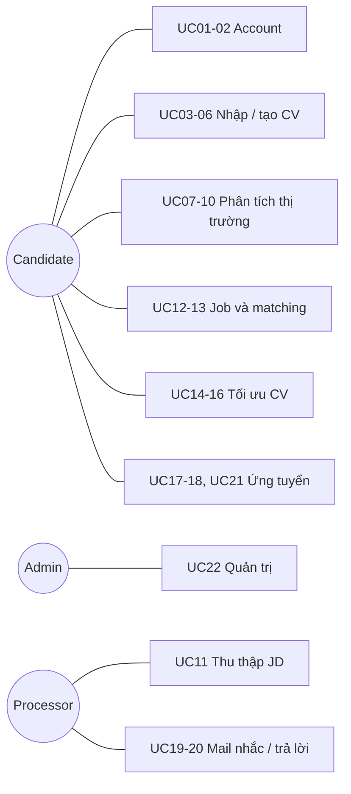
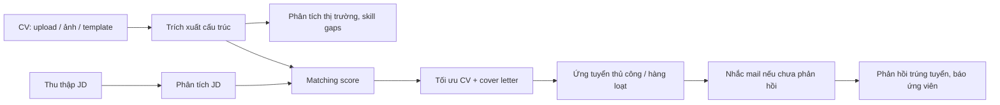

# Actors, roles, use cases

> Design status: TARGET
>
> Current implementation: none (documentation phase)

Product name: **ACAJ**.

## Actors / roles

| Role | Display name in UI | Description |
|---|---|---|
| `CANDIDATE` | Ứng viên | Người tìm việc. Quản lý CV, xem phân tích, chọn job, ứng tuyển. Chỉ thấy dữ liệu của mình. |
| `ADMIN` | Quản trị viên | Quản lý người dùng, nguồn dữ liệu job, cấu hình hệ thống. Không đọc nội dung CV của ứng viên. |

System actors:

| Actor | Description |
|---|---|
| Job source | TopCV, LinkedIn, trang tuyển dụng công ty; cung cấp JD. |
| Background processor | Thu thập JD, phân tích JD, tính matching, thực hiện ứng tuyển tự động, gửi mail nhắc, quét phản hồi. |
| LLM service | Trích xuất CV, viết lại nội dung, tạo cover letter, soạn thư trả lời. |
| Email provider | Gửi mail ứng tuyển/nhắc/trả lời và nhận phản hồi trong hộp thư người dùng đã kết nối. |
| Recruiter | Bên tuyển dụng; không đăng nhập ACAJ, chỉ trao đổi qua email. |

## Role × feature matrix

| Feature | Candidate | Admin |
|---|---|---|
| Đăng ký / đăng nhập / hồ sơ cá nhân | ✓ | ✓ |
| Upload, tạo, sửa CV của mình | ✓ | |
| Xem phân tích thị trường cho CV của mình | ✓ | |
| Xem job và matching score | ✓ | ✓ (job, không có CV) |
| Tối ưu CV, cover letter | ✓ | |
| Ứng tuyển thủ công / tự động | ✓ | |
| Cấu hình luật ứng tuyển tự động | ✓ | |
| Xác nhận gửi thư trả lời trúng tuyển | ✓ | |
| Quản lý nguồn job, lịch thu thập | | ✓ |
| Quản lý người dùng, cấu hình hệ thống | | ✓ |

Backend áp dụng cùng các luật này; ẩn nút ở frontend chỉ phục vụ UX.

## Use case list

| ID | Use case | Primary actor | Feature |
|---|---|---|---|
| UC01 | Đăng ký tài khoản | Candidate | F01 |
| UC02 | Đăng nhập / đăng xuất | Candidate, Admin | F01 |
| UC03 | Upload CV PDF/DOCX | Candidate | F02 |
| UC04 | Upload ảnh CV | Candidate | F02 |
| UC05 | Tạo CV từ template thủ công | Candidate | F02 |
| UC06 | AI tạo CV từ thông tin cung cấp | Candidate | F02 |
| UC07 | Xem phân tích nhu cầu tuyển dụng | Candidate | F03 |
| UC08 | Xem mức lương có thể đạt | Candidate | F03 |
| UC09 | Xem skill gaps | Candidate | F03 |
| UC10 | Xem lộ trình phát triển theo năm | Candidate | F03 |
| UC11 | Thu thập và chuẩn hóa JD | Background processor | F04 |
| UC12 | Xem danh sách job và matching score | Candidate | F04 |
| UC13 | Xem phân tích JD | Candidate | F04 |
| UC14 | Tối ưu CV theo job (ATS, kỹ năng JD) | Candidate | F05 |
| UC15 | Viết lại summary, nhấn mạnh dự án | Candidate | F05 |
| UC16 | Tạo cover letter, đính kèm chứng chỉ | Candidate | F05 |
| UC17 | Ứng tuyển thủ công | Candidate | F06 |
| UC18 | Cấu hình và chạy ứng tuyển hàng loạt | Candidate | F06 |
| UC19 | Tự động gửi mail nhắc nhà tuyển dụng | Background processor | F06 |
| UC20 | Xử lý mail trúng tuyển và thông báo | Background processor, Candidate | F06 |
| UC21 | Theo dõi trạng thái hồ sơ đã nộp | Candidate | F06 |
| UC22 | Quản lý nguồn job và người dùng | Admin | F01, F04 |

## Use Case Diagram

## Main use case: UC12 Xem job và matching score

| Item | Content |
|---|---|
| Precondition | Ứng viên đã đăng nhập và có ít nhất một CV đã lưu. |
| Main flow | 1. Ứng viên mở danh sách job. 2. Hệ thống hiển thị job theo matching score giảm dần, mỗi job có điểm khớp, khả năng trúng tuyển và lý do theo từng yếu tố (kỹ thuật, kỹ năng, địa điểm). 3. Ứng viên mở một job để xem JD, phần khớp và phần còn thiếu. |
| Alternative flow | Chưa có CV → yêu cầu tải/tạo CV (UC03–UC06). Không có job phù hợp → gợi ý nới bộ lọc. |
| Postcondition | Không thay đổi dữ liệu. |

## Use case: UC14–UC16 Tối ưu CV cho một job

| Item | Content |
|---|---|
| Precondition | Ứng viên đã chọn một job và có CV gốc. |
| Main flow | 1. Hệ thống phân tích JD. 2. Hệ thống tạo bản CV riêng: thêm kỹ năng JD yêu cầu mà ứng viên có, chuẩn ATS, viết lại summary, đưa dự án liên quan lên đầu. 3. Hệ thống tạo cover letter và gợi ý chứng chỉ đính kèm. 4. Hệ thống lưu bản so sánh với bản gốc; ở chế độ tự động bản tối ưu được dùng ngay, ứng viên xem lại, sửa hoặc hoàn tác sau. Ở chế độ duyệt trước, ứng viên duyệt rồi mới dùng. |
| Alternative flow | JD yêu cầu kỹ năng không có trong phả hệ kỹ năng của ứng viên (không có kỹ năng liên quan) → không thêm; hiển thị trong phần thiếu và gợi ý bổ sung (UC09). Kỹ năng suy ra từ phả hệ được thêm kèm nhãn "suy ra" để ứng viên xem lại. |
| Postcondition | Lưu một phiên bản CV mới gắn với job; CV gốc giữ nguyên. |

## Use case: UC18 Ứng tuyển hàng loạt

| Item | Content |
|---|---|
| Precondition | Có CV gốc; ứng viên đã kết nối hộp thư gửi mail. |
| Main flow | 1. Ứng viên đặt điểm khớp tối thiểu, hạn mức mỗi ngày, công ty loại trừ và bật chế độ. 2. Processor chọn các job đạt điều kiện chưa nộp. 3. Với mỗi job: tối ưu CV, tạo cover letter, nộp hồ sơ. 4. Hệ thống ghi trạng thái và thông báo tổng kết. |
| Alternative flow | Job yêu cầu CAPTCHA/đăng nhập không tự nộp được → chuyển sang danh sách "cần nộp thủ công". Hết hạn mức → dừng và tiếp tục ngày sau. |
| Rule | Không bao giờ nộp vượt hạn mức, nộp trùng một job, hoặc nộp công ty bị loại trừ. |

## Use case: UC19–UC20 Mail nhắc và mail trúng tuyển

| Item | Content |
|---|---|
| UC19 flow | 1. Sau N ngày (mặc định 5) chưa có phản hồi, Processor gửi một mail nhắc lịch sự. 2. Hệ thống ghi lại và không nhắc quá số lần tối đa (mặc định 1). |
| UC20 flow | 1. Processor phát hiện phản hồi trúng tuyển/mời phỏng vấn. 2. Hệ thống đổi trạng thái hồ sơ, soạn thư trả lời và thông báo cho ứng viên. 3. Ứng viên xác nhận (hoặc sửa) rồi hệ thống gửi. |
| Alternative flow | Phân loại phản hồi không chắc chắn → chỉ thông báo, không soạn thư tự động. |

## Business flow: từ CV đến hồ sơ đã nộp

