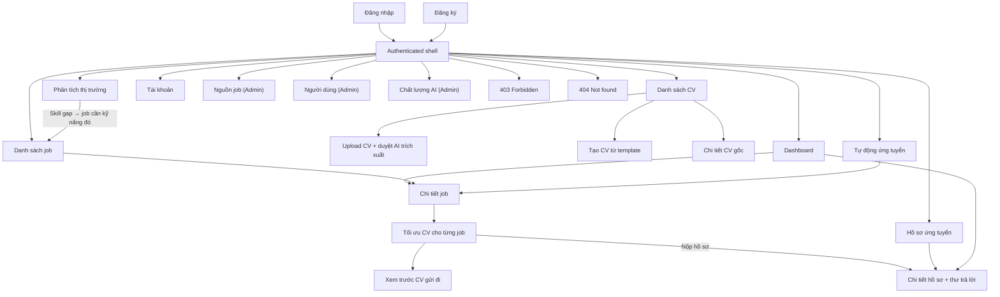
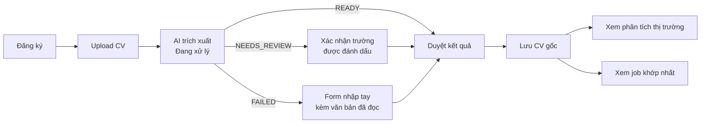
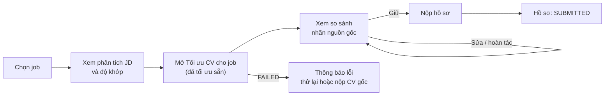
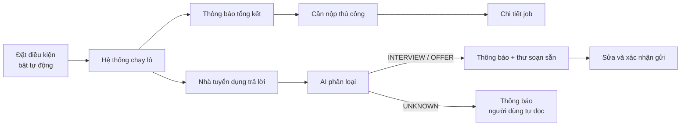
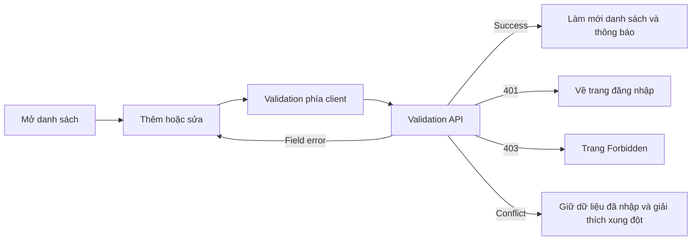

# Information architecture

> Design status: TARGET
>
> Current implementation: none (documentation phase)

Kiến trúc thông tin của ACAJ được mô tả bằng bốn hệ thống: tổ chức, gắn nhãn, điều hướng và phân cấp (mô hình IA của Rosenfeld & Morville). Màn hình và quyền truy cập bám theo [use case](03-use-cases.md) và [ma trận vai trò](03-use-cases.md#role--feature-matrix).

**Organization scheme.** Trang được nhóm theo *câu hỏi người dùng đang muốn trả lời*, không theo bảng dữ liệu. Thứ tự nhóm đi theo hành trình xin việc:

| Nhóm | Câu hỏi của người dùng | Trang |
|---|---|---|
| **TỔNG QUAN** | Hôm nay tôi cần làm gì? | Dashboard |
| **HỒ SƠ** | CV của tôi đang có gì? | CV của tôi |
| **THỊ TRƯỜNG** | Tôi đang ở đâu trên thị trường? | Phân tích thị trường |
| **VIỆC LÀM** | Việc nào hợp với tôi, và CV cần sửa thế nào? | Việc làm |
| **ỨNG TUYỂN** | Hồ sơ của tôi đang ra sao? | Hồ sơ ứng tuyển, Tự động ứng tuyển |
| **QUẢN TRỊ** | Hệ thống và AI có chạy tốt không? (Admin) | Nguồn job, Người dùng, Chất lượng AI |

Trong mỗi nhóm, nội dung được tổ chức theo đối tượng (CV, Job, Hồ sơ ứng tuyển).

**Site map.** Level 0 là sản phẩm, level 1 là nhóm điều hướng, level 2 là trang, level 3 là phần, tab hoặc modal trong trang.

```mermaid
flowchart TB
    ACAJ(["ACAJ"])
    ACAJ --> Public["Public"]
    ACAJ --> Shell["Authenticated workspace<br/>(sidebar + topbar)"]
    ACAJ --> Sys["System pages"]
    Public --> Login["Đăng nhập"]
    Public --> Register["Đăng ký"]
    Sys --> Forbidden["403 Forbidden"]
    Sys --> NotFound["404 Not found"]

    Shell --> Home["TỔNG QUAN"]
    Shell --> Profile["HỒ SƠ"]
    Shell --> Market["THỊ TRƯỜNG"]
    Shell --> Jobs["VIỆC LÀM"]
    Shell --> Apps["ỨNG TUYỂN"]
    Shell --> Admin["QUẢN TRỊ"]
    Shell --> Utility["UTILITY (topbar)"]

    Home --> Dash["Dashboard"]
    Dash --> D1["Việc cần làm<br/>(cần duyệt, cần nộp tay, thư chờ xác nhận)"]
    Dash --> D2["Job khớp nhất"]
    Dash --> D3["Tiến độ hồ sơ"]

    Profile --> Cv["CV của tôi"]
    Cv --> CV1["Danh sách CV"]
    Cv --> CV2["Upload CV<br/>AI trích xuất + duyệt kết quả"]
    Cv --> CV3["Tạo CV từ template<br/>thủ công / AI soạn"]
    Cv --> CV4["Chi tiết CV gốc<br/>sửa + xuất PDF"]

    Market --> Mk["Phân tích thị trường"]
    Mk --> M1["Nhu cầu tuyển dụng<br/>xu hướng năm, cạnh tranh, khu vực, hình thức"]
    Mk --> M2["Mức lương có thể đạt<br/>theo cấp độ, ngành, công ty"]
    Mk --> M3["Skill gaps<br/>kỹ năng hay gặp, còn thiếu, ưu tiên"]
    Mk --> M4["Lộ trình theo năm<br/>khóa học, chứng chỉ, ngạch nghề"]

    Jobs --> Jb["Việc làm"]
    Jb --> J1["Danh sách job<br/>điểm khớp + lý do"]
    Jb --> J2["Chi tiết job"]
    J2 --> J3["JD gốc"]
    J2 --> J4["Phân tích JD<br/>có trích dẫn"]
    J2 --> J5["Độ khớp<br/>từng yếu tố"]
    J2 --> J6["Tối ưu CV cho từng job<br/>màu tô nguồn gốc + căn cứ"]
    J6 --> J7["Cover letter"]
    J6 --> J8["Xem trước CV gửi đi"]

    Apps --> Ap["Hồ sơ ứng tuyển"]
    Ap --> AP1["Danh sách hồ sơ"]
    Ap --> AP2["Chi tiết hồ sơ<br/>chuỗi mail + nhãn AI"]
    AP2 --> AP3["Thư trả lời<br/>AI soạn, chờ xác nhận"]
    Apps --> Auto["Tự động ứng tuyển"]
    Auto --> AU1["Nạp CV và tiến trình 8 bước"]
    Auto --> AU2["Điều kiện nộp và chế độ"]
    Auto --> AU3["Nhật ký, cần nộp thủ công"]

    Admin --> Src["Nguồn job"]
    Admin --> Usr["Người dùng"]
    Admin --> Aiq["Chất lượng AI"]
    Aiq --> Q1["Chỉ số chất lượng"]
    Aiq --> Q2["Độ trễ và chi phí"]
    Aiq --> Q3["Trọng số matching"]

    Utility --> Noti["Thông báo"]
    Utility --> Acc["Tài khoản"]
    Acc --> P1["Thông tin cá nhân"]
    Acc --> P2["Bảo mật và xóa dữ liệu"]
    Acc --> P3["Kết nối hộp thư"]
    Utility --> Lang["Ngôn ngữ VI / EN"]
    Utility --> Logout["Đăng xuất"]

    classDef root fill:#222,color:#fff,stroke:#000
    classDef group fill:#1168bd,color:#fff,stroke:#0b4f9e
    classDef page fill:#dbeafe,color:#111,stroke:#3a7bd5
    classDef leaf fill:#fff,color:#111,stroke:#bbb
    class ACAJ root
    class Home,Profile,Market,Jobs,Apps,Admin,Utility group
    class Dash,Cv,Mk,Jb,Ap,Auto,Src,Usr,Aiq,Noti,Acc page
    class D1,D2,D3,CV1,CV2,CV3,CV4,M1,M2,M3,M4,J1,J2,J3,J4,J5,J6,J7,J8,AP1,AP2,AP3,AU1,AU2,AU3,Q1,Q2,Q3,P1,P2,P3,Lang,Logout,Login,Register,Forbidden,NotFound leaf
```

**Navigation model.**

| Layer | Where | Content |
|---|---|---|
| Global | Sidebar | Các nhóm và trang level 2; nhóm không có trang nào được phép thì ẩn |
| Utility | Topbar | Thông báo, trạng thái tự động hóa (bật/tắt, số hồ sơ còn lại trong ngày), tài khoản, ngôn ngữ, đăng xuất |
| Local | Tab trong trang | Chi tiết job (JD gốc · Phân tích JD · Độ khớp · Tối ưu CV), Chi tiết hồ sơ (Tổng quan · Chuỗi mail), Tự động ứng tuyển, Chất lượng AI, Tài khoản |
| Contextual | Liên kết trong nội dung | Skill gap → lộ trình; job → CV đã tối ưu; hồ sơ → job và bản CV đã nộp; câu trong CV tối ưu → fact gốc làm căn cứ; nhận định phân tích JD → đoạn JD được trích; việc cần làm trên dashboard → đúng màn hình xử lý |

**Labeling.** Nhãn dùng từ của người tìm việc, mỗi khái niệm một tên:

| Khái niệm | Nhãn hiển thị | Không dùng |
|---|---|---|
| CV người dùng tải lên/tạo | CV gốc | CV chính, CV master |
| Bản CV đã tối ưu cho một job | CV đã tối ưu (trang: Tối ưu CV cho từng job) | CV AI, CV đã sửa |
| Matching score | Điểm khớp — luôn là số 0–100 kèm Cao / Trung bình / Thấp | % phù hợp |
| Khả năng đậu phỏng vấn | Khả năng đậu phỏng vấn: Cao / Trung bình / Thấp — chỉ số chính của mỗi job | Tỉ lệ đỗ, khả năng trúng tuyển |
| Application | Hồ sơ ứng tuyển | Đơn, lượt nộp |
| Nhãn nguồn gốc | Giữ nguyên · Viết lại · Suy ra | AI đã thêm |
| Gợi ý ngoài dữ liệu hệ thống | Gợi ý của AI | Khuyến nghị, chắc chắn |
| Trạng thái tác vụ AI | Đang xử lý · Cần bạn kiểm tra · Không xử lý được | Lỗi hệ thống |

**AI presentation.** Kết quả AI luôn đi kèm căn cứ và trạng thái, không bao giờ trình bày như sự thật tuyệt đối:

- Mỗi câu trong "CV đã tối ưu" có nhãn nguồn gốc; bấm vào câu để xem fact gốc làm căn cứ.
- Mỗi nhận định trong "Phân tích JD" bấm được để tô sáng đoạn JD được trích.
- Điểm khớp luôn có bảng giá trị từng yếu tố; không có ô "AI chấm".
- Con số thị trường luôn kèm cỡ mẫu và ngày cập nhật.
- Mỗi kết quả AI có nút phản hồi (hữu ích / không hữu ích) và mỗi thay đổi CV có nút hoàn tác.
- Hành động gửi ra ngoài do AI soạn (thư trả lời) luôn có bước xác nhận riêng.

**Role scope.** Mỗi trang level 2 khai báo vai trò được xem (xem [Page permissions](#page-permissions)). Trang không được phép không hiển thị trên sidebar; truy cập trực tiếp trả về 403. Truy cập dữ liệu của người dùng khác trả về 404 để không lộ sự tồn tại của dữ liệu (BR-001).

Routes: `/login` `/register` `/dashboard` `/cv` `/cv/upload` `/cv/new` `/cv/:id` `/insights` `/jobs` `/jobs/:id` `/jobs/:id/cv` `/jobs/:id/preview` `/applications` `/applications/:id` `/auto-apply` `/account` `/admin/sources` `/admin/users` `/admin/ai` `/403` `/404`.

Form thêm/sửa người dùng và nguồn job mở dạng **modal** trên trang danh sách. Thông báo mở dạng panel từ topbar, không phải trang riêng.

**Time display:** thời gian lưu UTC, hiển thị theo múi giờ người xem (mặc định giờ Việt Nam) và luôn ghi rõ múi giờ.

## Page permissions

| Page | Who can access |
|---|---|
| Dashboard | CANDIDATE |
| CV của tôi, Phân tích thị trường | CANDIDATE |
| Việc làm (danh sách, chi tiết JD) | CANDIDATE, ADMIN (ADMIN không thấy điểm khớp và CV) |
| Việc làm — tab "Độ khớp", "Tối ưu CV" | CANDIDATE |
| Hồ sơ ứng tuyển, Tự động ứng tuyển | CANDIDATE |
| Nguồn job, Người dùng, Chất lượng AI | ADMIN |
| Tài khoản | mọi vai trò (tab "Kết nối hộp thư" chỉ CANDIDATE) |
| Unauthorized | `/403` |
| Dữ liệu của người khác | `/404` |

Mục không được phép **không được hiển thị** trên sidebar. Backend kiểm tra cùng các luật này.

## Screen inventory

| Screen ID | Screen | Presentation | Related use cases |
|---|---|---|---|
| `SCR-01` | Đăng nhập | Page | UC02 |
| `SCR-02` | Đăng ký | Page | UC01 |
| `SCR-03` | Dashboard: việc cần làm, job khớp nhất, tiến độ hồ sơ | Page | UC12, UC20, UC21 |
| `SCR-10` | Danh sách CV | Page | UC03–UC06 |
| `SCR-11` | Upload CV và duyệt kết quả AI trích xuất | Page (theo bước) | UC03, UC04 |
| `SCR-12` | Tạo CV từ template (thủ công / AI soạn) | Page | UC05, UC06 |
| `SCR-13` | Chi tiết CV gốc: sửa, xuất PDF | Page | UC03–UC06 |
| `SCR-20` | Phân tích CV so với thị trường theo 4 nhánh của mindmap: nhu cầu tuyển dụng, mức lương có thể đạt, skill gaps, lộ trình theo năm | Page | UC07, UC08, UC09, UC10 |
| `SCR-30` | Danh sách job kèm điểm khớp | Page | UC12, UC23 |
| `SCR-31` | Chi tiết job: JD gốc, phân tích JD, độ khớp | Tabbed page | UC12, UC13 |
| `SCR-32` | Tối ưu CV cho từng job: CV đã tối ưu với màu tô nguồn gốc, căn cứ của từng câu, JD hỏi gì và CV đáp ứng gì, nộp hồ sơ | Page | UC14, UC15, UC16, UC17, UC23 |
| `SCR-33` | Xem trước CV gửi đi: đúng bản PDF nhà tuyển dụng nhận, kết quả kiểm tra ATS | Page | UC14, UC17 |
| `SCR-40` | Danh sách hồ sơ ứng tuyển | Page | UC21 |
| `SCR-41` | Chi tiết hồ sơ: trạng thái, CV đã nộp, chuỗi mail, nhãn AI, thư trả lời | Tabbed page | UC19, UC20, UC21, UC23 |
| `SCR-42` | Tự động ứng tuyển: chỉ cần nạp CV, tiến trình 8 bước từ đọc CV đến báo tin, điều kiện nộp, chế độ, nhật ký | Page | UC03, UC18, UC19, UC20 |
| `SCR-50` | Tài khoản: thông tin, bảo mật và xóa dữ liệu, kết nối hộp thư | Tabbed page | F01.4, UC20 (tiền đề) |
| `SCR-60` | Nguồn job | Page with form modal | UC11, UC22 |
| `SCR-61` | Người dùng | Page with form modal | UC22 |
| `SCR-62` | Chất lượng AI: chỉ số, độ trễ và chi phí, trọng số matching | Tabbed page | UC24 |
| `SCR-90` | Forbidden | Page | Phân quyền chung |
| `SCR-91` | Not found | Page | Cô lập dữ liệu (BR-001) |

## Requirement-to-screen mapping

| Requirement | Primary screen/action |
|---|---|
| US01 | `SCR-02` gửi form đăng ký |
| US02 | `SCR-01` đăng nhập; topbar đăng xuất, quay về `SCR-01` |
| US03 | `SCR-11` upload PDF/DOCX, chờ AI trích xuất, duyệt và lưu |
| US04 | `SCR-11` upload ảnh, xác nhận các trường "Cần bạn kiểm tra" |
| US05 | `SCR-12` chọn template, tự điền |
| US06 | `SCR-12` nhập thông tin thô, AI soạn, duyệt và lưu |
| US07 | `SCR-20` phần Nhu cầu tuyển dụng |
| US08 | `SCR-20` phần Mức lương có thể đạt |
| US09 | `SCR-20` phần Skill gaps |
| US10 | `SCR-20` phần Lộ trình theo năm và bảng ngạch nghề |
| US11 | Không có màn hình người dùng (tác vụ nền); kết quả xuất hiện ở `SCR-30`; Admin theo dõi ở `SCR-60` |
| US12 | `SCR-30` lọc, sắp xếp; `SCR-31` tab Độ khớp |
| US13 | `SCR-31` tab Phân tích JD, bấm nhận định để xem đoạn JD |
| US14 | `SCR-32` xem CV đã tối ưu, màu tô nguồn gốc và căn cứ; `SCR-33` kết quả kiểm tra ATS |
| US15 | `SCR-32` chấp nhận, sửa hoặc hoàn tác từng thay đổi |
| US16 | `SCR-32` phần Cover letter và chứng chỉ đính kèm |
| US17 | `SCR-32` hoặc `SCR-33` nút Nộp hồ sơ |
| US18 | `SCR-42` nạp CV, theo dõi tiến trình tự động, đặt điều kiện, xem nhật ký |
| US19 | `SCR-41` xem mail nhắc đã gửi trong chuỗi mail |
| US20 | Thông báo → `SCR-41` xem nhãn AI, sửa và xác nhận thư trả lời |
| US21 | `SCR-40` lọc theo trạng thái; `SCR-41` xem chi tiết |
| US22 | `SCR-60`, `SCR-61` |
| US23 | Nút phản hồi trên `SCR-30`, `SCR-32`, `SCR-41` |
| US24 | `SCR-62` |

## Screen hierarchy

## Primary task flows

**Lần đầu sử dụng: từ CV đến job phù hợp**

**Sửa CV và nộp cho một job**

**Tự động ứng tuyển và phản hồi**

**Form chung**

## UI/UX state contract

| State | Required behavior |
|---|---|
| Initial loading | Giữ khung trang; hiện skeleton cho panel hoặc bảng đang tải. |
| Empty | Giải thích chưa có dữ liệu; phân biệt "chưa có dữ liệu" với "bộ lọc không có kết quả"; hiện hành động chính được phép (ví dụ "Tải CV lên"). |
| Chưa có CV | Màn hình job và thị trường hướng dẫn tải hoặc tạo CV, không hiển thị điểm khớp rỗng. |
| AI đang xử lý (`PENDING`) | Hiện tiến trình và việc đang làm ("Đang đọc CV", "Đang tối ưu CV đã tối ưu"); người dùng vẫn điều hướng được sang trang khác. |
| Cần kiểm tra (`NEEDS_REVIEW`) | Tô nổi trường có độ tin cậy thấp kèm chữ "Cần bạn kiểm tra"; đưa focus tới trường đầu tiên. |
| AI không xử lý được (`FAILED`) | Nói rõ phần nào chưa có và phần nào vẫn dùng được (ví dụ điểm khớp vẫn hiển thị); có nút thử lại và lối thao tác thủ công; không hiện kết quả rỗng như thành công. |
| Nhãn nguồn gốc | Mỗi câu trong "CV đã tối ưu" hiện nhãn Giữ nguyên / Viết lại / Suy ra bằng chữ, không chỉ bằng màu; câu Suy ra cho biết suy ra từ kỹ năng nào. |
| Căn cứ | Mọi kết quả AI xem được căn cứ (fact CV gốc, đoạn JD); không bao giờ hiển thị văn bản AI không có căn cứ. |
| Gợi ý của AI | Gợi ý ngoài dữ liệu hệ thống (ví dụ khóa học ngoài danh mục) có nhãn "Gợi ý của AI" và trông khác nội dung từ dữ liệu. |
| Chưa đủ dữ liệu | Chỉ số thị trường dưới ngưỡng hiện "Chưa đủ dữ liệu" kèm cỡ mẫu hiện có (BR-006). |
| Hết hạn mức AI | Báo tác vụ sẽ chạy lại vào ngày mai; không ẩn lỗi (BR-016). |
| Xác nhận gửi | Thư trả lời do AI soạn hiện đầy đủ người nhận và nội dung, có nút sửa; nút gửi chỉ có tác dụng sau khi người dùng bấm xác nhận. |
| Tự động hóa | Topbar luôn hiện tự động ứng tuyển đang bật hay tắt và số hồ sơ còn lại trong ngày; nút tạm dừng luôn với tới được. |
| Validation error | Giữ dữ liệu đã nhập, gắn thông báo vào đúng trường, focus vào lỗi đầu tiên. |
| API error | Thông báo ngắn kèm mã tham chiếu (trace id); không lộ chi tiết kỹ thuật. |
| Unauthorized | Xóa phiên không hợp lệ và về trang đăng nhập. |
| Forbidden | Giữ phiên, hiển thị `/403` kèm đường quay lại an toàn. |
| Saving / submitting | Chặn bấm gửi lặp; hiện tiến trình mà không chặn điều hướng, trừ khi có thể mất dữ liệu. |
| Success | Xác nhận hành động, đóng modal khi phù hợp, làm mới dữ liệu liên quan. |

## Responsive and accessibility rules

- Bảng trên desktop giữ đủ cột; màn hình hẹp (≥ 360 px) dùng cuộn ngang hoặc thẻ tóm tắt, không ẩn dữ liệu vĩnh viễn.
- Màn so sánh CV: desktop hiển thị hai cột (CV gốc · CV đã tối ưu); màn hình hẹp chuyển sang một cột với nút chuyển qua lại.
- Modal nằm gọn trong màn hình, giữ nút hành động luôn thấy, khóa focus bàn phím, đóng bằng `Escape` khi không có thao tác gửi đang chạy, và trả focus về nút đã mở.
- Mọi ô nhập có nhãn hiển thị; nút chỉ có icon có tên truy cập; trạng thái không chỉ thể hiện bằng màu (điểm khớp luôn có số và chữ Cao / Trung bình / Thấp; nhãn nguồn gốc luôn có chữ).
- Căn cứ của câu AI viết (popover) mở được bằng bàn phím và được trình đọc màn hình đọc.
- Thông báo trạng thái AI (đang xử lý, xong, lỗi) được báo qua vùng `aria-live`.
- Người dùng bàn phím đi được qua điều hướng, bộ lọc, hàng trong bảng, tab, hành động trong modal và phân trang theo thứ tự dự đoán được.
- Ngày giờ có định dạng và múi giờ rõ ràng; giao diện hỗ trợ tiếng Việt và tiếng Anh (NFR-UX-001).

## Current UI versus target

Chưa có giao diện; tài liệu này là thiết kế mục tiêu. Độ phủ trường dữ liệu của từng màn hình sẽ được rà lại khi có data model.
