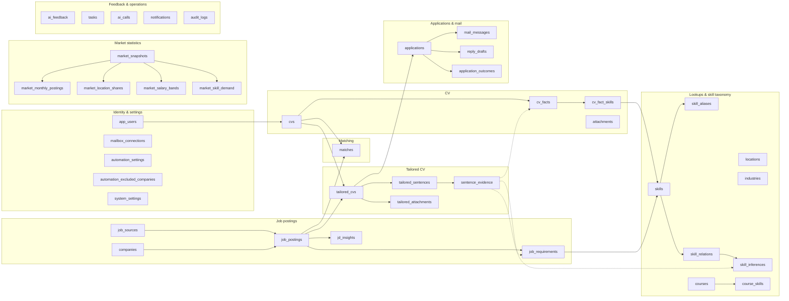

# Data model (PostgreSQL schema design)

> Design status: TARGET
>
> Runtime status: SCHEMA DESIGN ONLY; loaded into PostgreSQL 16 + pgvector with a smoke test, not connected to an application

41 bảng. Sources of truth: [acaj.dbml](database/acaj.dbml) (bảng, cột, khóa, index) và [checks.sql](database/checks.sql) (ràng buộc CHECK mà DBML không diễn đạt được). SQL chạy được sinh từ DBML bằng `dbml2sql --postgres`, rồi áp `checks.sql`.

## Table groups

## Entity-relationship diagram

```mermaid
erDiagram
    app_users ||--o| mailbox_connections : connects
    app_users ||--|| automation_settings : configures
    app_users ||--o{ automation_excluded_companies : excludes
    companies ||--o{ automation_excluded_companies : excluded
    app_users ||--o{ cvs : owns
    app_users ||--o{ attachments : uploads
    app_users ||--o{ applications : submits
    app_users ||--o{ ai_feedback : gives
    app_users ||--o{ notifications : receives
    app_users ||--o{ tasks : requests
    app_users ||--o{ audit_logs : performs

    skills ||--o{ skill_aliases : known_as
    skills ||--o{ skill_relations : from
    skills ||--o{ skill_inferences : infers
    courses ||--o{ course_skills : teaches
    skills ||--o{ course_skills : taught_by

    cvs ||--o{ cv_facts : has
    cv_facts ||--o{ cv_fact_skills : shows
    skills ||--o{ cv_fact_skills : shown_in
    locations ||--o{ cvs : targets

    job_sources ||--o{ job_postings : publishes
    companies ||--o{ job_postings : posts
    industries ||--o{ companies : groups
    locations ||--o{ job_postings : located_in
    job_postings ||--o{ job_requirements : requires
    skills ||--o{ job_requirements : asked_for
    job_postings ||--o{ jd_insights : explains

    locations ||--o{ market_snapshots : for
    market_snapshots ||--o{ market_monthly_postings : trend
    market_snapshots ||--o{ market_location_shares : spread
    market_snapshots ||--o{ market_salary_bands : salary
    market_snapshots ||--o{ market_skill_demand : demand
    skills ||--o{ market_skill_demand : demanded

    cvs ||--o{ matches : scored
    job_postings ||--o{ matches : scored

    cvs ||--o{ tailored_cvs : tailored_from
    job_postings ||--o{ tailored_cvs : tailored_for
    tailored_cvs ||--o{ tailored_sentences : contains
    tailored_sentences ||--o{ sentence_evidence : cites
    cv_facts |o--o{ sentence_evidence : cited_fact
    skill_inferences |o--o{ sentence_evidence : cited_inference
    job_requirements |o--o{ sentence_evidence : cited_requirement
    tailored_cvs ||--o{ tailored_attachments : attaches
    attachments ||--o{ tailored_attachments : attached

    job_postings ||--o{ applications : applied_to
    tailored_cvs |o--o{ applications : used
    applications ||--o{ mail_messages : thread
    applications ||--o{ reply_drafts : drafts
    mail_messages ||--o| reply_drafts : answers
    applications ||--o| application_outcomes : results_in
    tasks ||--o{ ai_calls : makes

    app_users {
        uuid id PK
        citext email UK
        user_role role
        boolean is_active
        timestamptz delete_requested_at
    }
    automation_settings {
        uuid user_id PK
        boolean enabled
        automation_mode mode
        smallint min_match_score
        smallint daily_limit
        smallint follow_up_after_days
    }
    skill_inferences {
        uuid from_skill_id PK
        uuid to_skill_id PK
        smallint depth
        uuid via_skill_id FK
    }
    cvs {
        uuid id PK
        uuid user_id FK
        cv_source source
        ai_status status
        boolean is_primary
        vector embedding
    }
    cv_facts {
        uuid id PK
        uuid cv_id FK
        fact_kind kind
        text body
        numeric confidence
        boolean needs_review
    }
    job_postings {
        uuid id PK
        uuid source_id FK
        varchar external_id
        uuid company_id FK
        posting_status status
        apply_channel apply_channel
        text description
        vector embedding
    }
    job_requirements {
        uuid id PK
        uuid posting_id FK
        requirement_kind kind
        uuid skill_id FK
        integer quote_start
        integer quote_end
    }
    matches {
        uuid id PK
        uuid cv_id FK
        uuid posting_id FK
        smallint score
        interview_chance chance
        numeric factor_skill
        numeric factor_semantic
    }
    tailored_cvs {
        uuid id PK
        uuid cv_id FK
        uuid posting_id FK
        smallint version
        ai_status status
        boolean ats_passed
        varchar prompt_version
    }
    tailored_sentences {
        uuid id PK
        uuid tailored_cv_id FK
        text text
        provenance provenance
        boolean needs_review
        sentence_state state
    }
    sentence_evidence {
        uuid id PK
        uuid sentence_id FK
        evidence_type type
        uuid fact_id FK
        uuid requirement_id FK
    }
    applications {
        uuid id PK
        uuid user_id FK
        uuid posting_id FK
        uuid tailored_cv_id FK
        application_mode mode
        application_status status
        interview_chance chance_at_apply
    }
    mail_messages {
        uuid id PK
        uuid application_id FK
        message_direction direction
        varchar provider_message_id UK
        reply_class class
        numeric class_confidence
    }
    reply_drafts {
        uuid id PK
        uuid inbound_message_id FK
        draft_status status
        uuid confirmed_by FK
        timestamptz confirmed_at
    }
    tasks {
        uuid id PK
        task_type type
        task_status status
        timestamptz run_after
        smallint attempts
    }
```

Các bảng tra cứu, thống kê thị trường, `ai_feedback`, `ai_calls`, `notifications` và `audit_logs` chỉ hiện trong quan hệ; cột đầy đủ ở [acaj.dbml](database/acaj.dbml).

## Tables

| Group | Table | Purpose |
|---|---|---|
| Identity | `app_users` | Người dùng, vai trò, mật khẩu đã hash; email không phân biệt hoa thường |
| Identity | `mailbox_connections` | Hộp thư đã kết nối (Gmail/Outlook), token OAuth mã hóa |
| Settings | `automation_settings` | Điều kiện tự động của từng người dùng: bật/tắt, chế độ, điểm tối thiểu, hạn mức, lịch nhắc |
| Settings | `automation_excluded_companies` | Công ty không nộp |
| Settings | `system_settings` | Đúng một dòng: trọng số matching, ngưỡng Cao/Trung bình, độ sâu suy ra, ngưỡng phân loại thư, hạn mức token |
| Taxonomy | `skills`, `skill_aliases` | Tên kỹ năng chuẩn và các cách gọi khác |
| Taxonomy | `skill_relations` | Quan hệ cha–con, liên quan giữa các kỹ năng |
| Taxonomy | `skill_inferences` | Tính sẵn từ `skill_relations`: kỹ năng A suy ra B, độ sâu ≤ 2 |
| Taxonomy | `courses`, `course_skills` | Khóa học và kỹ năng nó dạy; `in_catalog = false` là gợi ý của AI |
| Lookups | `locations`, `industries` | Khu vực, ngành |
| CV | `cvs` | CV gốc, nguồn, trạng thái trích xuất, mục tiêu, embedding; tối đa một CV chính mỗi người |
| CV | `cv_facts`, `cv_fact_skills` | Fact có ID và kỹ năng của từng fact |
| CV | `attachments` | Chứng chỉ đính kèm (TOEIC, IELTS) |
| Jobs | `job_sources`, `companies` | Nguồn tin (bật/tắt được), công ty |
| Jobs | `job_postings` | Tin tuyển dụng; không trùng theo (nguồn, mã ngoài); embedding |
| Jobs | `job_requirements`, `jd_insights` | Yêu cầu và nhận định do AI trích, mỗi mục trỏ vào đoạn JD |
| Market | `market_snapshots` và 4 bảng con | Thống kê theo vị trí × cấp độ × khu vực: xu hướng, phân bổ khu vực, lương theo cấp và ngành, tần suất kỹ năng |
| Matching | `matches` | Điểm khớp, khả năng đậu phỏng vấn và giá trị 4 yếu tố cho mỗi cặp CV–job |
| Tailoring | `tailored_cvs` | Bản CV theo job, có phiên bản, trạng thái, cover letter, model và prompt đã dùng |
| Tailoring | `tailored_sentences` | Từng câu, nhãn nguồn gốc, cần xem lại hay không, đã sửa hay hoàn tác |
| Tailoring | `sentence_evidence` | Căn cứ của câu: một fact, một dòng suy ra, hoặc một yêu cầu JD |
| Tailoring | `tailored_attachments` | Chứng chỉ gửi kèm bản CV |
| Applications | `applications` | Hồ sơ đã nộp; không nộp trùng; lưu khả năng đậu phỏng vấn lúc nộp |
| Applications | `mail_messages` | Thư đi và đến; nhãn phân loại và nhãn người dùng sửa |
| Applications | `reply_drafts` | Thư trả lời AI soạn; chỉ gửi khi đã xác nhận |
| Applications | `application_outcomes` | Kết quả thật để hiệu chỉnh khả năng đậu phỏng vấn |
| Feedback | `ai_feedback` | Hữu ích / không, nhãn sai; một ý kiến mỗi người cho mỗi kết quả |
| Operations | `tasks` | Job table giữa Backend API và Automation Worker |
| Operations | `ai_calls` | Mỗi lời gọi LLM: model, prompt version, token, độ trễ (chỉ số chất lượng, chi phí, hạn mức) |
| Operations | `notifications`, `audit_logs` | Thông báo cho người dùng; nhật ký hành động chỉ ghi thêm |

Không có bảng riêng cho dashboard: số liệu tổng quan được tính từ `applications`, `matches` và `tasks`.

## Enums

| Enum | Values |
|---|---|
| `user_role` | CANDIDATE, ADMIN |
| `automation_mode` | AUTO, REVIEW_FIRST |
| `ai_status` | PENDING, READY, NEEDS_REVIEW, FAILED |
| `cv_source` | UPLOAD_FILE, UPLOAD_IMAGE, TEMPLATE_MANUAL, AI_GENERATED |
| `fact_kind` | PROFILE, SUMMARY, EXPERIENCE, PROJECT, EDUCATION, CERTIFICATE, SKILL_LIST |
| `skill_relation_type` | PARENT_OF, RELATED_TO |
| `work_mode` | ONSITE, HYBRID, REMOTE |
| `seniority` | INTERN, FRESHER, JUNIOR, MIDDLE, SENIOR |
| `source_kind` | TOPCV, LINKEDIN, COMPANY_SITE |
| `posting_status` | OPEN, EXPIRED |
| `apply_channel` | FORM, EMAIL, MANUAL_ONLY |
| `requirement_kind` | MUST, NICE |
| `insight_kind` | HIGHLIGHT, WEAKNESS, KEYWORD |
| `interview_chance` | HIGH, MEDIUM, LOW |
| `provenance` | ORIGINAL, REWRITTEN, INFERRED |
| `sentence_state` | ACTIVE, EDITED, REVERTED |
| `evidence_type` | FACT, INFERENCE, JD_REQUIREMENT |
| `application_mode` | MANUAL, AUTO |
| `application_status` | QUEUED, SUBMITTED, MANUAL_REQUIRED, FOLLOWED_UP, INTERVIEW, OFFER, REJECTED, FAILED |
| `reply_class` | INTERVIEW, OFFER, REJECTED, UNKNOWN |
| `draft_status` | DRAFT, CONFIRMED, SENT, DISCARDED |
| `outcome` | INTERVIEW, OFFER, REJECTED, NO_RESPONSE |
| `task_type` | PARSE_CV, COLLECT_JOBS, ANALYZE_JD, COMPUTE_MARKET, SCORE_MATCHES, OPTIMIZE_CV, SUBMIT_APPLICATION, SEND_FOLLOW_UP, POLL_INBOX, SEND_REPLY, PURGE_USER |
| `task_status` | QUEUED, RUNNING, SUCCEEDED, FAILED |

Các enum còn lại (`mail_provider`, `message_kind`, `feedback_target`, `audit_action`…) nằm trong [acaj.dbml](database/acaj.dbml).

## Rules enforced by the database

| Rule | How | Business rule |
|---|---|---|
| Không nộp hai lần cho một job | `applications`: UNIQUE (`user_id`, `posting_id`) | BR-018 |
| Không lưu trùng tin tuyển dụng | `job_postings`: UNIQUE (`source_id`, `external_id`) | BR-003 |
| Điểm 0–100, yếu tố 0–1, một điểm cho mỗi cặp CV–job | `matches` CHECK và UNIQUE | BR-007 |
| Mỗi căn cứ trỏ đúng một thứ đúng loại | `sentence_evidence` CHECK theo `type` | BR-009 |
| Kỹ năng suy ra phải có trong phả hệ | `sentence_evidence` → `skill_inferences` bằng khóa ngoại kép | BR-008 |
| Mọi yêu cầu và nhận định JD trỏ vào đoạn trích | `job_requirements`, `jd_insights`: `0 ≤ quote_start < quote_end` | BR-009 |
| Thư chỉ gửi khi đã xác nhận | `reply_drafts`: `CONFIRMED`/`SENT` cần `confirmed_by` và `confirmed_at`; `SENT` cần `sent_message_id` | BR-022 |
| Nộp tay phải có lý do | `applications`: `MANUAL_REQUIRED` cần `manual_reason` | BR-020 |
| Điều kiện tự động trong khoảng cho phép | `automation_settings` CHECK | BR-019, BR-021 |
| Chỉ phân loại thư đến | `mail_messages`: nhãn chỉ có khi `INBOUND` | BR-014 |
| Một dòng cấu hình, trọng số hợp lệ | `system_settings`: `id = 1`, trọng số ≥ 0 và tổng > 0, ngưỡng Trung bình < Cao | BR-007 |
| Tối đa một CV chính mỗi người | Unique index một phần `WHERE is_primary` | — |
| Đọc hộp thư không lưu trùng | `mail_messages`: UNIQUE `provider_message_id` | — |
| Mọi khóa ngoại có index | Kiểm tra bằng `pg_index` (trừ `system_settings.updated_by`, bảng một dòng) | — |

## Rules enforced by the application

- Mỗi câu `REWRITTEN` hoặc `INFERRED` có ít nhất một căn cứ (luật giữa nhiều dòng; `GroundingValidator` kiểm tra trước khi ghi).
- Câu `needs_review = true` không được dùng khi nộp hồ sơ.
- Hạn mức hồ sơ mỗi ngày: đếm `applications.submitted_at` trong ngày theo giờ Việt Nam trước khi nộp (BR-019).
- Hạn mức token mỗi ngày: cộng `ai_calls` trong ngày (BR-016).
- Che thông tin nhạy cảm trước khi gọi LLM; `audit_logs.details` không bao giờ chứa mật khẩu, token, khóa (BR-015, NFR-SEC-005).
- Người dùng chỉ đọc/ghi dữ liệu của mình (BR-001); kiểm tra ở tầng service.

## Task table

Backend API ghi một dòng vào `tasks`; Automation Worker lấy việc bằng `SELECT … FOR UPDATE SKIP LOCKED`, nên hai worker không chạy cùng một việc. Việc lỗi được thử lại tới `max_attempts` (mặc định 3), sau đó `FAILED` và kết quả AI liên quan chuyển `FAILED` (BR-012).

## Account deletion

`DELETE /account` đặt `app_users.delete_requested_at` và tạo việc `PURGE_USER`. Việc này xóa CV, fact, file trong object storage, bản CV, hồ sơ, thư, token hộp thư và kết quả AI của người dùng trong vòng 30 ngày (BR-023). `audit_logs` giữ dòng nhưng bỏ `user_id`.

## Mapping to the API contract

| API ([openapi.yaml](api/openapi.yaml)) | Database |
|---|---|
| `Cv.facts` | `cv_facts` + `cv_fact_skills` |
| `JobSummary.match` | `matches` của CV chính |
| `JobDetail.requirements`, `JobDetail.insights` | `job_requirements`, `jd_insights` (kèm `quote`) |
| `MarketInsights` | `market_snapshots` mới nhất và 4 bảng con; khóa học từ `course_skills` |
| `TailoredCv.sentences[].evidence` | `tailored_sentences` + `sentence_evidence` |
| `Application.messages` | `mail_messages` |
| `ReplyDraft` | `reply_drafts` |
| `AutomationSettings` | `automation_settings` + `automation_excluded_companies` |
| `AiQualityReport` | Gom từ `ai_calls`, `ai_feedback`, `tailored_sentences`, `application_outcomes` |
| `MatchingSettings` | Các cột trọng số và ngưỡng của `system_settings` |

## Validation performed

Schema được sinh từ DBML (`@dbml/cli`), nạp vào PostgreSQL 16 + pgvector cùng `checks.sql`, rồi chạy ví dụ job Backend tại Công ty ABC: CV, fact, kỹ năng suy ra `MySQL → SQL`, tin tuyển dụng, điểm khớp 86 (Cao), bản CV có câu `REWRITTEN` và `INFERRED`, hồ sơ, thư mời phỏng vấn, thư trả lời, kết quả. Mười thao tác sai đều bị từ chối: nộp trùng, tin trùng, điểm 120, căn cứ trỏ hai thứ, suy ra không có trong phả hệ, gửi thư chưa xác nhận, hai CV chính, hạn mức 500 hồ sơ/ngày, hai dòng cấu hình, nộp tay không lý do.
