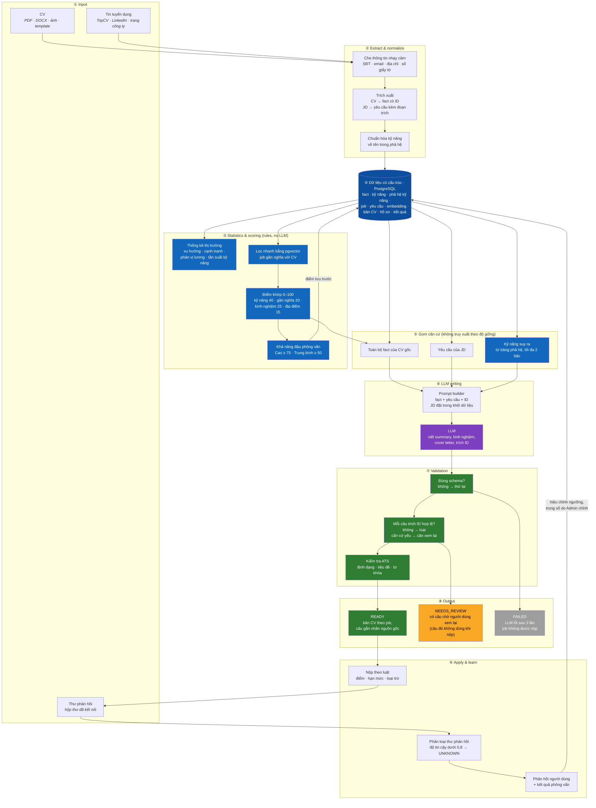
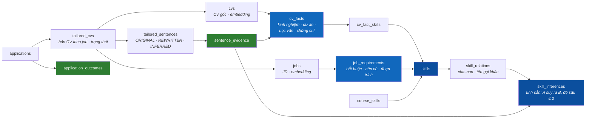

# AI Pipeline and Data for AI

> **Status:** Target design · Implements F02–F07 · Runs in the Automation Worker · Steps ②, ⑥, ⑦ live in the AI package `acaj_ai` ([C3.3](c4/03-component.md#c33-ai-package-acaj_ai))

Phần AI trả lời hai câu hỏi cho mỗi cặp CV và job: **job này hợp với bạn đến đâu** (điểm khớp và khả năng đậu phỏng vấn, tính bằng luật) và **CV nên viết thế nào cho job này** (LLM viết lại trên căn cứ có sẵn). LLM không bao giờ quyết định điểm hay quyết định nộp, và mọi câu nó viết vào CV phải trích được căn cứ.

Dữ liệu cho AI được lưu dạng **bảng quan hệ trong PostgreSQL**, cộng một **bảng phả hệ kỹ năng** và **pgvector** cho độ gần nghĩa. ACAJ không dùng knowledge graph hay RAG; lý do ở [mục 6](#6-decision-why-not-a-knowledge-graph-or-rag).

## 1. End-to-end flow — from input to output

| Step | What happens | Code (target) | Rules |
|---|---|---|---|
| ① Input | CV từ người dùng, JD từ nguồn tuyển dụng, thư từ hộp thư | `CV Management`, `Job Collector`, `Inbox Watcher` | BR-002, BR-003, BR-005 |
| ② Extract & normalize | Che dữ liệu, OCR, trích fact và yêu cầu kèm trích dẫn, chuẩn hóa kỹ năng, tạo embedding | `acaj_ai`: `PiiMasker`, `OcrEngine`, `CvExtractor`, `JdAnalyzer`, `SkillNormalizer`, `Embedder` | BR-008, BR-013, BR-015 |
| ③ Statistics & scoring | Thống kê thị trường bằng SQL; lọc job gần nghĩa bằng pgvector; tính điểm khớp và khả năng đậu phỏng vấn bằng công thức | `Market Statistics`, `Match Scorer` | BR-006, BR-007, BR-012 |
| ④ Structured data | Bảng quan hệ, phả hệ kỹ năng, embedding (mục 2) | Repositories | — |
| ⑤ Gom căn cứ | Lấy **toàn bộ** fact của CV, yêu cầu của JD và kỹ năng suy ra; mỗi mục có ID. CV và JD đủ nhỏ để đưa nguyên vào prompt | `CV Optimizer` → `acaj_ai.EvidenceBundle` | BR-008 |
| ⑥ LLM writing | Gửi căn cứ kèm ID; nhận câu đã viết lại có trích ID | `acaj_ai`: `CvTailor`, `LLMClient` | BR-013, BR-016 |
| ⑦ Validation | Kiểm schema, kiểm căn cứ từng câu, gắn nhãn, kiểm tra ATS | `acaj_ai`: `OutputSchemaValidator`, `GroundingValidator`, `AtsChecker` | BR-009, BR-010 |
| ⑧ Output | Lưu phiên bản CV theo job với trạng thái | `CV Optimizer` | BR-011 |
| ⑨ Apply & learn | Nộp theo luật; phân loại thư; phản hồi và kết quả được lưu để hiệu chỉnh | `Application Sender`, `Inbox Watcher`, `AI Feedback` | BR-014, BR-019, BR-022, BR-024 |

## 2. Data used by the AI

Tên bảng là đề xuất, sẽ chốt ở phần thiết kế database.

| Dữ liệu | Lưu ở | Dùng cho |
|---|---|---|
| Fact của CV | `cv_facts`, `cv_fact_skills` | Căn cứ để viết lại; mỗi câu trích ID fact |
| Phả hệ kỹ năng | `skills`, `skill_relations` | Chuẩn hóa tên kỹ năng ("ReactJS" → "React") |
| Kỹ năng suy ra | `skill_inferences`, tính lại khi phả hệ đổi | Tra một lần, không phải đi đệ quy mỗi lượt (BR-008) |
| Yêu cầu của JD | `job_requirements` (kèm `quote_start`, `quote_end`) | Chấm điểm kỹ năng; trích dẫn trong phân tích JD |
| Embedding | cột `embedding vector` trên `cvs`, `jobs` (pgvector) | Lọc nhanh job gần nghĩa; yếu tố "gần nghĩa" của điểm khớp |
| Câu đã viết và căn cứ | `tailored_sentences`, `sentence_evidence` | Hiển thị nhãn nguồn gốc và "Vì sao có câu này" |
| Kết quả hồ sơ | `applications`, `application_outcomes` | Hiệu chỉnh ngưỡng khả năng đậu phỏng vấn (BR-024) |
| Khóa học | `courses`, `course_skills` | Gợi ý lộ trình cho kỹ năng còn thiếu |

## 3. How each AI need is served

| Câu hỏi | Cách trả lời |
|---|---|
| Ứng viên có kỹ năng JD yêu cầu không? | `job_requirements.skill_id` có trong `cv_fact_skills` của ứng viên |
| Có suy ra được không? | Có dòng trong `skill_inferences` từ một kỹ năng ứng viên có tới kỹ năng JD cần, độ sâu ≤ 2 |
| Job nào nên chấm điểm? | pgvector lấy vài trăm job gần nghĩa nhất với CV, rồi `Match Scorer` tính điểm bằng công thức |
| Câu này dựa vào đâu? | `sentence_evidence` trỏ tới đúng một fact hoặc một dòng suy ra |
| Thiếu gì, học gì? | Yêu cầu không khớp và không suy ra được → skill gap; nối `course_skills` → khóa học |
| Thị trường thế nào? | Truy vấn SQL gom nhóm trên `jobs` và `job_requirements` |
| Khả năng đậu phỏng vấn có đúng không? | Gom `application_outcomes` theo mức Cao / Trung bình / Thấp để hiệu chỉnh ngưỡng |

## 4. Walkthrough — Backend Developer tại Công ty ABC

Đây là ví dụ hiển thị trên màn [Tối ưu CV cho từng job](../04-information-architecture.md#screen-inventory) của prototype.

1. **Input.** CV gốc có fact #2 "Backend Intern, Công ty GHI: xây dựng REST API cho hệ thống đặt hàng; viết truy vấn MySQL, tối ưu index". JD của Công ty ABC yêu cầu REST API, Node.js, SQL, Docker, CI/CD.
2. **Scoring.** pgvector đưa job này vào nhóm cần chấm. Kỹ năng 92, gần nghĩa 81, kinh nghiệm 78, địa điểm 100 → điểm khớp 86 → khả năng đậu phỏng vấn **Cao**. Điểm được lưu trước khi gọi LLM.
3. **Gom căn cứ.**
   - REST API, Node.js: có fact trực tiếp.
   - SQL: không có trong CV, nhưng `skill_inferences` có dòng `MySQL → SQL` (độ sâu 1) → được suy ra.
   - Docker, CI/CD: không có dòng suy ra nào → không thêm, đưa vào skill gaps.
   - Toàn bộ fact của CV cùng ba nhóm trên được đưa vào prompt.
4. **LLM writing.** Summary mới: "Lập trình viên backend mới tốt nghiệp, đã thực tập xây dựng REST API bằng Node.js cho hệ thống đặt hàng", trích fact #2 và fact dự án.
5. **Validation.**
   - Câu summary có căn cứ → `REWRITTEN`.
   - "SQL" → `INFERRED` qua `MySQL`.
   - Câu "Quen làm việc nhóm theo quy trình Agile" chỉ dựa vào "nhóm 3 người" → căn cứ yếu → **cần xem lại**, không dùng khi nộp.
   - Kiểm tra ATS đạt.
6. **Output và nộp.** Bản CV ở trạng thái `NEEDS_REVIEW` cho đúng một câu; các câu còn lại dùng được. Ở chế độ tự động, hồ sơ được nộp với bản không có câu chờ xem lại.
7. **Learn.** Công ty ABC gửi thư mời phỏng vấn → `ReplyClassifier` gắn `INTERVIEW` (0,93) → thư trả lời được soạn và chờ xác nhận. Kết quả được ghi vào `application_outcomes` để hiệu chỉnh mức "Cao".

## 5. Guarantees

| Bảo đảm | Cách thực hiện | Đo bằng |
|---|---|---|
| Không bịa công ty, bằng cấp, chứng chỉ | `GroundingValidator` chỉ chấp nhận câu trích fact hợp lệ | NFR-AI-003, NFR-AI-004 |
| Chỉ suy ra kỹ năng có kiểm soát | Kỹ năng suy ra phải có dòng trong `skill_inferences`, không để LLM tự đoán | BR-008, eval `hallucination` |
| Điểm không phụ thuộc LLM | `Match Scorer` chạy và lưu trước `CV Optimizer` | NFR-AI-007 |
| Không làm theo chỉ dẫn trong JD hay thư | JD/thư đặt trong khối dữ liệu; đầu ra phải đúng schema | NFR-AI-006 |
| Không lộ dữ liệu cá nhân cho LLM | `PiiMasker` che trước khi gọi, điền lại sau | NFR-PRIV-002 |
| Không gửi thư khi chưa xác nhận | Việc `SEND_REPLY` chỉ được tạo từ xác nhận của người dùng | BR-022 |
| Chất lượng đo được | Bộ eval trong `acaj_ai`, chạy stub trong CI và live khi đổi model hay prompt | NFR-MAINT-002 |

## 6. Decision: why not a knowledge graph or RAG

**Bối cảnh.** Phần AI cần: trích căn cứ cho từng câu, suy ra kỹ năng có kiểm soát, chấm điểm một CV với hàng nghìn job, và thống kê trên hàng trăm nghìn JD. Mỗi lần gọi LLM chỉ cần **một CV (1–3 trang) và một JD**, tức vài nghìn token.

| | **A. Bảng quan hệ + phả hệ + pgvector (chọn)** | B. RAG trên vector | C. Graph DB (Neo4j) | D. Chỉ dùng LLM |
|---|---|---|---|---|
| Hạ tầng | Chỉ PostgreSQL | PostgreSQL + pgvector | Thêm Neo4j, đồng bộ hai nơi | Ít nhất |
| Suy ra kỹ năng có kiểm soát | Có, bằng bảng | Không, chỉ dựa độ giống | Có | Không, LLM tự đoán |
| Trích căn cứ từng câu | Theo ID fact | Theo ID đoạn văn | Theo ID node | Khó kiểm chứng |
| Matching hàng nghìn job | Tốt | Tốt | Phải ghép thêm vector | Đắt, chậm |
| Thống kê thị trường | SQL làm tốt | Không hợp | Không hợp | Không hợp |
| Độ phức tạp | Thấp | Thấp | Cao | Thấp nhưng thiếu an toàn |

**Quyết định.** Chọn A. Dữ liệu cho mỗi lần viết lại đủ nhỏ để đưa nguyên vào prompt, nên không cần bước truy xuất. Phần duy nhất mang tính "đồ thị" là phả hệ kỹ năng, và nó chỉ là một bảng quan hệ cộng một bảng suy ra tính sẵn.

**Hệ quả.**

- Một database, một cách sao lưu, một cách truy vấn.
- Kiểm chứng căn cứ chỉ cần so ID, dễ viết test và eval.
- Muốn đổi luật suy ra (ví dụ 2 bậc thành 1 bậc) chỉ cần tính lại `skill_inferences`.

**Xem lại khi.** Cần gợi ý lộ trình nghề nhiều bước qua nhiều ngạch, hoặc phả hệ kỹ năng lên tới hàng trăm nghìn quan hệ có trọng số. Khi đó có thể chuyển riêng phần phả hệ sang graph database mà không đụng tới phần còn lại.
