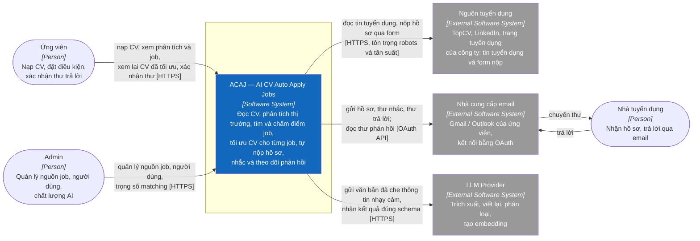

# C1 — System Context

> **Purpose:** cho thấy ai dùng ACAJ, ACAJ nói chuyện với hệ thống bên ngoài nào và chịu trách nhiệm gì, chưa nói tới công nghệ.

## System Boundary

ACAJ chịu trách nhiệm: tài khoản và phân quyền; nhập, tạo và lưu CV; phân tích thị trường; thu thập, phân tích và chấm điểm job; tối ưu CV và cover letter cho từng job; tự nộp hồ sơ theo điều kiện người dùng; nhắc nhà tuyển dụng; phân loại thư phản hồi và soạn thư trả lời; phản hồi về chất lượng AI; quản trị.

Ngoài ranh giới:

- **Nguồn tuyển dụng** vẫn sở hữu tin tuyển dụng; ACAJ chỉ đọc bản sao và nộp hồ sơ qua kênh công khai. ACAJ không vượt CAPTCHA hay đăng nhập thay người dùng trên trang đích (BR-020).
- **Nhà cung cấp email** là hộp thư của chính ứng viên. ACAJ chỉ xin quyền gửi và đọc thư liên quan tới hồ sơ ứng tuyển (NFR-SEC-006).
- **LLM Provider** chỉ đọc hiểu và viết văn bản từ dữ liệu đã che thông tin nhạy cảm. Nó không tính điểm khớp, không quyết định nộp hồ sơ hay gửi thư (BR-012, BR-015).
- **Nhà tuyển dụng** không đăng nhập ACAJ; mọi trao đổi đi qua email.

## People and External Systems

| Element | Type | Interaction |
|---|---|---|
| Ứng viên | Person | Nạp CV một lần, đặt điều kiện (hoặc giữ mặc định), xem phân tích và job, xem lại CV đã tối ưu, xác nhận thư trả lời |
| Admin | Person | Bật/tắt nguồn job, quản lý người dùng, xem chất lượng và chi phí AI, chỉnh trọng số matching |
| Nhà tuyển dụng | Person | Nhận hồ sơ và thư nhắc, trả lời qua email |
| Nguồn tuyển dụng | External system | Cung cấp tin tuyển dụng; nhận hồ sơ qua form công khai |
| Nhà cung cấp email | External system | Gửi và nhận thư thay mặt ứng viên qua OAuth |
| LLM Provider | External system | Nhận văn bản đã che, trả về kết quả trích xuất, văn bản viết lại, nhãn phân loại, embedding |

**Next:** zoom vào Software System → [C2 — Container](02-container.md).

**Sources of truth:** `docs/01-scope.md`, `docs/03-use-cases.md`, `docs/requirements/business-rules.md`.
