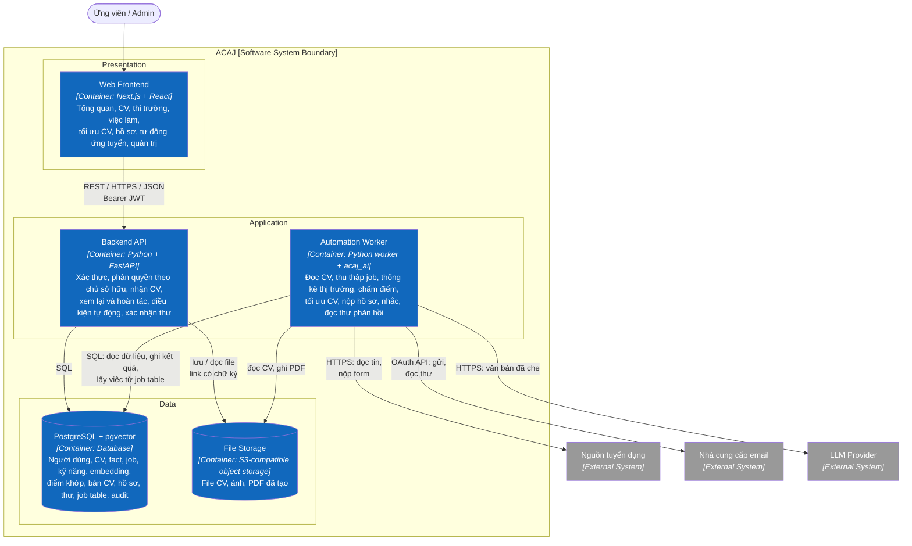

# C2 — Container

> **Purpose:** cho thấy các khối chạy tạo nên ACAJ và cách chúng giao tiếp.

## Responsibilities

| Container | Technology (proposed) | Responsibility | Status |
|---|---|---|---|
| Web Frontend | Next.js (App Router), React, TypeScript | Giao diện theo [IA](../../04-information-architecture.md), route guard, bảng, form, biểu đồ; hiển thị trạng thái tác vụ AI | Not started |
| Backend API | Python, FastAPI, Pydantic, SQLAlchemy, REST/JSON | Ranh giới tin cậy: xác thực, kiểm tra chủ sở hữu dữ liệu, validation, nhận file CV, đọc kết quả, sửa và hoàn tác, điều kiện tự động, xác nhận thư trả lời, phản hồi AI, quản trị; ghi việc vào job table | Not started |
| Automation Worker | Python worker (cùng codebase với API), package `acaj_ai`, Playwright, OAuth client cho Gmail/Outlook | Chạy theo lịch và theo yêu cầu: đọc CV, thu thập và phân tích JD, thống kê thị trường, chấm điểm, tối ưu CV, nộp hồ sơ, nhắc, đọc và phân loại thư; mọi lời gọi ra ngoài nằm ở đây | Not started |
| PostgreSQL + pgvector | PostgreSQL, extension pgvector | Dữ liệu bền vững, embedding của CV và JD, phả hệ kỹ năng, job table, audit | Not started |
| File Storage | Object storage tương thích S3 (thư mục ngoài web root khi chạy local) | File CV, ảnh chụp CV, PDF CV và cover letter đã tạo; truy cập bằng link có chữ ký hết hạn sau 15 phút | Not started |

Python được chọn cho toàn bộ backend vì phần AI (OCR, trích xuất, embedding, gọi LLM, thống kê) có thư viện tốt nhất trên Python. Backend API và Automation Worker dùng chung một codebase, chung domain model và tầng database; chúng chỉ khác điểm khởi chạy. Phần gọi LLM và kiểm chứng đầu ra nằm trong package riêng `acaj_ai` để test và eval được độc lập.

## Architecture Rules

- Web Frontend không bao giờ gọi trực tiếp database, worker, LLM, nguồn job hay email; Backend API là cửa vào duy nhất.
- Kiểm tra chủ sở hữu dữ liệu nằm ở Backend API; frontend chỉ ẩn nút (BR-001).
- Backend API và Automation Worker giao tiếp qua PostgreSQL (job table), không dùng message broker. Ví dụ: người dùng nạp CV → API lưu file và ghi việc `PARSE_CV`; worker lấy việc và xử lý. V1 chỉ có hai service triển khai và một database.
- **Chỉ Automation Worker** gọi ra ngoài (LLM, nguồn job, email). Backend API không chờ LLM trong request; mọi tác vụ AI có trạng thái `PENDING` → `READY` / `NEEDS_REVIEW` / `FAILED`.
- Thông tin nhạy cảm được che trước khi gửi LLM (BR-015). Token hộp thư được mã hóa khi lưu (NFR-SEC-006).
- Điểm khớp, thống kê thị trường, quyết định nộp hồ sơ và lịch nhắc do luật tính và được lưu trước mọi lời gọi LLM liên quan; LLM lỗi không làm thay đổi chúng (BR-012).
- Thư trả lời nhà tuyển dụng chỉ được gửi khi có bản ghi xác nhận của người dùng do Backend API tạo (BR-022).
- Người dùng xác thực bằng JWT; worker gọi email bằng token OAuth của chính người dùng đó.

**Next:** zoom vào các container ứng dụng → [C3 — Component](03-component.md).
