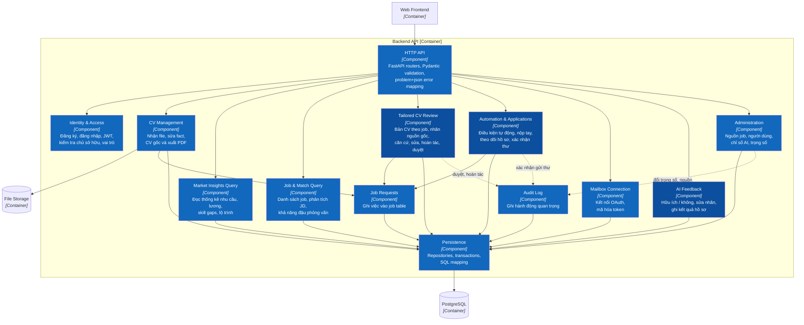
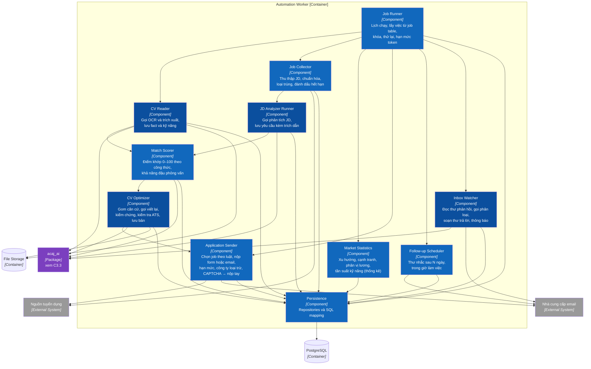
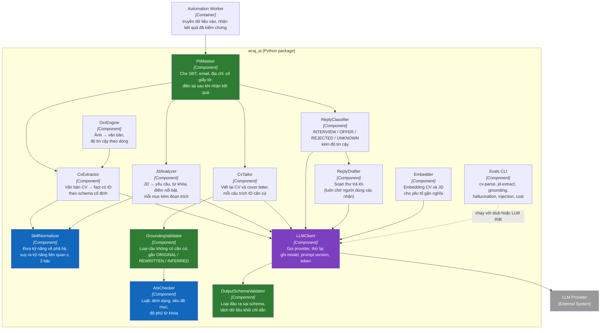

# C3 — Component

> **Purpose:** cho thấy hai container ứng dụng (Backend API, Automation Worker) và AI package `acaj_ai` được chia thành những thành phần nào.

## C3.1 Backend API

## C3.2 Automation Worker

Màu xanh đậm là thành phần có gọi AI; xanh thường là luật, thống kê hoặc tích hợp.

## C3.3 AI package `acaj_ai`

`acaj_ai` không bao giờ chạm database hay gọi email, nguồn job. Worker truyền dữ liệu vào và lưu kết quả đã kiểm chứng; nhờ vậy package test được độc lập và chạy eval trong CI với LLM giả lập (NFR-MAINT-002). Màu xanh lá là các lớp bảo vệ: che dữ liệu, kiểm tra schema, kiểm chứng căn cứ.

## Component catalog

| Container | Component | Responsibility | Features / use cases |
|---|---|---|---|
| Backend API | HTTP API | Endpoint, validation, ánh xạ lỗi | Tất cả |
| Backend API | Identity & Access | Đăng ký, đăng nhập, JWT, kiểm tra chủ sở hữu và vai trò | F01 · UC01, UC02 |
| Backend API | CV Management | Nhận file CV, sửa fact, CV gốc, xuất PDF | F02 · UC03–UC06 |
| Backend API | Market Insights Query | Đọc thống kê đã tính sẵn cho SCR-20 | F03 · UC07–UC10 |
| Backend API | Job & Match Query | Danh sách job, phân tích JD, khả năng đậu phỏng vấn, giá trị từng yếu tố | F04 · UC12, UC13 |
| Backend API | Tailored CV Review | Bản CV theo job, nhãn nguồn gốc, căn cứ, sửa, hoàn tác, duyệt (chế độ duyệt trước) | F05 · UC14–UC16 |
| Backend API | Automation & Applications | Điều kiện tự động, nộp tay, theo dõi hồ sơ, xác nhận thư trả lời | F06 · UC17, UC18, UC20, UC21 |
| Backend API | Mailbox Connection | Kết nối OAuth, lưu token mã hóa | F06 · tiền đề UC18–UC20 |
| Backend API | AI Feedback | Ghi phản hồi về kết quả AI | F07 · UC23 |
| Backend API | Administration | Nguồn job, người dùng, chỉ số AI, trọng số matching | F07 · UC22, UC24 |
| Backend API | Job Requests | Ghi việc `PARSE_CV`, `OPTIMIZE_CV`, `SEND_REPLY`… vào job table | Tất cả tác vụ nền |
| Backend API | Audit Log | Ghi đăng nhập, xác nhận thư, duyệt, hoàn tác, đổi cấu hình | Tất cả |
| Automation Worker | Job Runner | Chạy việc theo lịch và theo yêu cầu, khóa, thử lại, hạn mức | Tất cả tác vụ nền |
| Automation Worker | CV Reader | Gọi OCR và trích xuất, lưu fact và kỹ năng chuẩn hóa | F02 · UC03, UC04, UC06 |
| Automation Worker | Job Collector | Thu thập, chuẩn hóa, loại trùng, hết hạn | F04.1 · UC11 |
| Automation Worker | JD Analyzer Runner | Phân tích JD, lưu yêu cầu kèm trích dẫn | F04.2 · UC13 |
| Automation Worker | Market Statistics | Thống kê nhu cầu, cạnh tranh, lương, kỹ năng (không dùng LLM cho con số) | F03 · UC07–UC10 |
| Automation Worker | Match Scorer | Điểm khớp theo công thức, khả năng đậu phỏng vấn | F04.3 · UC12 |
| Automation Worker | CV Optimizer | Gom căn cứ, gọi viết lại, kiểm chứng, ATS, lưu bản CV | F05 · UC14–UC16 |
| Automation Worker | Application Sender | Chọn job theo luật, nộp, hạn mức, loại trừ, chuyển nộp tay | F06.2 · UC17, UC18 |
| Automation Worker | Follow-up Scheduler | Thư nhắc theo lịch | F06.3 · UC19 |
| Automation Worker | Inbox Watcher | Đọc phản hồi, phân loại, soạn thư, thông báo | F06.4 · UC20 |
| acaj_ai | PiiMasker, OcrEngine, CvExtractor, JdAnalyzer, SkillNormalizer, Embedder | Đọc hiểu đầu vào | F02, F04 |
| acaj_ai | CvTailor, GroundingValidator, AtsChecker | Viết lại có căn cứ và kiểm tra | F05 |
| acaj_ai | ReplyClassifier, ReplyDrafter | Phân loại và soạn thư | F06.4 |
| acaj_ai | OutputSchemaValidator, LLMClient, Evals CLI | An toàn đầu ra, truy vết, đo chất lượng | F07 · NFR-AI |

## Dependency Flow

- **Backend API:** HTTP API → thành phần tính năng → Persistence → PostgreSQL. Thành phần tính năng (module) gọi nhau chỉ qua service của module sở hữu dữ liệu, không đọc repository hay bảng của nhau; việc cần chạy nền thì ghi vào job table qua Job Requests.
- **Automation Worker:** Job Runner → CV Reader / Job Collector → JD Analyzer Runner → Match Scorer → CV Optimizer → Application Sender → Follow-up Scheduler / Inbox Watcher → Persistence.
- Match Scorer chạy xong và lưu điểm trước khi CV Optimizer gọi LLM, nên điểm khớp không phụ thuộc LLM (BR-012).
- Application Sender chỉ nộp khi bản CV của job ở trạng thái `READY` và job thỏa điều kiện người dùng (BR-019). LLM lỗi thì job đó không được nộp, các job khác vẫn chạy.
- Inbox Watcher chỉ soạn thư; việc gửi thư trả lời là một việc `SEND_REPLY` riêng, chỉ được tạo khi Backend API ghi nhận xác nhận của người dùng (BR-022).
