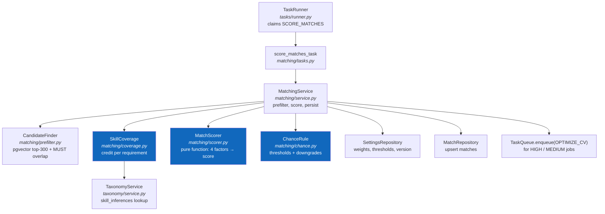
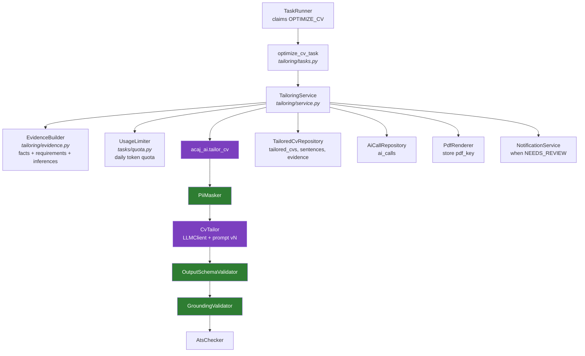

# C4 Level 4 — Code

> **Purpose:** cho thấy các lớp Python cộng tác thế nào trong hai tính năng cốt lõi: **Matching** (luật, không LLM) và **Tối ưu CV cho từng job** (LLM có kiểm chứng). Cả hai chạy trong Automation Worker; người dùng đọc kết quả qua Backend API.

Tên lớp là thiết kế mục tiêu, nằm trong các module FastAPI ([folder structure](../../07-folder-structure.md#3-backend--fastapi-one-codebase-for-api-and-worker)) và package `acaj_ai`. Chi tiết thuộc tính và phương thức: [class diagrams](../uml/01-class-diagrams.md).

## L4.1 Matching

- `MatchScorer` và `ChanceRule` là hàm thuần: cùng đầu vào luôn cho cùng kết quả, không I/O, không LLM. Test đơn vị bao phủ ≥ 90% (NFR-MAINT-001).
- `MatchingService` ghi điểm trước rồi mới tạo việc `OPTIMIZE_CV`, nên điểm không phụ thuộc LLM (BR-012).

## L4.2 CV tailoring

- `EvidenceBuilder` chỉ đưa vào bundle các dòng `skill_inferences` thật, nên LLM không thể "suy ra" kỹ năng ngoài phả hệ (BR-008).
- Mọi kết quả, kể cả `FAILED`, đều ghi `ai_calls` để tính hạn mức và chi phí (BR-016).
- Bản CV `NEEDS_REVIEW` vẫn được lưu; câu chờ xem lại bị bỏ khi xuất PDF gửi đi.
