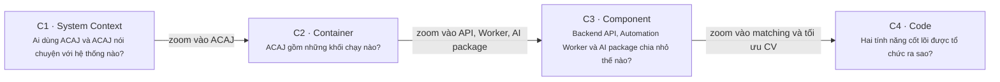

# C4 Model — ACAJ

> **Status:** Target design · **Audience:** developers, reviewers, and mentors

Tài liệu đi từ ngoài vào trong. Mỗi node có **tên**, **loại** (`Person`, `Software System`, `Container`, `Component`), công nghệ khi cần, và một mô tả ngắn.

| Level | Document | Scope |
|---|---|---|
| C1 | [System Context](01-system-context.md) | Ứng viên, Admin, nhà tuyển dụng, nguồn job, nhà cung cấp email, LLM provider |
| C2 | [Container](02-container.md) | Web Frontend, Backend API, Automation Worker, PostgreSQL, File Storage |
| C3 | [Component](03-component.md) | Thành phần bên trong Backend API, Automation Worker và AI package `acaj_ai` |
| C4 | Code (phần 6, chưa viết) | Lớp Python cho Matching và Tối ưu CV |

Luồng AI từ đầu vào đến đầu ra, dữ liệu AI dùng và lý do không dùng knowledge graph nằm ở [AI Pipeline and Data for AI](../ai-pipeline.md).

## Implementation Status

Chưa có container nào được cài đặt. Các sơ đồ mô tả **kiến trúc mục tiêu**; công nghệ ở C2 là đề xuất.
