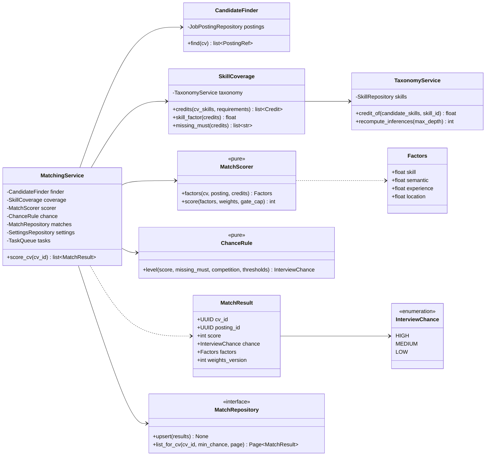
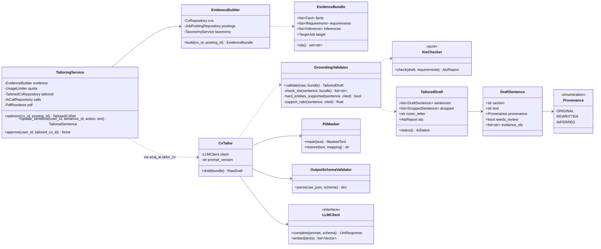
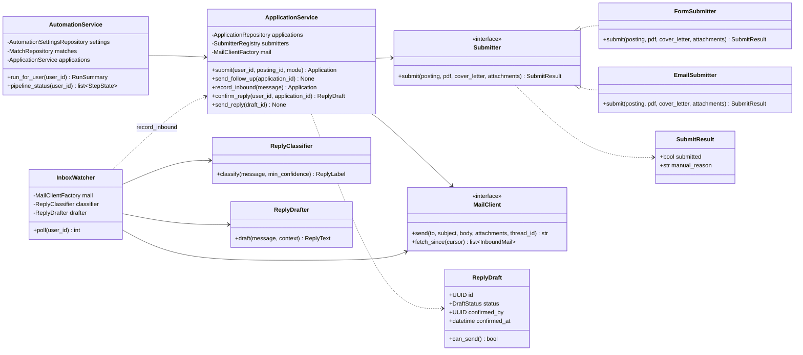

# Class diagrams

> **Status:** Target design · Python classes inside the FastAPI modules and `acaj_ai`

Ba sơ đồ dưới đây phủ ba phần quan trọng nhất: **Matching**, **Tối ưu CV cho từng job**, và **Tự động ứng tuyển và thư phản hồi**. Repository và client bên ngoài là interface (`Protocol`); implementation được gắn ở `core/container.py`, test thay bằng bản giả ([folder structure](../../07-folder-structure.md#rules)).

## 1. Matching

## 2. CV tailoring

## 3. Automation and replies

`ReplyDraft.can_send()` trả `true` chỉ khi `status = CONFIRMED` và có `confirmed_by`, `confirmed_at`. Database có ràng buộc tương ứng ([checks.sql](../../database/checks.sql)), nên kể cả code sai cũng không ghi được `SENT` khi chưa xác nhận (BR-022).

## Mapping boundaries

| Layer | Kiểu dữ liệu | Ghi chú |
|---|---|---|
| API (`schemas.py`) | Pydantic, khớp [openapi.yaml](../../api/openapi.yaml) | camelCase ra ngoài |
| Service | Dataclass / Pydantic nội bộ (`MatchResult`, `TailoredDraft`) | Không lộ ORM ra ngoài service |
| Repository | SQLAlchemy model trong `models.py` | Khớp [acaj.dbml](../../database/acaj.dbml) |
| `acaj_ai` | Pydantic bất biến (`EvidenceBundle`, `Result`) | Không biết tới ORM hay database |
