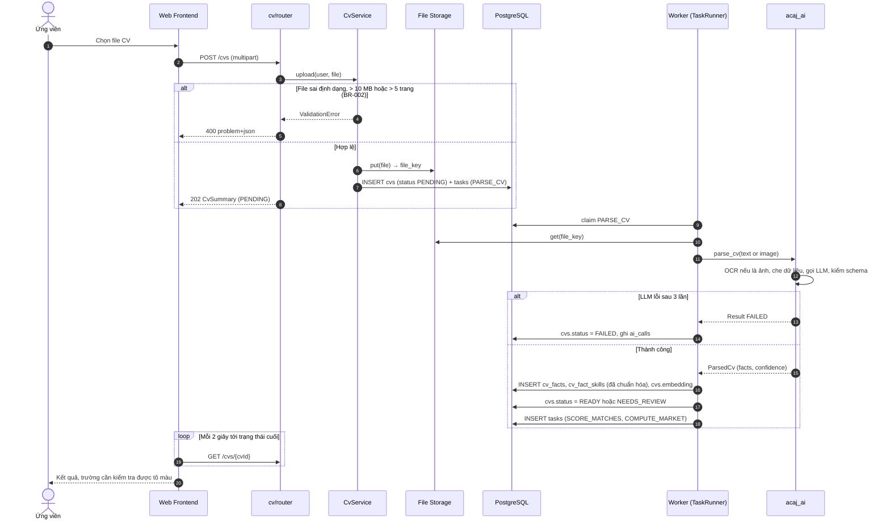
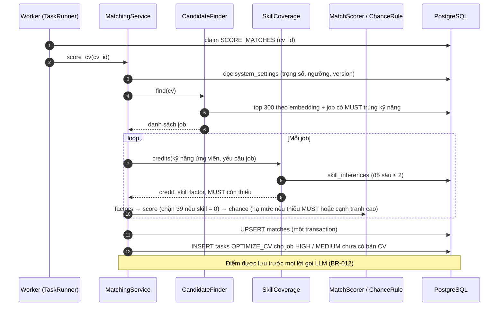
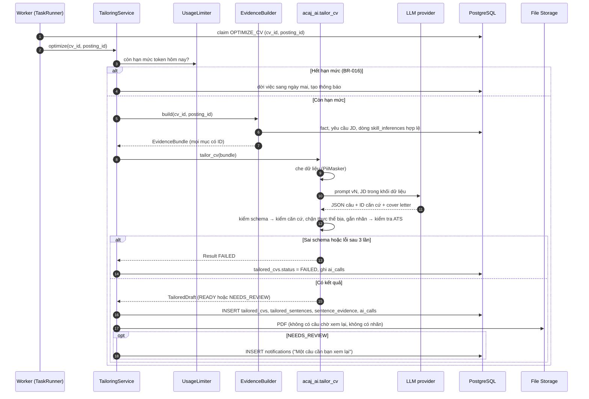
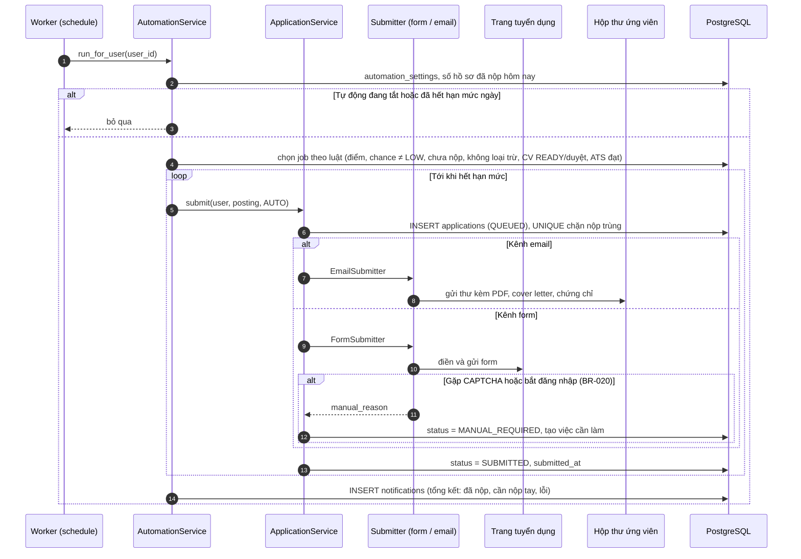
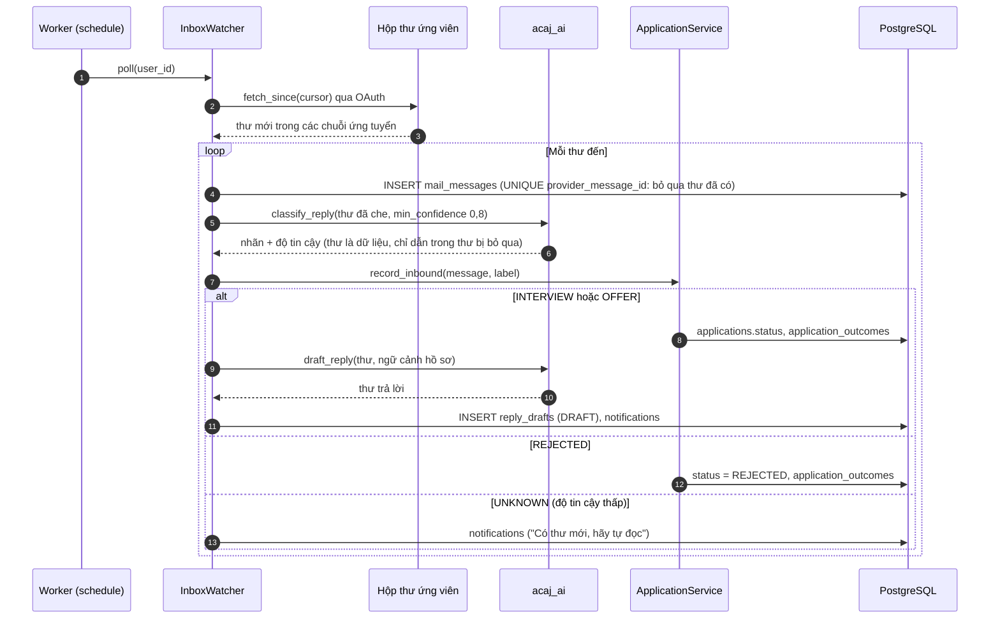
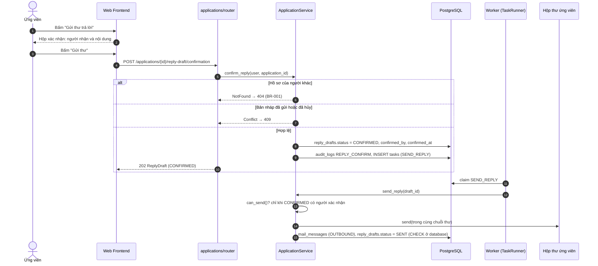
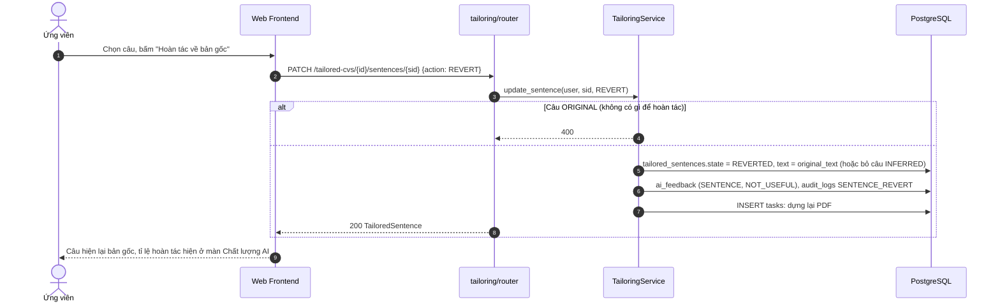

# Sequence diagrams

> **Status:** Target design

Bảy luồng chạy chính, mỗi luồng nối use case và thao tác OpenAPI với router, service, `acaj_ai`, repository, database và các nhánh lỗi. API chỉ ghi việc vào bảng `tasks`; worker lấy việc bằng `FOR UPDATE SKIP LOCKED` ([data model](../../06-data-model.md#task-table)).

| # | Flow | Trigger | Use case |
|---|---|---|---|
| 1 | Nạp CV và AI đọc CV | `POST /cvs` | UC03, UC04 |
| 2 | Chấm điểm job | Việc `SCORE_MATCHES` | UC12 |
| 3 | Tối ưu CV cho một job | Việc `OPTIMIZE_CV` | UC14–UC16 |
| 4 | Tự động nộp hồ sơ | Việc `SUBMIT_APPLICATION` theo lịch | UC18 |
| 5 | Đọc thư phản hồi | Việc `POLL_INBOX` theo lịch | UC20 |
| 6 | Xác nhận và gửi thư trả lời | `POST /applications/{id}/reply-draft/confirmation` | UC20 |
| 7 | Hoàn tác một câu đã tối ưu | `PATCH /tailored-cvs/{id}/sentences/{sid}` | UC15, UC23 |

## 1. Upload CV and AI extraction

## 2. Score matches

## 3. Optimize the CV for one job

## 4. Automatic application run

## 5. Inbox polling and reply classification

## 6. Confirm and send a reply

## 7. Revert one tailored sentence

